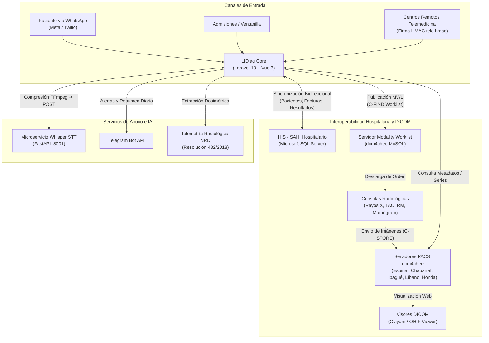

# LIDiag — Sistema Integral de Gestión de Imágenes Diagnósticas y Telemedicina

[](https://laravel.com)
[](https://php.net)
[](https://vuejs.org)
[](https://vitejs.dev)
[](https://mysql.com)
[](https://microsoft.com/sql-server)
[](https://www.dicomstandard.org/)

**LIDiag** es una plataforma médica de nivel empresarial diseñada para la gestión clínica, adquisición, procesamiento, interpretación diagnóstica y entrega de resultados de imágenes médicas y consultas especializadas. Integra en un único ecosistema el flujo completo de atención: desde la solicitud de citas multicanal (WhatsApp Bot / Portal) y la admisión con Modality Worklist (DICOM MWL), hasta el dictado con inteligencia artificial (Whisper STT), la firma digital de consentimientos informados, el control de radioprotección (Resolución 482 de 2018) y la sincronización bidireccional con el sistema de información hospitalaria (**SAHI**) y servidores **PACS** multisede.

---

## 1. Guía Rápida de Despliegue Local (TL;DR)

El proyecto está diseñado para ejecutarse en entornos **Windows + Laragon** sobre el host virtual seguro **`https://lidiag.test`**.

```bash
# 1. Dependencias backend y frontend
composer install
npm install

# 2. Configuración de entorno
copy .env.example .env     # En PowerShell: Copy-Item .env.example .env
php artisan key:generate

# 3. Base de datos y enlaces simbólicos
php artisan migrate
php artisan db:seed
php artisan storage:link

# 4. Compilación frontend en desarrollo
npm run dev
```

### 1.1 Credenciales por Defecto de Desarrollo
- **URL Local:** `https://lidiag.test`
- **Usuario:** `administrador@administrador.com`
- **Contraseña:** `123456`

### 1.2 Túnel Cloudflare para Desarrollo (Webhook de WhatsApp)
Meta WhatsApp requiere un endpoint HTTPS con certificado público reconocido para despachar webhooks. En desarrollo local se utiliza [cloudflared](https://developers.cloudflare.com/cloudflare-one/connections/connect-networks/):

```bash
cloudflared tunnel --url http://lidiag.test
```

Configuración en Meta Developers:
- **Callback URL:** `https://<subdominio>.trycloudflare.com/api/citas/webhook`
- **Verify Token:** `lidiag_whatsapp_2026` (o el valor de `META_WHATSAPP_VERIFY_TOKEN` en `.env`)

---

## 2. Stack Tecnológico

| Capa | Tecnologías y Librerías | Propósito en LIDiag |
|---|---|---|
| **Backend** | **Laravel 13** (PHP >= 8.4) | Framework MVC de alto rendimiento con tipos estrictos, inyección de dependencias y servicios desacoplados. |
| **Frontend** | **Vue 3** (Composition API `<script setup>`), **Vite** | Interfaz SPA reactiva, modular y optimizada integrada con el tema AdminWrap. Bus de eventos global con **Mitt** (`proxy.emitter`). |
| **Bases de Datos** | **MySQL 8.0** & **Microsoft SQL Server** | MySQL como base de datos primaria transaccional y de PACS. SQL Server (`ESP_PRI` mediante extensiones `sqlsrv`/`pdo_sqlsrv`) para interoperabilidad con HIS SAHI. |
| **Control de Acceso** | **Spatie Laravel-Permission ^6** | Roles y permisos granulares (RBAC), caché de autorizaciones y políticas de seguridad. |
| **Autenticación** | **Laravel Sanctum** | Autenticación stateful basada en cookies de sesión para la SPA y tokens personales para APIs externas. |
| **Estándares Médicos** | **DICOM 3.0**, **Dcm4chee**, **Oviyam**, **OHIF Viewer** | Modality Worklist (MWL C-FIND), visor web Oviyam, estación de trabajo OHIF Viewer y servidor PACS multisede. |
| **Inteligencia Artificial / STT** | **FastAPI** + **Whisper** (OpenAI), **FFmpeg** | Microservicio local de transcripción de voz a texto en `http://localhost:8001`, con conversión de audios a MP3 64kbps mono. |
| **Dosimetría y Radioprotección** | **pydicom**, Scripting Python | Extracción edge de telemetría de radiación (`CTDIvol`, `DLP`, `DGM`, `DAP`) conforme a la Res. 482 de 2018 (Colombia). |
| **Documentos y Reportes** | **DomPDF**, **PhpSpreadsheet** / **Maatwebsite Excel** | Generación de historias clínicas en PDF con código QR y reportes analíticos multi-hoja en Excel. |
| **Mensajería y Notificaciones** | **Twilio**, **Meta WhatsApp Cloud API**, **Telegram Bot API** | Agendamiento automático por WhatsApp, recordatorios preventivos y bot de alertas operativas en Telegram. |

---

## 3. Arquitectura Global e Interoperabilidad



---

## 4. Catálogo Modular de la Documentación

Para garantizar una documentación limpia, escalable y detallada por área de especialidad, la especificación de cada módulo se encuentra organizada en archivos independientes dentro de [`docs/READMES/`](file:///c:/laragon/www/lidiag/docs/READMES/):

| Módulo | Documentación Específica | Resumen Funcional |
|---|---|---|
| 📋 **Estudios Radiológicos** | [README-Estudios.md](file:///c:/laragon/www/lidiag/docs/READMES/README-Estudios.md) | Gestión del flujo de alta complejidad (RX, TAC, Resonancia, Mamografía), dictado con Whisper STT, bloqueos concurrentes (`EstudioLockService`), plantillas y entrega de informes. |
| 🩺 **Ecografías y Consentimientos** | [README-Ecografias.md](file:///c:/laragon/www/lidiag/docs/READMES/README-Ecografias.md) | Admisiones particulares/cortesía/SAHI, consentimientos informados con firma táctil digitalizada por token público, autoguardado de borrador (60s) y transmisión hospitalaria. |
| 👁️ **Oftalmología** | [README-Oftalmologia.md](file:///c:/laragon/www/lidiag/docs/READMES/README-Oftalmologia.md) | Historia clínica oftálmica en 2 etapas: triaje/admisión y consulta clínica especializada con examen ocular binocular OD/OI (Agudeza Visual, PIO, Biomicroscopía), órdenes médicas, remisiones e incapacidades. |
| 📅 **Agenda y Citas Médicas** | [README-Agenda-Citas.md](file:///c:/laragon/www/lidiag/docs/READMES/README-Agenda-Citas.md) | Programación de citas por profesional y sala, bot de WhatsApp para radicación digital de órdenes médicas, tablero Kanban diario y recordatorios desatendidos vía cron (24h y 2h antes). |
| 🗂️ **Pacientes y DICOM Worklist (MWL)** | [README-Pacientes-Worklist.md](file:///c:/laragon/www/lidiag/docs/READMES/README-Pacientes-Worklist.md) | Admisión centralizada de pacientes y publicación en listas de trabajo Modality Worklist (DICOM PS 3.4) para alimentar consolas radiológicas sin digitación manual de tecnólogos. |
| 🖥️ **PACS y Visores DICOM** | [README-PACS-Visores.md](file:///c:/laragon/www/lidiag/docs/READMES/README-PACS-Visores.md) | Conexión dinámica a servidores `dcm4chee` multisede, integración transparente con visores web Oviyam y estación diagnóstica avanzada OHIF Viewer (MPR/3D). |
| 🌐 **Interoperabilidad SAHI y Tele-Radiología** | [README-Interoperabilidad-TeleRadiologia.md](file:///c:/laragon/www/lidiag/docs/READMES/README-Interoperabilidad-TeleRadiologia.md) | Pasarela bidireccional con HIS SAHI (SQL Server `ESP_PRI`) y red de Tele-Radiología segura autenticada mediante firmas criptográficas HMAC (`tele.hmac`) para hospitales satélites. |
| ☢️ **Control de Radiación y Dosimetría** | [README-Dosimetria.md](file:///c:/laragon/www/lidiag/docs/READMES/README-Dosimetria.md) | Extracción automatizada de dosis radiológica (`CTDIvol`, `DLP`, `DGM`, `DAP`) desde cabeceras DICOM para control de Niveles de Referencia para Diagnóstico (NRD) bajo la Res. 482 de 2018. |
| 📑 **Contratación y Tarifarios** | [README-Contratacion.md](file:///c:/laragon/www/lidiag/docs/READMES/README-Contratacion.md) | Parametrización de acuerdos comerciales con EPS, ARL y aseguradoras, con liquidación dinámica bajo manuales SOAT, ISS 2001 o tarifas particulares personalizadas. |
| 💰 **Liquidación y Productividad** | [README-Liquidacion-Productividad.md](file:///c:/laragon/www/lidiag/docs/READMES/README-Liquidacion-Productividad.md) | Cálculo automático de honorarios médicos por lectura, cruce financiero con facturación hospitalaria y analítica de productividad y tiempos de respuesta médica (TAT). |
| 📊 **Reportes y Business Intelligence** | [README-Reportes.md](file:///c:/laragon/www/lidiag/docs/READMES/README-Reportes.md) | Exportación multi-hoja en Excel de producción asistencial, conciliación de estudios en servidores PACS, tiempos de oportunidad diagnóstica y reportes de ausentismo. |
| 🎧 **Helpdesk y Mesa de Ayuda** | [README-Helpdesk.md](file:///c:/laragon/www/lidiag/docs/READMES/README-Helpdesk.md) | Sistema de radicación y seguimiento de incidentes técnicos en equipos radiológicos, redes y estaciones de trabajo médicas, con soporte de archivos adjuntos y niveles de prioridad. |
| 🔐 **Seguridad, Roles y Auditoría** | [README-Seguridad-Auditoria.md](file:///c:/laragon/www/lidiag/docs/READMES/README-Seguridad-Auditoria.md) | Matriz RBAC Spatie, activación de cuentas por correo electrónico con tokens firmados, bitácora forense inmutable (`audit_logs`) y monitoreo de salud de copias de seguridad. |
| ⚙️ **Configuración y Parametrización** | [README-Configuracion.md](file:///c:/laragon/www/lidiag/docs/READMES/README-Configuracion.md) | Catálogos maestros de sedes físicas, portafolio CUPS, diagnósticos CIE-10, plantillas clínicas predefinidas, prioridades y configuración de bots de mensajería. |
| 🤖 **Telegram y Notificaciones** | [README-Telegram-Notificaciones.md](file:///c:/laragon/www/lidiag/docs/READMES/README-Telegram-Notificaciones.md) | Bot institucional de Telegram para alertas de infraestructura crítica, ejecución de comandos directivos y envío automatizado del resumen diario de producción (Daily Digest). |

---

## 5. Comandos de Consola y Tareas Programadas

El sistema dispone de comandos Artisan personalizados (`app/Console/Commands/`) para la administración y automatización operativa:

- **Sincronización Asistencial:**
  - `php artisan sync-usuarios`: Sincroniza usuarios y médicos desde SAHI hacia LIDiag.
  - `php artisan sync:dicom-ecografias`: Vincula capturas DICOM locales de ecógrafos al PACS.
  - `php artisan estudios:sahi-reconcile`: Reconcilia y retransmite estudios leídos pendientes de entrega a SAHI.
  - `php artisan worklist:reconcile`: Concilia órdenes de trabajo abiertas contra imágenes recibidas.
- **Notificaciones y Citas:**
  - `php artisan citas:notificar`: Despacha recordatorios de citas con 24 horas de antelación vía WhatsApp.
  - `php artisan citas:notificar-2h`: Envía avisos urgentes con 2 horas de anticipación.
  - `php artisan telegram:daily-digest`: Compila y envía el informe diario de producción a directivos.
  - `php artisan telegram:poll`: Mantiene activo el bot de Telegram en modo Long-Polling.
- **Dosimetría y Radioprotección:**
  - `php artisan dosimetria:sync-estudios`: Extrae métricas dosimétricas de estudios de Tomografía.
  - `php artisan dosimetria:sync-mamografia`: Extrae y calcula la Dosis Glandular Media (DGM) de mamografías.
- **Mantenimiento y Seguridad:**
  - `php artisan permissions:audit`: Audita la coherencia entre rutas, controladores y permisos Spatie.
  - `php artisan sync:missing-permissions`: Siembra permisos pendientes de forma no destructiva.
  - `php artisan permissions:cache-reset`: Resetea de forma segura la caché de Spatie evitando excepciones de archivo.
  - `php artisan lidiag:backup`: Genera volcado de respaldo de la base de datos principal.

---

## 6. Estándares de Desarrollo y Calidad de Código

- **Estilo PHP:** Laravel Pint estrictamente con finales de línea **LF** y comillas dobles (`vendor\bin\pint.bat`).
- **Análisis Estático:** Larastan / PHPStan nivel 5 verificado (`phpstan.neon`).
- **Frontend:** ESLint flat config (`eslint.config.js`) y Prettier. Todo cambio en archivos `.vue` debe compilar exitosamente con `npm run build`.
- **Estructura Documental:** Los estándares de controladores se encuentran especificados en [`docs/CONTROLLERS.md`](file:///c:/laragon/www/lidiag/docs/CONTROLLERS.md) y los estándares de codificación en [`docs/CODING_STANDARDS.md`](file:///c:/laragon/www/lidiag/docs/CODING_STANDARDS.md).
