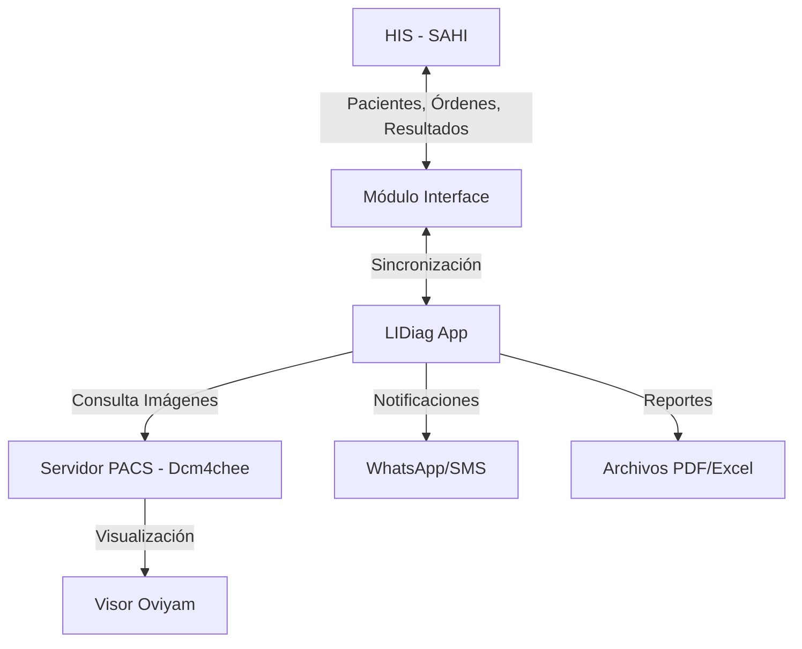

# LIDiag - Sistema de Gestión de Imágenes Diagnósticas

LIDiag es una plataforma integral diseñada para la gestión, procesamiento y lectura de imágenes diagnósticas. Facilita el flujo de trabajo desde la asignación de citas hasta la entrega de resultados a la historia clínica, integrándose con sistemas PACS y HIS (Hospital Information System).

## Arquitectura y Flujo de Datos

El siguiente diagrama ilustra cómo interactúa LIDiag con los sistemas externos:



---

## Módulos del Sistema

La aplicación está compuesta por los siguientes módulos especializados:

### 1. Agendamiento

**Propósito:** Gestión de la carga de trabajo médica.

-   Permite la asignación de estudios radiológicos a los médicos radiólogos para su lectura e interpretación.
-   Facilita la distribución equitativa y organizada de los estudios pendientes.

### 2. Citas

**Propósito:** Gestión de la atención al paciente.

-   Módulo dedicado a la programación y asignación de citas para los pacientes que requieren exámenes de imágenes diagnósticas.
-   Controla la agenda de las salas y equipos disponibles.

### 3. Estudios (RX, TAC, Resonancia, Mamografía)

**Propósito:** Gestión del flujo de trabajo para modalidades de alta complejidad y radiología convencional.

-   Maneja el ciclo de vida de los estudios de Rayos X, Tomografía Axial Computarizada (TAC), Resonancia Magnética y Mamografía.
-   Separado operativamente del área de ecografías para alinearse con la estructura organizacional de la empresa.

### 4. Ecografías

**Propósito:** Gestión especializada para estudios ecográficos.

-   Módulo dedicado exclusivamente al flujo de trabajo de ecografías.
-   Permite el registro, lectura y reporte de hallazgos ecográficos con plantillas específicas.

### 5. Interface (Integración SAHI)

**Propósito:** Interoperabilidad con la Historia Clínica Electrónica (HIS).

-   **Sistema Conectado:** SAHI (Sistema de Administración Hospitalaria Integral).
-   **Bidireccionalidad:**
    -   **Entrada:** Consulta los servicios y diagnósticos ordenados a los pacientes desde el HIS.
    -   **Salida:** Envía automáticamente los informes y lecturas de las imágenes diagnósticas de vuelta a la historia clínica del paciente.

### 6. Dcm4chee (Integración PACS)

**Propósito:** Comunicación con el servidor de almacenamiento de imágenes.

-   Realiza la integración directa con el servidor PACS (Picture Archiving and Communication System).
-   Permite la consulta de estudios radiológicos.
-   Facilita la visualización de imágenes mediante el visor **Oviyam**.

### 7. Importar

**Propósito:** Migración de datos.

-   Herramienta diseñada para la carga masiva inicial de datos desde sistemas legados o externos.
-   Se ejecuta una única vez durante la puesta en producción del módulo o sistema.

### 8. HelpDesk

**Propósito:** Soporte técnico.

-   Módulo de uso interno para la gestión de tickets de soporte y requerimientos técnicos de la aplicación.

### 9. Configuración

-   Administración de parámetros generales del sistema, sedes, aseguradoras, y catálogos de servicios.

### 10. Seguridad

-   Gestión de usuarios, roles y permisos (basado en `spatie/laravel-permission`).
-   Control de acceso y auditoría.

---

## Comandos Personalizados (Console Commands)

LIDiag incluye comandos de consola para tareas de mantenimiento y sincronización de datos críticos.

### Sincronización de Usuarios

```bash
php artisan sync-usuarios
```

**Descripción:** Sincroniza los usuarios y plantillas de ecografías desde la base de datos de origen (SAHI/Importar) hacia la base de datos local de LIDiag.

-   Crea usuarios médicos y administrativos si no existen.
-   Asigna roles y permisos por defecto.
-   Sincroniza las plantillas de lectura de ecografías asociadas a cada médico.

### Sincronización DICOM Ecografías

```bash
php artisan sync:dicom-ecografias
```

**Descripción:** Ejecuta una importación masiva de datos históricos de ecografías desde una conexión externa (`mysql_importar_dicom`).

-   **Usuarios:** Importa personal médico y administrativo faltante.
-   **EPS:** Sincroniza el catálogo de aseguradoras.
-   **Productos:** Actualiza el listado de procedimientos (CUPS).
-   **Ecografías:** Migra el historial de lecturas, asociándolas a pacientes, médicos y atenciones correspondientes.

---

## Integraciones y Servicios Externos

El sistema utiliza varios servicios de terceros configurados en el archivo `.env`:

-   **Twilio (`TWILIO_*`)**:

    -   Utilizado para el envío de notificaciones automáticas a pacientes y médicos a través de WhatsApp.
    -   Casos de uso: Recordatorios de citas, confirmación de asignaciones.

-   **FFmpeg (`php-ffmpeg/php-ffmpeg`)**:

    -   Herramienta para el procesamiento de archivos multimedia.
    -   Se utiliza para **procesar y comprimir audios** (subidos desde el módulo de estudios) convirtiéndolos a **MP3** antes de guardarlos en `storage`.

    #### Configuración de FFmpeg/FFprobe (Producción - Windows + Apache + PHP)

    -   **Recomendado**: instalar FFmpeg a nivel del servidor en una ruta fija (ej. `C:\Tools\ffmpeg\bin\ffmpeg.exe` y `C:\Tools\ffmpeg\bin\ffprobe.exe`).  
        Evitar guardar binarios dentro de `storage/` (es escribible y no es buen lugar para ejecutables).

    -   Variables en `.env` (usar `/` en Windows para evitar escapes):

        ```ini
        FFMPEG_BINARIES=C:/Tools/ffmpeg/bin/ffmpeg.exe
        FFPROBE_BINARIES=C:/Tools/ffmpeg/bin/ffprobe.exe
        FFMPEG_TIMEOUT=3600
        FFMPEG_THREADS=12

        # Compresión de salida
        AUDIO_MP3_KBPS=64

        # Opcional: mínimo de duración para considerar "con contenido" (segundos).
        # 0 = deshabilitado
        AUDIO_MIN_SECONDS=0
        ```

    -   **Permisos**:
        -   Dar **Lectura y ejecución** sobre la carpeta de FFmpeg al **usuario del servicio Apache** (revisar “Servicios” → Apache → “Iniciar sesión”).
        -   Dar **Modificar** (crear/escribir/borrar) sobre el disk de audios (carpeta configurada en `filesystems.php`), en especial el subdirectorio `tmp/`.

    #### Almacenamiento de audios (disk `audios`)

    -   El endpoint de subida convierte cualquier formato válido a MP3 y guarda el archivo final en el disk `audios`.
    -   Asegúrese de que exista el subdirectorio `tmp/` dentro del disk `audios` (se usa para temporales durante la conversión).

-   **AWS S3 (Opcional)**:
    -   Configurado para el almacenamiento escalable de documentos adjuntos o respaldos de informes, si se habilita en el entorno.

---

## Estructura del Proyecto

A continuación, una guía rápida de las ubicaciones clave en el código fuente:

-   **Modelos de Datos**:

    -   `app/Models/Ecografias`: Lógica de negocio para el módulo de ecografías.
    -   `app/Models/ImportarEcografias`: Modelos espejo utilizados exclusivamente para la migración de datos legados.
    -   `app/Models/Interface`: Modelos que gestionan la interacción con las tablas del HIS (SAHI).

-   **Controladores**:

    -   `app/Http/Controllers/Reportes`: Contiene la lógica para la generación y descarga de reportes en Excel y PDF.
    -   **Documentación completa disponible en:** [`docs/CONTROLLERS.md`](docs/CONTROLLERS.md)
        -   Todos los controladores están documentados con PHPDoc detallado
        -   Incluye 30 controladores organizados en 10 módulos
        -   Más de 95 métodos documentados con parámetros, retornos y descripciones

-   **Frontend (Vue.js)**:
    -   `resources/js/components/modulos`: Componentes Vue organizados por módulo funcional (ej. `agendamiento`, `ecografias`).

---

## Documentación del Código

El proyecto cuenta con documentación detallada para facilitar el mantenimiento y comprensión del código:

### Estándares de Codificación

-   **[`docs/CODING_STANDARDS.md`](docs/CODING_STANDARDS.md)**: Define los estándares de documentación y convenciones de código del proyecto.
    -   Reglas para comentarios PHPDoc
    -   Convenciones de nomenclatura
    -   Estructura de archivos y carpetas

### Documentación de Controladores

-   **[`docs/CONTROLLERS.md`](docs/CONTROLLERS.md)**: Índice completo de todos los controladores del sistema.
    -   Organizado por módulos (Ecografías, Estudios, Interface, Seguridad, etc.)
    -   Descripción de cada método con sus responsabilidades
    -   Identificación de controladores scaffold y controladores activos

### Controladores Principales

Los controladores más importantes del sistema incluyen:

-   **`EstudioController`**: Gestión completa del ciclo de vida de estudios radiológicos
-   **`SAHIController`** y **`SAHITranscibirController`**: Integración bidireccional con HIS
-   **`StudyController` (Dcm4chee)**: Consulta dinámica de estudios desde PACS
-   **`UserController`** y **`RolController`**: Gestión de seguridad y permisos
-   **`DashBoardController`**: Estadísticas y métricas del sistema

---

## Instalación y Configuración

Siga estos pasos para desplegar la aplicación en un entorno local o de producción.

### Requisitos Previos

-   **PHP**: >= 8.0.2
-   **Composer**
-   **Servidor Web**: Apache o Nginx
-   **Base de Datos**: MySQL (Principal) y SQL Server (Integraciones opcionales)
-   **Node.js & NPM** (para compilar assets del frontend)

### Pasos de Instalación

1. **Clonar el Repositorio**

    ```bash
    git clone <url-del-repositorio>
    cd lidiag
    ```

2. **Instalar Dependencias de PHP**

    ```bash
    composer install
    ```

3. **Configurar el Entorno**

    - Copie el archivo de ejemplo `.env.example` a `.env`:
        ```bash
        cp .env.example .env
        ```
    - Configure las credenciales de la base de datos y otras variables en el archivo `.env`:
        ```ini
        DB_CONNECTION=mysql
        DB_HOST=127.0.0.1
        DB_PORT=3306
        DB_DATABASE=nombre_base_datos
        DB_USERNAME=usuario
        DB_PASSWORD=contraseña
        ```

4. **Generar Key de Aplicación**

    ```bash
    php artisan key:generate
    ```

5. **Ejecutar Migraciones** Crea las tablas en la base de datos:

    ```bash
    php artisan migrate
    ```

    _(Opcional) Si desea poblar la base de datos con datos de prueba:_

    ```bash
    php artisan db:seed
    ```

6. **Instalar Dependencias de Frontend**

    ```bash
    npm install
    ```

7. **Compilar Assets** Para desarrollo:

    ```bash
    npm run dev
    ```

    Para producción:

    ```bash
    npm run build
    ```

8. **Configuración Adicional**
    - **Permisos de Carpetas:** Asegúrese de que las carpetas `storage` y `bootstrap/cache` tengan permisos de escritura.
    - **Enlace Simbólico:** Cree el enlace simbólico para el almacenamiento de archivos públicos:
        ```bash
        php artisan storage:link
        ```

### Despliegue

Para servir la aplicación localmente:

```bash
php artisan serve
```

La aplicación estará disponible en `http://localhost:8000` (o el puerto configurado).

---

## Solución de Problemas (Troubleshooting)

**1. Error de conexión con SQL Server (SAHI)**

-   Verifique que las extensiones `sqlsrv` y `pdo_sqlsrv` estén instaladas y habilitadas en su versión de PHP.
-   Confirme que las credenciales `DB_HOST_SQLSRV` en el `.env` son accesibles desde el servidor donde corre LIDiag.

**2. Las notificaciones de WhatsApp no llegan**

-   Revise los logs en `storage/logs/laravel.log` para ver si hay errores de autenticación con Twilio.
-   Asegúrese de que el número `TWILIO_WHATSAPP_NUMBER` esté configurado correctamente con el formato internacional (ej. `whatsapp:+57...`).

**3. Problemas al generar PDFs**

-   DomPDF requiere que las fuentes y estilos sean compatibles. Si el PDF sale en blanco o desordenado, verifique que no esté usando estilos CSS3 avanzados no soportados.

**4. Error al convertir audios (FFmpeg)**

-   Verifique que `FFMPEG_BINARIES` y `FFPROBE_BINARIES` apunten a rutas válidas (en Windows use `/`).
-   Revise permisos del **usuario que ejecuta Apache**:
    -   Lectura/ejecución sobre la carpeta de FFmpeg.
    -   Escritura sobre el disk `audios` y su subcarpeta `tmp/`.
-   Revise el log en `storage/logs/laravel.log` para ver el detalle del error devuelto por FFmpeg/FFprobe.
