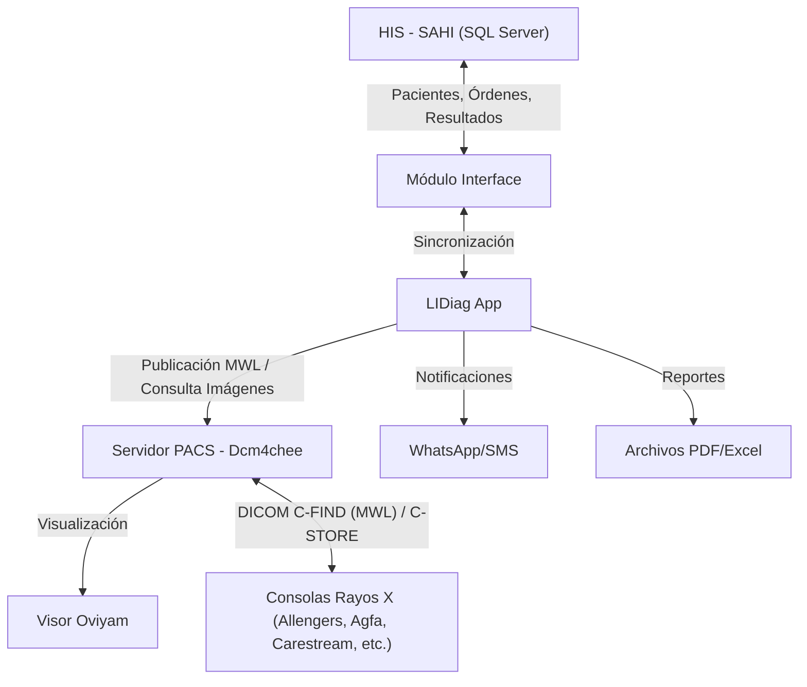

# LIDiag - Sistema de Gestión de Imágenes Diagnósticas

LIDiag es una plataforma integral diseñada para la gestión, procesamiento y lectura de imágenes diagnósticas. Facilita el flujo de trabajo desde la asignación de citas hasta la entrega de resultados a la historia clínica, integrándose con sistemas PACS y HIS (Hospital Information System).

## Guía rápida (TL;DR)

```bash
composer install
cp .env.example .env
php artisan key:generate
php artisan migrate
php artisan db:seed
php artisan storage:link
npm install
npm run dev
```

En Windows (PowerShell) puedes reemplazar el `cp` por:

```powershell
Copy-Item .env.example .env
```

En Windows + Laragon, el proyecto está pensado para el vhost **`lidiag.test`** con HTTPS en Vite (ver `vite.config.js`).

### Túnel Cloudflare para desarrollo local (WhatsApp webhook)

Meta WhatsApp requiere una URL pública HTTPS para enviar webhooks. Para desarrollo local usa [cloudflared](https://developers.cloudflare.com/cloudflare-one/connections/connect-networks/):

```bash
# Con HTTPS (si tienes certificado válido, ej. Laragon)
cloudflared tunnel --url https://lidiag.test

# Con HTTP (recomendado si cloudflared rechaza el certificado self-signed)
cloudflared tunnel --url http://lidiag.test
```

Esto genera una URL como `https://xxx.trycloudflare.com`. Úsala en la configuración del webhook de Meta:

| Campo | Valor |
|-------|-------|
| **Callback URL** | `https://xxx.trycloudflare.com/api/citas/webhook` |
| **Verify token** | `lidiag_whatsapp_2026` (o el configurado en `META_WHATSAPP_VERIFY_TOKEN`) |

> El túnel debe mantenerse corriendo en la terminal. Si se cierra, la URL expira. Cada vez que inicias cloudflared se genera una URL nueva.

## Stack Tecnológico (resumen)

-   **Backend**: Laravel 10 (PHP >= 8.0.2), MySQL
-   **Frontend**: Vue 3 + Vite (Laravel Vite Plugin), Bootstrap 5
-   **Seguridad**: `spatie/laravel-permission` (roles/permisos)
-   **Integraciones**: HIS/SAHI (SQL Server), PACS Dcm4chee (MySQL multisede), Twilio (WhatsApp), generación de PDF/Excel (DomPDF / Maatwebsite Excel)
-   **Estándares Médicos / DICOM**: Modality Worklist (MWL) DICOM nativo, codificación binaria Little Endian Explicit VR y compresión zlib *Deflated Explicit VR Little Endian* (`1.2.840.10008.1.2.1.99`)
-   **Autenticación API**: `auth:sanctum` (Sanctum stateful para SPA)
-   **Multimedia**: FFmpeg (conversión/compresión de audios a MP3)
-   **Transcripción de voz a texto**: Whisper (OpenAI) + FastAPI (servicio Python local, puerto 8001)
-   **Conversión Word→PDF** (según flujos): LibreOffice + `unoconv`

## Arquitectura y Flujo de Datos

El siguiente diagrama ilustra cómo interactúa LIDiag con los sistemas externos:



---

## Módulos del Sistema

La aplicación está compuesta por los siguientes módulos especializados:

### 1. Agendamiento

**Propósito:** Gestión de la carga de trabajo médica.

-   Permite la asignación de estudios radiológicos a los médicos radiólogos para su lectura e interpretación.
-   Facilita la distribución equitativa y organizada de los estudios pendientes.

### 2. Citas

**Propósito:** Gestión de la atención al paciente.

-   Módulo dedicado a la programación y asignación de citas para los pacientes que requieren exámenes de imágenes diagnósticas.
-   Controla la agenda de las salas y equipos disponibles.

### 3. Estudios (RX, TAC, Resonancia, Mamografía)

**Propósito:** Gestión del flujo de trabajo para modalidades de alta complejidad y radiología convencional.

-   Maneja el ciclo de vida de los estudios de Rayos X, Tomografía Axial Computarizada (TAC), Resonancia Magnética y Mamografía.
-   Separado operativamente del área de ecografías para alinearse con la estructura organizacional de la empresa.

### 4. Ecografías

**Propósito:** Gestión especializada para estudios ecográficos.

-   Módulo dedicado exclusivamente al flujo de trabajo de ecografías.
-   Permite el registro, lectura y reporte de hallazgos ecográficos con plantillas específicas.
-   Incluye flujo de **consentimientos informados** (plantillas, generación de PDF/ZIP y firma por token).

### 5. Interface (Integración SAHI)

**Propósito:** Interoperabilidad con la Historia Clínica Electrónica (HIS).

-   **Sistema Conectado:** SAHI (Sistema de Administración Hospitalaria Integral).
-   **Bidireccionalidad:**
    -   **Entrada:** Consulta los servicios y diagnósticos ordenados a los pacientes desde el HIS.
    -   **Salida:** Envía automáticamente los informes y lecturas de las imágenes diagnósticas de vuelta a la historia clínica del paciente.

### 6. Dcm4chee (Integración PACS)

**Propósito:** Comunicación con el servidor de almacenamiento de imágenes y orquestación de la lista de trabajo DICOM.

-   Realiza la integración directa y dinámica con las bases de datos de los servidores PACS de cada sede (Picture Archiving and Communication System).
-   **Modality Worklist (MWL):** Sincronización de pacientes (`patient`) e inserción de ítems programados (`mwl_item`) codificados en *Deflated Explicit VR Little Endian* para que las consolas de adquisición descarguen órdenes vía DICOM C-FIND.
-   Permite la consulta de estudios radiológicos en tiempo real.
-   Facilita la visualización de imágenes diagnósticas mediante el visor **Oviyam**.

### 7. Importar

**Propósito:** Migración de datos.

-   Herramienta diseñada para la carga masiva inicial de datos desde sistemas legados o externos.
-   Se ejecuta una única vez durante la puesta en producción del módulo o sistema.

### 8. HelpDesk

**Propósito:** Soporte técnico.

-   Módulo de uso interno para la gestión de tickets de soporte y requerimientos técnicos de la aplicación.

### 9. Configuración

-   Administración de parámetros generales del sistema, sedes, aseguradoras, y catálogos de servicios.

### 10. Seguridad

-   Gestión de usuarios, roles y permisos (basado en `spatie/laravel-permission`).
-   Control de acceso y auditoría.

<<<<<<< HEAD
=======
### 11. Contratación

**Propósito:** Tarifas por sede como fuente para la liquidación de pagos a médicos.

-   Contratos por sede con vigencia sin solapamientos y detalle médico-producto (`valor_consulta`, `valor_urgencias`, vigencia por médico).
-   El detalle se sincroniza por diff no destructivo con preview y confirmación (nunca `DELETE`; retiros con `estado` + `fecha_retiro`, con reactivación al re-incluir).
-   Cobertura: informa qué productos exigibles no tienen tarifa en el contrato.
-   Plantilla e importación por Excel (productos y médicos-producto).
-   API: `/api/contratos`, `/cobertura`, `/medicos/preview`, `/medicos` (sync), imports. UI: `/contratos`.

### 12. Liquidación

**Propósito:** Calcular y reportar cuánto se le debe a cada médico por periodo.

-   Cálculo a demanda por sede + rango de fechas, con filtros opcionales de contrato y médico. Prioridad Alta → `valor_urgencias`, resto → `valor_consulta`.
-   Cada lectura congela su línea en `liquidacion_lineas` (valor inmutable para el corte); lo no liquidable queda con su categoría de exclusión visible.
-   Productividad por médico para el corte de mes, con detalle de producción y export a Excel. UI: `/liquidacion`, `/productividad`.
-   Solo el médico asignado puede registrar la lectura (`leerEstudio`: 422 sin asignado, 403 otro médico).
-   API: `/api/liquidacion`, `/api/liquidacion/productividad`, `/api/liquidacion/exportar` (permisos `liquidacion.index`, `liquidacion.exportar`).

### 13. Admisión y Modality Worklist (MWL DICOM)

**Propósito:** Gestión integral de pacientes admitidos y vinculación directa con la lista de trabajo DICOM (Modality Worklist) de las consolas de adquisición de imágenes (Rayos X, etc.).

-   **Búsqueda y Admisión:** Búsqueda ágil de pacientes por documento o nombres, creación y edición de datos demográficos con integración a la tabla de pacientes local.
-   **Envío a Worklist:** Sincronización en tiempo real del paciente (`patient`) y de la orden programada (`mwl_item`) en el PACS Dcm4chee de la sede activa.
-   **Accession Number Secuencial:** Generación automática de consecutivo diario por sede con formato `RX-YYYYMMDD-####`.
-   **Codificación DICOM Estándar:** Empaquetamiento binario con cabecera File Meta Information y compresión nativa *Deflated Explicit VR Little Endian* (`1.2.840.10008.1.2.1.99`) vía `DicomDatasetBuilder`, garantizando la deserialización por parte del servicio Java de Dcm4chee.
-   **Multisede 100% Dinámica:** Detección en vivo de los equipos/salas de adquisición registrados en la tabla `ae` de la sede correspondiente (`GET /api/pacientes/worklist-estaciones`). Cero valores fijos o hardcodeados; si la sede agrega o renombra una consola, LIDiag la refleja de inmediato.
-   **Trazabilidad y Cancelación:** Control de estado de órdenes (`PENDIENTE`, `CANCELADO`), prevención de duplicidad por `sps_id` único, y retiro de pacientes de la consola del equipo en caliente.
-   **UI y Rutas:** Pantalla web en `/pacientes/admision`, API en `/api/pacientes/*` (permisos `gestion.pacientes.*`). Documentación técnica en `docs/WORKLIST_FLUJO_DCM.md`.

>>>>>>> 01b98816 (feat(worklist): modulo de admision y modality worklist (MWL DICOM) multisede dinamico)
---

## Comandos Personalizados (Console Commands)

LIDiag incluye comandos de consola para tareas de mantenimiento y sincronización de datos críticos.

### Auditoría y mantenimiento de permisos (Spatie)

Estos comandos ayudan a evitar “drift” entre **permisos usados en código** (rutas/controllers/blade/vue) y **permisos existentes en BD** (`spatie/laravel-permission`).

```bash
# Auditoría: compara permisos usados vs permisos en BD (guard web)
php artisan permissions:audit

# Auditoría: compara permisos usados vs permisos en BD (guard web) y lista permisos en BD no usados en código
php artisan permissions:audit --show-unused

# Auditoría estricta (útil en CI): falla si hay permisos usados en código que no existen en BD
php artisan permissions:audit --fail

# Buscar un permiso exacto en BD (independiente del guard)
php artisan permissions:audit --find=config.plantillas.index

# Reset “safe” del cache de Spatie (en CACHE_DRIVER=file puede no existir el key y eso es normal)
php artisan permissions:cache-reset

# Diagnóstico: validar permisos/roles de un usuario (Spatie)
php artisan permissions:user-check --search=carlos
php artisan permissions:user-check 5 --perm=estudio.leerestudio --perm=estudio.leerEstudio
```

> Nota: `php artisan permission:cache-reset` (comando del paquete Spatie) puede mostrar `Unable to flush cache` en entornos con `CACHE_DRIVER=file` cuando el key no existe. El comando `permissions:cache-reset` evita ese falso negativo.

### Sincronización de Usuarios

```bash
php artisan sync-usuarios
```

**Descripción:** Sincroniza los usuarios y plantillas de ecografías desde la base de datos de origen (SAHI/Importar) hacia la base de datos local de LIDiag.

-   Crea usuarios médicos y administrativos si no existen.
-   Asigna roles y permisos por defecto.
-   Sincroniza las plantillas de lectura de ecografías asociadas a cada médico.

### Sincronización DICOM Ecografías

```bash
php artisan sync:dicom-ecografias
```

**Descripción:** Ejecuta una importación masiva de datos históricos de ecografías desde una conexión externa (`mysql_importar_dicom`).

-   **Usuarios:** Importa personal médico y administrativo faltante.
-   **EPS:** Sincroniza el catálogo de aseguradoras.
-   **Productos:** Actualiza el listado de procedimientos (CUPS).
-   **Ecografías:** Migra el historial de lecturas, asociándolas a pacientes, médicos y atenciones correspondientes.

### Rate limiting (API / Login)

Por defecto (ver `app/Providers/RouteServiceProvider.php`):

-   **API**: 60 requests/minuto por usuario autenticado (o por IP si no hay usuario).
-   **Login**: 10 intentos/minuto por combinación email+IP (`throttle:login` en `POST /login`).

---

## Integraciones y Servicios Externos

El sistema utiliza varios servicios de terceros configurados en el archivo `.env`:

-   **Twilio (`TWILIO_*`)**:

    -   Utilizado para el envío de notificaciones automáticas a pacientes y médicos a través de WhatsApp.
    -   Casos de uso: Recordatorios de citas, confirmación de asignaciones.
    -   Configuración: `config/services.php` lee `TWILIO_SID`, `TWILIO_AUTH_TOKEN`, `TWILIO_WHATSAPP_NUMBER`.

-   **FFmpeg (`php-ffmpeg/php-ffmpeg`)**:

    -   Herramienta para el procesamiento de archivos multimedia.
    -   Se utiliza para **procesar y comprimir audios** (subidos desde el módulo de estudios) convirtiéndolos a **MP3** antes de guardarlos en `storage`.

    #### Configuración de FFmpeg/FFprobe (Producción - Windows + Apache + PHP)

    -   **Recomendado**: instalar FFmpeg a nivel del servidor en una ruta fija (ej. `C:\Tools\ffmpeg\bin\ffmpeg.exe` y `C:\Tools\ffmpeg\bin\ffprobe.exe`).  
        Evitar guardar binarios dentro de `storage/` (es escribible y no es buen lugar para ejecutables).

    -   Variables en `.env` (usar `/` en Windows para evitar escapes):

        ```ini
        FFMPEG_BINARIES=C:/Tools/ffmpeg/bin/ffmpeg.exe
        FFPROBE_BINARIES=C:/Tools/ffmpeg/bin/ffprobe.exe
        FFMPEG_TIMEOUT=3600
        FFMPEG_THREADS=12

        # Compresión de salida
        AUDIO_MP3_KBPS=64

        # Opcional: mínimo de duración para considerar "con contenido" (segundos).
        # 0 = deshabilitado
        AUDIO_MIN_SECONDS=0
        ```

    -   **Permisos**:
        -   Dar **Lectura y ejecución** sobre la carpeta de FFmpeg al **usuario del servicio Apache** (revisar “Servicios” → Apache → “Iniciar sesión”).
        -   Dar **Modificar** (crear/escribir/borrar) sobre el disk de audios (carpeta configurada en `filesystems.php`), en especial el subdirectorio `tmp/`.

    #### Almacenamiento de audios (disk `audios`)

    -   El endpoint de subida convierte cualquier formato válido a MP3 y guarda el archivo final en el disk `audios`.
    -   Los audios se asocian a `estudio_producto_id` (producto), no a `estudio_id` (estudio). Cada producto puede tener múltiples audios (grabados o cargados).
    -   La transcripción del audio se persiste en la columna `transcripcion` de la tabla `estudios_audios`.
    -   Asegúrese de que exista el subdirectorio `tmp/` dentro del disk `audios` (se usa para temporales durante la conversión).
    -   **Reproducción**: Usar la ruta `/audios/{filename}` (controlador `EstudioAudioController@stream`).
    -   **Limpieza**: Al abrir un nuevo estudio, los audios cargados en sesión se limpian automáticamente (incluyendo blob URLs).

-   **Transcripción automática (Whisper + FastAPI)**:

    Servicio Python en `storage/transcriptor/` que transcribe audios usando Whisper de OpenAI.

    #### Arquitectura

    ```mermaid
    graph LR
        Frontend[Vue - leerEstudioComponent] -->|Sube audio| Laravel[Laravel Controller]
        Laravel -->|POST /transcribir| FastAPI[FastAPI :8001]
        FastAPI --> Whisper[Whisper model 'base']
        Whisper -->|texto| FastAPI
        FastAPI -->|transcripción| Laravel
        Laravel -->|guarda en BD| MySQL[(estudios_audios.transcripcion)]
        Laravel -->|response| Frontend
    ```

    #### Flujo

    1. El médico sube un archivo de audio (mp3, wav, m4a, webm, ogg, flac) desde el formulario de lectura.
    2. Laravel recibe el archivo, lo convierte a MP3 con FFmpeg y lo envía al servicio Python.
    3. FastAPI recibe el audio, lo transcribe con Whisper (modelo base, CPU) y devuelve el texto.
    4. Laravel guarda el audio y la transcripción en `estudios_audios`.
    5. El frontend muestra la transcripción y permite insertarla en la lectura con un clic.

    #### Instalación (Windows / producción)

    1. Instalar Python 3.10+ y pip.
    2. Ir al directorio del servicio:
       ```bash
       cd storage/transcriptor
       ```
    3. Instalar dependencias:
       ```bash
       pip install -r requirements.txt
       ```
       O ejecutar `install.bat`.
    4. Iniciar el servicio:
       ```bash
       python main.py
       ```
       O ejecutar `start.bat`. El servicio queda escuchando en `http://localhost:8001`.

    #### Configuración en `.env`

    ```ini
    TRANSCRIPTOR_SERVICE_URL=http://localhost:8001
    TRANSCRIPTOR_TIMEOUT=300
    ```

    El timeout debe ser suficiente para audios largos (Whisper en CPU puede demorar).

    #### Endpoints del servicio

    | Método | Ruta | Descripción |
    |--------|------|-------------|
    | GET | `/health` | Health check |
    | POST | `/transcribir` | Recibe `file` (multipart), devuelve `{"texto": "..."}` |

    #### Variables de entorno del servicio (opcional)

    En `storage/transcriptor/.env` (o variables del sistema):

    ```ini
    WHISPER_MODEL=base               # tiny, base, small, medium, large
    WHISPER_DEVICE=cpu               # cpu o cuda
    WHISPER_COMPUTE_TYPE=int8        # int8, float16, float32
    ```

-   **AWS S3 (Opcional)**:
    -   Configurado para el almacenamiento escalable de documentos adjuntos o respaldos de informes, si se habilita en el entorno.

-   **Conversión Word → PDF (LibreOffice + `unoconv`)**:
    -   Usado en flujos de generación de reportes a partir de plantillas Word (por ejemplo, en `PlantillaEstudioController`).
    -   En este repositorio hay utilidades en `Documentos/` relacionadas con `unoconv`. En producción normalmente se instala LibreOffice y se expone `unoconv` en PATH (o se ajusta el comando/ruta).

-   **Speech-to-text (Whisper + FastAPI)**:
    -   Servicio Python independiente (`storage/transcriptor/`) que expone un endpoint HTTP en el puerto 8001.
    -   Recibe archivos de audio desde Laravel, los transcribe usando Whisper (modelo base, CPU) y devuelve el texto.
    -   Configuración: `TRANSCRIPTOR_SERVICE_URL` (por defecto `http://localhost:8001`).
    -   Instalación: `cd storage/transcriptor && pip install -r requirements.txt`
    -   Inicio: `python main.py` (o ejecutar `start.bat` en Windows).

-   **Servicio externo de reportes (`URL_API_REPORTES`, `PASSWORD_API_REPORTES`)**:
    -   Variables usadas por flujos de notificación/reportes (revisar `.env` en cada entorno).

---

## Estructura del Proyecto

A continuación, una guía rápida de las ubicaciones clave en el código fuente:

-   **Comandos de consola (Artisan)**:

    -   `app/Console/Commands`: comandos personalizados (ej. `sync-usuarios`, `sync:dicom-ecografias`).

-   **Rutas**:
    -   `routes/web.php`: pantallas Blade (MPA) con `auth` + `permission:...` (Spatie).
    -   `routes/api_*.php`: endpoints API por módulo (generalmente bajo `auth:sanctum`).
    -   Registro centralizado: `app/Providers/RouteServiceProvider.php` (incluye `api_configuracion`, `api_estudios`, `api_ecografias`, `api_seguridad`, `api_interfaces`, `api_agendamiento_dashboard`, `api_helpdesk`).

-   **Modelos de Datos**:

    -   `app/Models/Ecografias`: Lógica de negocio para el módulo de ecografías.
    -   `app/Models/ImportarEcografias`: Modelos espejo utilizados exclusivamente para la migración de datos legados.
    -   `app/Models/Interface`: Modelos que gestionan la interacción con las tablas del HIS (SAHI).

-   **Controladores**:

    -   `app/Http/Controllers/Reportes`: Contiene la lógica para la generación y descarga de reportes en Excel y PDF.
    -   **Documentación completa disponible en:** [`docs/CONTROLLERS.md`](docs/CONTROLLERS.md)
        -   Todos los controladores están documentados con PHPDoc detallado
        -   Incluye 30 controladores organizados en 10 módulos
        -   Más de 95 métodos documentados con parámetros, retornos y descripciones

-   **Frontend (Vue.js)**:
    -   `resources/js/components/modulos`: Componentes Vue organizados por módulo funcional (ej. `agendamiento`, `ecografias`).
    -   `resources/js/helpers`: utilidades reutilizables del frontend (ej. `alerts.js`, `datatables.js`).
    -   `resources/js/app.js`: entrypoint donde se registra Vue y se registran componentes globales por pantalla/módulo.
    -   Comunicación entre componentes: event bus con `mitt` (`app.config.globalProperties.emitter`).
    -   Utilidades de fechas: `dayjs` con plugins UTC/timezone (expuesto como `window.dayjs`).

-   **Servicio de transcripción Whisper**:
    -   `storage/transcriptor/`: Servicio Python FastAPI + Whisper para transcripción de voz a texto.
    -   `storage/transcriptor/main.py`: Servidor FastAPI.
    -   `storage/transcriptor/whisper_service.py`: Lógica de transcripción.
    -   `storage/transcriptor/start.bat` / `install.bat`: Scripts para Windows.
    -   **Requiere**: Python 3.10+, pip. Se inicia independientemente del servidor web (puerto 8001).

-   **Storage / discos públicos**:
    -   Definición de discos y symlinks: `config/filesystems.php`.
    -   `php artisan storage:link` crea enlaces adicionales además de `public/storage` (ej. `public/audios`, `public/files_help_desk`, `public/firmas_consntimientos`, etc.).

---

## Frontend: `resources/js` y módulos en `resources/js/components`

El frontend está organizado como **componentes Vue montados en vistas Blade**. En `resources/js/app.js` se crea la app con `createApp({})` y se registran componentes globales que se usan como tags en Blade.

### Entry point

- `resources/js/app.js`: registra componentes por módulo y hace `app.mount('#app')`.

### Componentes por módulo (`resources/js/components/modulos`)

- **Configuración**: `resources/js/components/modulos/configuracion/*`
  - Catálogos (EPS, productos, diagnósticos, sedes, plantillas, tipos de documento).
  - Parametrización HelpDesk (categorías, prioridades, estados).
- **Estudios**: `resources/js/components/modulos/estudios/*`
  - Asignar, leer, transcribir, notificar, y pantallas auxiliares.
- **Ecografías**: `resources/js/components/modulos/ecografias/*`
  - Admisión, lectura, admisionadas y consentimiento informado (captura/firma/plantillas).
- **HelpDesk**: `resources/js/components/modulos/help-desk/*`
  - Listado/creación/detalle de tickets, reportes y notificaciones.
- **Agenda**: `resources/js/components/modulos/agenda/*`
  - Disponibilidad/agenda.
- **Seguridad**: `resources/js/components/modulos/seguridad/*`
  - Usuarios, roles y perfil.
- **Reportes**: `resources/js/components/modulos/reportes/*`
  - Reportes de producción.
- **Tele radiología**: `resources/js/components/modulos/tele-radiologia/*`
  - Envío y transcripción.
- **Otras plataformas**: `resources/js/components/modulos/otras-plataformas/*`
  - Envío/asignación hacia/desde integraciones externas.
- **Varios**: `resources/js/components/modulos/varios/*`
  - Utilidades/UX (por ejemplo selección de sede).

### Componentes comunes y compartidos

- `resources/js/components/comunes/*`: UI común (sidebar, footer, header/search, etc.).
- `resources/js/components/shared/*`: componentes reutilizables (ej. wrapper global de Select2).

### Helpers y datos del frontend

- `resources/js/helpers/*`: helpers reutilizables (alerts, permisos, datatables, utilidades, etc.).
- `resources/js/helpers/voice/*`: helpers para captura/dictado/voz.
- `resources/js/data/*`: archivos de datos (por ejemplo diccionarios/reemplazos médicos usados en transcripción).

## Storage / Filesystems (detalle)

Además de `public`, el proyecto define múltiples discos públicos (driver `local`) en `config/filesystems.php`:

- `reporte_lecturas`
- `avatars`
- `firmas_medicos`
- `soportes_hc`
- `audios`
- `plantillas_lecturas`
- `img_dicom`
- `files_help_desk`
- `firmas_consntimientos`
- `files_consentimientos`

Al ejecutar `php artisan storage:link` se crean symlinks en `public/` para cada uno (por eso es un paso obligatorio en local/producción).

## Documentación del Código

El proyecto cuenta con documentación detallada para facilitar el mantenimiento y comprensión del código:

### Estándares de Codificación

-   **[`docs/CODING_STANDARDS.md`](docs/CODING_STANDARDS.md)**: Define los estándares de documentación y convenciones de código del proyecto.
    -   Reglas para comentarios PHPDoc
    -   Convenciones de nomenclatura
    -   Estructura de archivos y carpetas

### Documentación de Controladores

-   **[`docs/CONTROLLERS.md`](docs/CONTROLLERS.md)**: Índice completo de todos los controladores del sistema.
    -   Organizado por módulos (Ecografías, Estudios, Interface, Seguridad, etc.)
    -   Descripción de cada método con sus responsabilidades
    -   Identificación de controladores scaffold y controladores activos

### Controladores Principales

Los controladores más importantes del sistema incluyen:

-   **`EstudioController`**: Gestión completa del ciclo de vida de estudios radiológicos
-   **`SAHIController`**, **`SAHIEcografiasController`** y **`SAHIEcografiasEnviarController`**: Integración con HIS (consulta/consumo de atenciones y envío de resultados)
-   **`StudyController` (Dcm4chee)**: Consulta dinámica de estudios desde PACS
-   **`UserController`** y **`RolController`**: Gestión de seguridad y permisos
-   **`DashBoardController`**: Estadísticas y métricas del sistema

---

## Instalación y Configuración

Siga estos pasos para desplegar la aplicación en un entorno local o de producción.

### Requisitos Previos

-   **PHP**: >= 8.0.2
-   **Composer**
-   **Servidor Web**: Apache o Nginx
-   **Base de Datos**: MySQL (Principal) y SQL Server (Integraciones opcionales)
-   **Node.js & NPM** (para compilar assets del frontend). Recomendado **Node 16+**.

### Quick start (Windows + Laragon)

Si estás en Windows con Laragon:

1. **Virtual host**
    - Crea/usa el host **`lidiag.test`** en Laragon (Virtual Hosts).
    - Ajusta `APP_URL` al dominio local, por ejemplo:

        ```ini
        APP_URL=https://lidiag.test
        ```

2. **Certificados SSL (Vite/HMR)**
    - `vite.config.js` usa los certificados de Laragon:
        - `C:/laragon/etc/ssl/laragon.key`
        - `C:/laragon/etc/ssl/laragon.crt`
    - Si tu Laragon usa otra ruta o no tienes SSL, ajusta `vite.config.js` (o desactiva `server.https` para desarrollo).

3. **Archivo hosts**
    - Verifica que `lidiag.test` resuelva a tu máquina (normalmente `127.0.0.1`). Si Laragon no lo gestiona automáticamente, agrega la entrada en `C:\Windows\System32\drivers\etc\hosts`.

4. **Sanctum (SPA stateful)**
    - La mayoría de endpoints API usan `auth:sanctum` (cookies/sesión).
    - Si en local tienes `401` en `/api/*`, revisa `APP_URL` y `SANCTUM_STATEFUL_DOMAINS` (en `config/sanctum.php` se incluye el host actual como best-effort, útil para `lidiag.test`).

### Pasos de Instalación

1. **Clonar el Repositorio**

    ```bash
    git clone <url-del-repositorio>
    cd lidiag
    ```

2. **Instalar Dependencias de PHP**

    ```bash
    composer install
    ```

3. **Configurar el Entorno**

    - Copie el archivo de ejemplo `.env.example` a `.env`:
        ```bash
        cp .env.example .env
        ```
        En Windows (PowerShell) también puede usar:
        ```powershell
        Copy-Item .env.example .env
        ```
    - Configure las credenciales de la base de datos y otras variables en el archivo `.env`:
        ```ini
        DB_CONNECTION=mysql
        DB_HOST=127.0.0.1
        DB_PORT=3306
        DB_DATABASE=nombre_base_datos
        DB_USERNAME=usuario
        DB_PASSWORD=contraseña
        ```

4. **Generar Key de Aplicación**

    ```bash
    php artisan key:generate
    ```

5. **Ejecutar Migraciones** Crea las tablas en la base de datos:

    ```bash
    php artisan migrate
    ```

    _(Opcional) Si desea poblar la base de datos con datos de prueba:_

    ```bash
    php artisan db:seed
    ```

> Nota: el seeding de permisos/roles depende del orden. Los **roles** deben existir antes de hacer `syncRoles()` en permisos (por ejemplo, se ejecuta `RoleSeeder` antes de seeders como `PlantillaSeeder`).

6. **Instalar Dependencias de Frontend**

    ```bash
    npm install
    ```

7. **Compilar Assets** Para desarrollo:

    ```bash
    npm run dev
    ```

    Para producción:

    ```bash
    npm run build
    ```

8. **Configuración Adicional**
    - **Permisos de Carpetas:** Asegúrese de que las carpetas `storage` y `bootstrap/cache` tengan permisos de escritura.
    - **Enlace Simbólico:** Cree el enlace simbólico para el almacenamiento de archivos públicos:
        ```bash
        php artisan storage:link
        ```

### Variables de entorno clave

Además de `APP_*`, las variables más importantes que suelen requerir ajuste son:

-   **Base de datos principal (MySQL)**: `DB_*`
-   **Conexión secundaria (MySQL, si aplica)**: `DB_DATABASE_2`, `DB_USERNAME_2`, `DB_PASSWORD_2`
-   **Migración/importación (si aplica)**: `DB_CONNECTION_IMPORTAR`, `DB_HOST_IMPORTAR`, `DB_DATABASE_IMPORTAR`, etc.
-   **HIS/SAHI (SQL Server)**: `DB_CONNECTION_SQLSRV=sqlsrv`, `DB_HOST_SQLSRV`, `DB_DATABASE_SQLSRV`, `DB_USERNAME_SQLSRV`, `DB_PASSWORD_SQLSRV`
-   **Twilio (WhatsApp)**: `TWILIO_SID`, `TWILIO_AUTH_TOKEN`, `TWILIO_WHATSAPP_NUMBER`
-   **Servicio externo de reportes**: `URL_API_REPORTES`, `PASSWORD_API_REPORTES`
-   **FFmpeg/FFprobe (audios)**: `FFMPEG_BINARIES`, `FFPROBE_BINARIES` (ver sección de FFmpeg arriba)
-   **Transcripción Whisper**: `TRANSCRIPTOR_SERVICE_URL`, `TRANSCRIPTOR_TIMEOUT` (ver sección de transcripción abajo)

> Nota: este repositorio incluye `.env.example` como referencia. **No uses credenciales reales** allí (y evita subir secretos al repositorio). Si vas a compartir/publicar el proyecto, revisa y sanitiza `.env.example` para que solo tenga placeholders.

### Despliegue

Para servir la aplicación localmente:

```bash
php artisan serve
```

La aplicación estará disponible en `http://localhost:8000` (o el puerto configurado).

En Laragon, normalmente accederás por tu vhost, por ejemplo `https://lidiag.test`.

---

## Colas (Queue) y Scheduler

- En `.env` el valor típico es `QUEUE_CONNECTION=sync` (ejecución síncrona).
- `app/Console/Kernel.php` no tiene tareas programadas por defecto (scheduler vacío).

## Solución de Problemas (Troubleshooting)

**0. 401 en endpoints `/api/*` (Sanctum stateful)**

-   Verifica que el dominio real (ej. `lidiag.test`) esté contemplado en `SANCTUM_STATEFUL_DOMAINS`.
-   Revisa que `APP_URL` coincida con el host por el que navegas.
-   Borra cookies del dominio y vuelve a iniciar sesión.

**0.1. Vite/HMR no conecta (Laragon + HTTPS)**

-   `vite.config.js` usa `lidiag.test` y rutas fijas a certificados de Laragon (`C:/laragon/etc/ssl/...`).
-   Si tu Laragon usa otra ruta o no tienes SSL, ajusta `vite.config.js` (o desactiva `server.https` para desarrollo).

**1. Error de conexión con SQL Server (SAHI)**

-   Verifique que las extensiones `sqlsrv` y `pdo_sqlsrv` estén instaladas y habilitadas en su versión de PHP.
-   Confirme que las credenciales `DB_HOST_SQLSRV` en el `.env` son accesibles desde el servidor donde corre LIDiag.

**2. Las notificaciones de WhatsApp no llegan**

-   Revise los logs en `storage/logs/laravel.log` para ver si hay errores de autenticación con Twilio.
-   Asegúrese de que el número `TWILIO_WHATSAPP_NUMBER` esté configurado correctamente con el formato internacional (ej. `whatsapp:+57...`).

**3. Problemas al generar PDFs**

-   DomPDF requiere que las fuentes y estilos sean compatibles. Si el PDF sale en blanco o desordenado, verifique que no esté usando estilos CSS3 avanzados no soportados.

**4. Error al convertir audios (FFmpeg)**

-   Verifique que `FFMPEG_BINARIES` y `FFPROBE_BINARIES` apunten a rutas válidas (en Windows use `/`).
-   Revise permisos del **usuario que ejecuta Apache**:
    -   Lectura/ejecución sobre la carpeta de FFmpeg.
    -   Escritura sobre el disk `audios` y su subcarpeta `tmp/`.
-   Revise el log en `storage/logs/laravel.log` para ver el detalle del error devuelto por FFmpeg/FFprobe.

**5. La transcripción de audios no funciona (Whisper/FastAPI)**

-   Verifique que el servicio Python esté corriendo: `curl http://localhost:8001/health` (debe responder `{"status": "ok"}`).
-   Revise los logs de Laravel (`storage/logs/laravel.log`) y los logs del servicio Python (salida estándar).
-   Confirme `TRANSCRIPTOR_SERVICE_URL` en `.env` (por defecto `http://localhost:8001`).
-   Si Whisper se demora mucho, aumente `TRANSCRIPTOR_TIMEOUT` en `.env`.
-   En Windows, ejecute `storage/transcriptor/start.bat` para iniciar el servicio manualmente.

**6. Word → PDF falla (unoconv / LibreOffice)**

-   Confirma que LibreOffice esté instalado y que `unoconv` sea ejecutable por el usuario del servicio (Apache/Nginx/CLI).
-   Si el comando no existe en el servidor, instala `unoconv` o ajusta el mecanismo de conversión en los controladores de plantillas.
