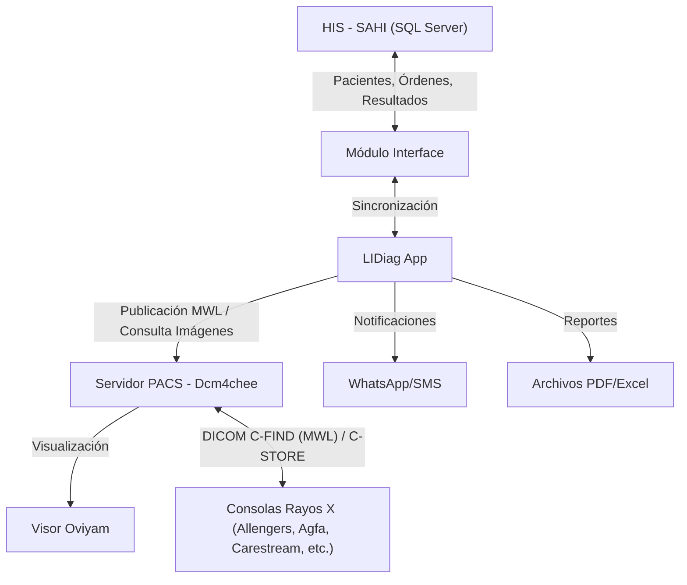

# LIDiag - Sistema de Gestión de Imágenes Diagnósticas

LIDiag es una plataforma integral diseñada para la gestión, procesamiento y lectura de imágenes diagnósticas. Facilita el flujo de trabajo desde la asignación de citas hasta la entrega de resultados a la historia clínica, integrándose con sistemas PACS y HIS (Hospital Information System).

## Guía rápida (TL;DR)

```bash
composer install
cp .env.example .env
php artisan key:generate
php artisan migrate
php artisan db:seed
php artisan storage:link
npm install
npm run dev
```

En Windows (PowerShell) puedes reemplazar el `cp` por:

```powershell
Copy-Item .env.example .env
```

En Windows + Laragon, el proyecto está pensado para el vhost **`lidiag.test`** con HTTPS en Vite (ver `vite.config.js`).

### Túnel Cloudflare para desarrollo local (WhatsApp webhook)

Meta WhatsApp requiere una URL pública HTTPS para enviar webhooks. Para desarrollo local usa [cloudflared](https://developers.cloudflare.com/cloudflare-one/connections/connect-networks/):

```bash
# Con HTTPS (si tienes certificado válido, ej. Laragon)
cloudflared tunnel --url https://lidiag.test

# Con HTTP (recomendado si cloudflared rechaza el certificado self-signed)
cloudflared tunnel --url http://lidiag.test
```

Esto genera una URL como `https://xxx.trycloudflare.com`. Úsala en la configuración del webhook de Meta:

| Campo | Valor |
|-------|-------|
| **Callback URL** | `https://xxx.trycloudflare.com/api/citas/webhook` |
| **Verify token** | `lidiag_whatsapp_2026` (o el configurado en `META_WHATSAPP_VERIFY_TOKEN`) |

> El túnel debe mantenerse corriendo en la terminal. Si se cierra, la URL expira. Cada vez que inicias cloudflared se genera una URL nueva.

## Stack Tecnológico (resumen)

-   **Backend**: Laravel 13 (PHP ^8.4), MySQL
-   **Frontend**: Vue 3 + Vite (Laravel Vite Plugin), Bootstrap 5, Chart.js + vue-chartjs (analítica clínica)
-   **Seguridad y Auditoría**: `spatie/laravel-permission` (roles/permisos), módulo de auditoría de eventos de usuario (`audit_logs` + `AuditLogger`), anonimización criptográfica SHA-256 de identificadores de pacientes (ISO/IEC 27001)
-   **Integraciones**: HIS/SAHI (SQL Server), PACS Dcm4chee (MySQL multisede), Visores DICOM (Oviyam / OHIF), Twilio (WhatsApp), Telegram Bot API (Long-Polling desatendido y Webhook), generación de PDF/Excel (DomPDF / Maatwebsite Excel)
-   **Estándares Médicos / DICOM**: Modality Worklist (MWL) DICOM nativo, codificación binaria Little Endian Explicit VR, compresión zlib *Deflated Explicit VR Little Endian* (`1.2.840.10008.1.2.1.99`), telemetría Edge de dosimetría radiológica (`pydicom`) con extracción de `CTDIvol`, `DLP`, `DGM` y `DAP` conforme a la Resolución 482 de 2018 (Colombia)
-   **Autenticación API**: `auth:sanctum` (Sanctum stateful para SPA)
-   **Multimedia**: FFmpeg (conversión/compresión de audios a MP3)
-   **Transcripción de voz a texto**: Whisper (OpenAI) + FastAPI (servicio Python local, puerto 8001)
-   **Conversión Word→PDF** (según flujos): LibreOffice + `unoconv`

## Arquitectura y Flujo de Datos

El siguiente diagrama ilustra cómo interactúa LIDiag con los sistemas externos:



---

## Módulos del Sistema

La aplicación está compuesta por los siguientes módulos especializados:

### 1. Agendamiento

**Propósito:** Gestión de la carga de trabajo médica.

-   Permite la asignación de estudios radiológicos a los médicos radiólogos para su lectura e interpretación.
-   Facilita la distribución equitativa y organizada de los estudios pendientes.
-   **Tablero de asignación:** Marca en azul los estudios que ya tienen lectura (`reportado`: producto activo con `fechor_lectura`, calculado en `Dcm4chee\StudyService::studyPksReportados`) para distinguir lo leído de lo pendiente.

### 2. Citas

**Propósito:** Gestión de la atención al paciente.

-   Módulo dedicado a la programación y asignación de citas para los pacientes que requieren exámenes de imágenes diagnósticas.
-   Controla la agenda de las salas y equipos disponibles.

### 3. Estudios (RX, TAC, Resonancia, Mamografía)

**Propósito:** Gestión del flujo de trabajo para modalidades de alta complejidad y radiología convencional.

-   Maneja el ciclo de vida de los estudios de Rayos X, Tomografía Axial Computarizada (TAC), Resonancia Magnética y Mamografía.
-   Separado operativamente del área de ecografías para alinearse con la estructura organizacional de la empresa.
-   **Informe centrado:** Al generar el DOCX con la plantilla de la sede se igualan los márgenes izquierdo y derecho (`PlantillaEstudioService::igualarMargenesLaterales`; se usa el mayor de los dos para no correr el texto bajo el membrete). Los márgenes superior e inferior no se tocan.

### 4. Ecografías

**Propósito:** Gestión especializada para estudios ecográficos.

-   Módulo dedicado exclusivamente al flujo de trabajo de ecografías.
-   Permite el registro, lectura y reporte de hallazgos ecográficos con plantillas específicas.
-   Incluye flujo de **consentimientos informados** (plantillas, generación de PDF/ZIP y firma por token). La versión genérica, para cualquier servicio, es el módulo 19.

### 5. Interface (Integración SAHI)

**Propósito:** Interoperabilidad con la Historia Clínica Electrónica (HIS).

-   **Sistema Conectado:** SAHI (Sistema de Administración Hospitalaria Integral).
-   **Bidireccionalidad:**
    -   **Entrada:** Consulta los servicios y diagnósticos ordenados a los pacientes desde el HIS.
    -   **Salida:** Envía automáticamente los informes y lecturas de las imágenes diagnósticas de vuelta a la historia clínica del paciente.

### 6. Dcm4chee (Integración PACS)

**Propósito:** Comunicación con el servidor de almacenamiento de imágenes y orquestación de la lista de trabajo DICOM.

-   Realiza la integración directa y dinámica con las bases de datos de los servidores PACS de cada sede (Picture Archiving and Communication System).
-   **Modality Worklist (MWL):** Sincronización de pacientes (`patient`) e inserción de ítems programados (`mwl_item`) codificados en *Deflated Explicit VR Little Endian* para que las consolas de adquisición descarguen órdenes vía DICOM C-FIND.
-   Permite la consulta de estudios radiológicos en tiempo real.
-   Facilita la visualización de imágenes diagnósticas mediante el visor **Oviyam**.

### 7. Importar

**Propósito:** Migración de datos.

-   Herramienta diseñada para la carga masiva inicial de datos desde sistemas legados o externos.
-   Se ejecuta una única vez durante la puesta en producción del módulo o sistema.

### 8. HelpDesk

**Propósito:** Gestión integral de soporte técnico e incidencias hospitalarias.

-   **Folios Secuenciales por Sede:** Asignación automática de folio correlativo diario con formato estándar `SED-YYYYMMDD-#####` (ej. `ESP-20261029-00001`).
-   **Ciclo de Vida y Transiciones Flexibles:** Máquina de estados con validación de transiciones entre `Abierto`, `En Progreso`, `Resuelto` y `Cerrado`, control de reapertura y registro de solución obligatoria.
-   **Trazabilidad e Historial:** Registro detallado de comentarios, adjuntos, reasignaciones de agentes y cambios de estado con marcas de tiempo.
-   **Dashboard de Analítica y Reportes:** Pantalla en `/helpdesk-reportes` con KPIs de tickets por sede, estado, categoría y tiempos de resolución, con filtros de fechas flexibles.
-   **Centro de Notificaciones en Vivo:** Alertas en base de datos para solicitantes y personal técnico asignado.
-   **UI y Rutas:** Pantallas web en `/helpdesk-tickets`, `/helpdesk-tickets/crear`, `/helpdesk-reportes`, `/helpdesk-notificaciones`, API en `/api/helpdesk-*`.

### 9. Configuración

-   Administración de parámetros generales del sistema, sedes hospitalarias, aseguradoras (EPS), y catálogos de servicios.
-   Parametrización de HelpDesk (categorías, prioridades y estados).
-   Configuración de plantillas de lectura, tipos de documentos, consentimientos informados y WhatsApp.
-   **Marca institucional por sede:** Logo, encabezado y pie de página (`/config-sede-logo`, `POST /api/config-sedes/{id}/branding`, permiso `config.sedes.edit`), que se usan en el PDF de los consentimientos informados.

### 10. Seguridad y Auditoría

**Propósito:** Control de acceso, gobernanza y trazabilidad forense de eventos de usuario.

-   **Roles y Permisos:** Control de acceso granular basado en `spatie/laravel-permission` (guard `web`), con auditoría estricta (`php artisan permissions:audit`).
-   **Módulo Centralizado de Auditoría (`/seguridad-auditoria`):**
    -   Persistencia en tabla `audit_logs` mediante el helper institucional `AuditLogger`.
    -   **Eventos de Autenticación:** `inicio_sesion`, `cierre_sesion`, `inicio_sesion_fallido` con captura de IP y User-Agent.
    -   **Eventos Asistenciales de Estudios:** `asignar_estudio` (paciente, médico, prioridad), `lectura_estudio` (médico especialista), `transcripcion_estudio` (transcriptor clínico) y `anular_estudio`.
    -   **Eventos de Citas y Agendamiento:** Creación, eliminación, `asignar_cita` (sede y fecha), `confirmar_cita`, `cancelar_cita` (con motivo), `cumplir_cita`, `inasistencia_cita` y `rechazar_cita`.
    -   **Eventos de Soporte y Seguridad:** `cambio_estado_ticket`, `reasignar_ticket`, creación/edición de roles y sincronización de permisos.
    -   **Filtros y Búsqueda Fulltext:** Filtrado por tipo de evento, usuario, rango de fechas y búsqueda textual por descripción, modelo, IP y nombre de usuario.
    -   **Exportación:** Descarga de registros a Excel, CSV, PDF, Portapapeles e Impresión con DataTables.
-   **Foto de perfil por sexo:** Columna `users.sexo` (`M`/`F`, migración `2026_10_22_100000_add_sexo_to_users_table`) y helper `resources/js/helpers/avatarUsuario.js`: si el usuario no subió foto se muestra la silueta de hombre o de mujer según su sexo, y la neutra de siempre si no lo tiene registrado. El sexo se elige al crear o editar el usuario (`usuarioComponent.vue`) y se refleja en la cabecera y en el perfil.
-   **UI y Rutas:** Pantallas web en `/seguridad.usuarios.listar`, `/seguridad.roles.listar`, `/seguridad.perfil`, `/seguridad-auditoria`, `/seguridad-backups`, `/seguridad-tokens`.

#### 🔑 Gestor de Tokens por Sede para Agentes Edge (`/seguridad-tokens`)

Módulo administrativo para la emisión, rotación segura y monitorización de credenciales de acceso API Sanctum utilizadas por los Agentes Edge distribuidos en los servidores hospitalarios (Backups de BD, Sincronización de Imágenes y Dosimetría Radiológica).

**Paso a paso para generar y desplegar tokens por sede:**
1. **Acceso:** En el menú lateral, dirígete a **Administración → Seguridad → Tokens de Sedes** (ruta `/seguridad-tokens`).
2. **Localización:** En la tabla principal, identifica la sede hospitalaria deseada (ej. *Espinal - Hospital San Rafael*).
3. **Generación / Rotación:**
   - Haz clic en **`Generar`** si la sede no posee credenciales activas, o en **`Rotar`** si requieres revocar el token previo e instaurar uno nuevo (política de 1 token activo por sede).
   - Confirma la acción en la ventana emergente de SweetAlert.
4. **Descarga de Configuración:**
   - En el modal de entrega, haz clic en **`Descargar config.json`** para obtener el archivo completo preconfigurado con el nuevo Bearer Token incrustado y los parámetros de red de la sede (o copia el token en texto plano con **`Copiar Token`**).
   - *Nota:* Por seguridad criptográfica de Sanctum, este valor no volverá a mostrarse tras cerrar el modal.
5. **Despliegue Local:** Copia el archivo en el servidor local de la sede dentro de `C:\agente_backups_dcm\config.json`.
6. **Monitoreo en Tiempo Real:** Verifica en la tabla del panel central que los semáforos de las columnas **DB DCM**, **Img Dicom** y **Dosi** cambien a **`OK`** con sus respectivos tiempos de reporte.

### 11. Contratación

**Propósito:** Tarifas por sede como fuente para la liquidación de pagos a médicos.

-   Contratos por sede con vigencia sin solapamientos y detalle médico-producto (`valor_consulta`, `valor_urgencias`, vigencia por médico).
-   El detalle se sincroniza por diff no destructivo con preview y confirmación (nunca `DELETE`; retiros con `estado` + `fecha_retiro`, con reactivación al re-incluir).
-   Cobertura: informa qué productos exigibles no tienen tarifa en el contrato.
-   Plantilla e importación por Excel (productos y médicos-producto).
-   API: `/api/contratos`, `/cobertura`, `/medicos/preview`, `/medicos` (sync), imports. UI: `/contratos`.

### 12. Liquidación

**Propósito:** Calcular y reportar cuánto se le debe a cada médico por periodo.

-   Cálculo a demanda por sede + rango de fechas, con filtros opcionales de contrato y médico. Prioridad Alta → `valor_urgencias`, resto → `valor_consulta`.
-   Cada lectura congela su línea en `liquidacion_lineas` (valor inmutable para el corte); lo no liquidable queda con su categoría de exclusión visible.
-   Productividad por médico para el corte de mes, con detalle de producción y export a Excel. UI: `/liquidacion`, `/productividad`.
-   Solo el médico asignado puede registrar la lectura (`leerEstudio`: 422 sin asignado, 403 otro médico).
-   API: `/api/liquidacion`, `/api/liquidacion/productividad`, `/api/liquidacion/exportar` (permisos `liquidacion.index`, `liquidacion.exportar`).

### 13. Admisión y Modality Worklist (MWL DICOM)

**Propósito:** Gestión integral de pacientes admitidos y vinculación directa con la lista de trabajo DICOM (Modality Worklist) de las consolas de adquisición de imágenes (Rayos X, etc.).

-   **Búsqueda y Admisión:** Búsqueda ágil de pacientes por documento o nombres, creación y edición de datos demográficos con integración a la tabla de pacientes local.
-   **Envío a Worklist:** Sincronización en tiempo real del paciente (`patient`) y de la orden programada (`mwl_item`) en el PACS Dcm4chee de la sede activa.
-   **Accession Number Secuencial:** Generación automática de consecutivo diario por sede con formato `RX-YYYYMMDD-####`.
-   **Codificación DICOM Estándar:** Empaquetamiento binario con cabecera File Meta Information y compresión nativa *Deflated Explicit VR Little Endian* (`1.2.840.10008.1.2.1.99`) vía `DicomDatasetBuilder`, garantizando la deserialización por parte del servicio Java de Dcm4chee.
-   **Multisede 100% Dinámica:** Detección en vivo de los equipos/salas de adquisición registrados en la tabla `ae` de la sede correspondiente (`GET /api/pacientes/worklist-estaciones`). Cero valores fijos o hardcodeados; si la sede agrega o renombra una consola, LIDiag la refleja de inmediato.
-   **Auto-Reconciliación PACS Dcm4chee (Ciclo Cerrado):**
    -   **Detección de Adquisición:** Monitoreo automatizado que cruza las órdenes pendientes con la tabla `study` del PACS de la sede. Al detectar las imágenes tomadas por el tecnólogo, transiciona la orden automáticamente a `ADQUIRIDO` (*Imágenes en PACS / Listo para Asignar*) y actualiza `sps_status = 1` (COMPLETED) en `pacsdb.mwl_item` para limpiar la consola del equipo.
    -   **Auto-Cierre en Asignación:** Al asignar formalmente el estudio a un radiólogo en `/estudios/asignar`, la orden pasa a `COMPLETADO`.
    -   **Feedback Visual Tricolor:** Badges semánticos en la tabla de pacientes (`🟡 En espera de Rayos X`, `🔵 Imágenes en PACS`, `🟢 Asignado a Lectura`).
    -   **Acción Rápida:** Botón directo para navegar a Asignación de Estudios con 1 clic cuando las imágenes ya ingresaron al PACS.
    -   **Botón Asistencial:** Botón *"Reconciliar PACS"* en cabecera para verificación manual bajo demanda (`POST /api/pacientes/worklist-reconciliar`).
-   **Trazabilidad y Cancelación:** Control de estado de órdenes (`PENDIENTE`, `ADQUIRIDO`, `COMPLETADO`, `CANCELADO`), prevención de duplicidad por `sps_id` único, y retiro de pacientes de la consola del equipo en caliente.
-   **UI y Rutas:** Pantalla web en `/pacientes/admision`, API en `/api/pacientes/*` (permisos `gestion.pacientes.*`). Documentación técnica en `docs/WORKLIST_FLUJO_DCM.md`.

### 14. Dosimetría y Control de Radiación (Resolución 482 de 2018 / ISO/IEC 27001)

**Propósito:** Monitoreo automatizado Edge-to-Cloud de dosis de radiación ionizante, evaluación de Niveles de Referencia para Diagnóstico (NRD) y detección predictiva de derivas técnicas de tubos emisores por sede hospitalaria.

-   **Modelo Edge-to-Cloud:** Agente desatendido en Python 3 (`agente_dosimetria.py`) que se ejecuta localmente en cada sede, consulta `pacsdb` de Dcm4chee y extrae los metadatos dosimétricos directamente desde las cabeceras DICOM sin saturar la red ni exponer puertos entrantes.
-   **Seguridad de Grado Clínico (ISO 27001 / Ley 1581):** Anonimización irreversible del `PatientID` con hash HMAC-SHA256 salado (`dosimetria_salt` único por hospital) antes de transmitir; ninguna Información de Salud Protegida (PHI) viaja por la red ni se almacena en el servidor central, permitiendo calcular la dosis efectiva acumulada por paciente anónimo.
-   **Métricas Multimodales:**
    -   **Tomografía Computarizada (CT):** Índice de Dosis en TC por Volumen (`CTDIvol` en mGy) y Producto Dosis-Longitud (`DLP` en mGy·cm).
    -   **Mamografía Digital (MG):** Dosis Glandular Media (`DGM` en mGy) y Entrada en Superficie (`ESD`).
    -   **Radiografía Digital / Computarizada (DX / CR / XA):** Producto Dosis-Área (`DAP` / `KAP` en Gy·cm² o dGy·cm²).
    -   **Dosis Efectiva Media ($E$ en mSv):** Cálculo automatizado basado en factores de ponderación tisular según la publicación ICRP 103 ($E = \text{DLP} \times k$).
-   **Resiliencia y Tolerancia a Fallos:** Cola persistente transaccional SQLite local (`logs/cola_dosimetria.db`), transmisión HTTPS autenticada mediante Bearer Token Sanctum (`/api/dosimetria/registros`), reintentos con backoff exponencial y micro-lotes de 50 registros para evitar errores HTTP 429.
-   **Detección Predictiva de Deriva Técnica (*Machine Drift Detection*):**
    -   Algoritmo heurístico que compara ventanas temporales históricas dentro del período de consulta para alertar oportunamente sobre desgastes físicos del ánodo o descalibraciones del emisor (+20% de incremento).
    -   **Calibración y Filtro de Suelo de Ruido (*Noise Floor*):** Descarte automático de topogramas, scouts y disparos residuales insignificantes (`CTDIvol < 1.0 mGy`, `DLP < 20 mGy·cm`, etc.) y exigencia de umbrales absolutos mínimos ($\Delta \ge 1.5\text{ mGy}$ en CT, $\Delta \ge 25\text{ mGy}\cdot\text{cm}$ en DLP) y al menos 3 disparos por ventana temporal, erradicando falsos positivos por sesgo de base pequeña.
-   **Dashboard Analítico Institucional (Vue 3 + Chart.js con Estándar AdminWrap):**
    -   **Header y Acciones Canónicas:** Ruta de navegación con `row page-titles`, botón de exportación a Excel y modal interactivo del Catálogo NRD regulatorio.
    -   **Info-Boxes Superiores (Estilo `index.html`):** Tarjetas con indicadores `.display-6`, íconos temáticos (`icon-Target-Market`, `icon-Desktop-Monitor`, `icon-Contrast`, `icon-Pulse`) y micro-barras de progreso de 3px para Estudios Monitoreados, Equipos Emisores, Cumplimiento NRD y Dosis Efectiva Media ($E$).
    -   **Monitor de Latidos Edge (*Dead Man's Switch*):** Panel de telemetría en vivo con badges `.label.label-rounded` para supervisar la conectividad continua de los agentes en cada hospital.
    -   **Alertas Semánticas de Radioprotección:** Paneles nativos `.alert.alert-danger` y `.alert.alert-warning` ante superaciones de NRD o advertencias de deriva técnica con delta absoluto y porcentual.
    -   **Gráficos Clínicos Comparativos:** Gráfico de barras de Dosis Medida vs Límite NRD por sede, gráfico de dona de Conformidad Normativa (Seguro, Alerta, Crítico), gráfico de líneas de Tendencia Mensual (ALARA) y dona de Distribución por Modalidad.
    -   **Ranking de Equipos Emisores (Estilo "Projects of the Month"):** Tabla estructurada con `.table.vm.no-th-brd.pro-of-month`, avatares circulares `.round`, estado clínico y dosis media por emisor.
    -   **Timeline de Auditoría Clínica (Estilo "Today's Schedule"):** Línea de tiempo interactiva con `.steamline` y `.sl-item` para trazabilidad de informes RDSR y eventos.
    -   **Tabla Maestra de Mediciones:** Historial reciente de muestreo con identificador anonimizado HMAC, parámetros técnicos ($kV_p$, $mA$, $ms$) y estado de verificación.
-   **UI y Rutas:** Pantalla web en `/dosimetria/dashboard`, API en `/api/dosimetria/*` (permisos `dosimetria.*`).
-   **Documentación Especializada:** Manuales dedicados en `storage/app_lidiag/agente_backups_dcm/README_DOSIMETRIA.md` e informe para proveedores en `storage/app_lidiag/agente_backups_dcm/INFORME_TECNICO_DOSIMETRIA_PROVEEDORES.md`.

### 15. Tele-Radiología

**Propósito:** Flujo de trabajo para asignación, descarga y lectura deslocalizada de estudios entre sedes remotas y especialistas externos.

-   **Asignación Deslocalizada:** Distribución de estudios a médicos radiólogos remotos con destino configurable (`Tele-Radiología`).
-   **Transcripción y Notificación Remota:** Pantallas especializadas para transcripción a distancia (`/tele-radiologia-transcribir`) y visualización de cola de trabajo remota (`/tele-radiologia`).
-   **Integración con Plantillas Word/PDF:** Sincronización de formatos institucionales de reporte según la sede de origen.
-   **UI y Rutas:** Pantallas web en `/tele-radiologia` y `/tele-radiologia-transcribir`.

### 16. Bot de Telegram & Telemetría Asistencial (`@salud_tolima_bot`)

**Propósito:** Canal móvil bidireccional y automatizado para monitoreo asistencial, alertas operativas y telemetría de sedes hospitalarias.

-   **Modo Dual (Long-Polling / Webhook):**
    -   *Long-Polling desatendido:* `php artisan telegram:poll` con resiliencia y auto-reinicio ante cortes de red. Óptimo para servidores Windows detrás de firewalls o sin certificado intermedio.
    -   *Webhook HTTPS:* Endpoint en `/api/telegram/webhook` con verificación de secreto criptográfico.
-   **Seguridad de Acceso:** Lista blanca institucional estricta mediante `TELEGRAM_ALLOWED_CHAT_IDS`.
-   **Comandos Interactivos:**
    -   `/start`: Menú interactivo de opciones y estado del bot.
    -   `/retrasados`: Semáforo asistencial de estudios prioritarios que exceden el tiempo límite de lectura.
    -   `/sedes`: Telemetría operativa y carga de trabajo agrupada por sede hospitalaria.
    -   `/resumen` / `wiz:red:hoy`: Resumen ejecutivo consolidado del día.
-   **Daily Digest Matutino:** Despacho automatizado a las 07:30 AM (`php artisan telegram:daily-digest`) con los indicadores clave del día.
-   **Automatización Windows (Servicio 24/7):** Scripts por lotes para Windows Task Scheduler (`instalar_tarea_telegram_bot.bat`, `ejecutar_telegram_bot.bat`, `detener_tarea_telegram_bot.bat`).

### 17. Monitoreo de Backups en Tiempo Real

**Propósito:** Supervisión centralizada de la integridad y vigencia de las copias de seguridad de todas las sedes hospitalarias.

-   **Telemetría de Sedes:** Monitoreo en `/seguridad-backups` del estado de los respaldos locales de `pacsdb` y almacenamiento clínico.
-   **Verificación Criptográfica:** Validación de hashes SHA-256 e integridad ZIP de cada respaldo generado.
-   **Ejecución Manual:** Capacidad de forzar copias de seguridad inmediatas bajo demanda.

### 18. Visores Diagnósticos Web (Oviyam y OHIF Viewer)

**Propósito:** Visualización de estudios e imágenes médicas DICOM en navegadores web sin requerir instalación de software cliente.

-   **Oviyam:** Integración nativa con Dcm4chee para visualización en pestaña auxiliar (`tap_oviyam`).
-   **OHIF Viewer:** Servicio preparado para visualización DICOM web zero-footprint de series multimodales.

### 19. Consentimientos Informados (módulo genérico)

**Propósito:** Gestión trazable de consentimientos informados para cualquier servicio (no solo ecografías): plantillas con versiones, firma del paciente por enlace con token, firma del médico y PDF final.

-   **Plantillas:** Formatos con versiones, vista previa e imágenes, asignables a productos (`consentimiento_plantillas`, `consentimiento_plantilla_productos`). El encabezado, el pie de página y el logo del PDF salen de la marca institucional de la sede.
-   **Flujo:** Generar el documento (`POST /api/consentimientos`) → crear el token de firma → el paciente o su acompañante firma sin iniciar sesión en `/firma/consentimiento/{token}` → firma del médico → PDF (`POST /api/consentimientos/{id}/pdf`). Estados: `GENERADO` → `PENDIENTE_PACIENTE` → `PENDIENTE_MEDICO` → `COMPLETO`, más `ANULADO` y `EXPIRADO`.
-   **Seguridad:** El token son 64 caracteres aleatorios y solo se guarda su SHA-256; vence a los 10 minutos (configurable al crearlo) y el documento a las 24 horas. La firma pública tiene límite de peticiones (`throttle:60,1` para consultar y `throttle:20,1` para firmar). Las firmas, los PDF y los adjuntos se guardan cifrados (`encrypt()`) en discos privados (`firmas_consntimientos`, `files_consentimientos`, `adjuntos_consentimientos`); `imagenes_consentimientos` guarda las imágenes de las plantillas. Cada documento lleva su auditoría (`consentimiento_documento_auditoria`).
-   **Complementos:** Marcas sobre imágenes (`consentimientoMarcasCanvas.vue`), adjuntos, anulación y restauración, y estadísticas por sede, producto, médico y tiempos (`/api/consentimientos/estadisticas/*`, con exportación).
-   **Vencimientos y recordatorios:** `consentimientos:expirar` marca como `EXPIRADO` los documentos vencidos y `consentimientos:notificar-medicos` avisa a cada médico de sus firmas pendientes (ver *Colas (Queue) y Scheduler*).
-   **UI y Rutas:** Pantallas web en `/consentimientos-generar`, `/consentimientos-medico`, `/consentimientos-plantillas-config`, `/consentimientos-dashboard` y `/config-sede-logo`; API en `/api/consentimientos*` (permisos `consentimientos.*`). Componentes en `resources/js/components/modulos/consentimientos/`.
-   **Convivencia:** El flujo anterior de ecografías (`ecografias_consentimientos`, `/firma/consentimiento-ecografia/{token}`) sigue funcionando sin cambios.

### 20. Entrega de Resultados al Paciente (enlace por WhatsApp / correo)

**Propósito:** Hacer llegar al paciente su informe y sus imágenes sin usuario ni contraseña: LIDiag envía la lectura al portal de pacientes (`lidiag-reportes`), el portal genera un enlace con token (`/p/{token}`; la vigencia la define el portal, 180 días por defecto) y LIDiag se lo entrega por WhatsApp y/o correo.

-   **Disparo:** Al guardar la transcripción se genera el PDF, se envía al portal (`/api/almacenarLectura`, firmado con HMAC) y se programa el job `EntregarResultadoPaciente` (cifrado y sin reintentos automáticos; con la cola `sync` corre al terminar de enviar la respuesta, sin dejar esperando al médico). Un fallo de la entrega nunca afecta el guardado de la lectura.
-   **Qué hace (`EntregaResultadoService`):** Pide el enlace al portal y comprueba que sea del dominio `REPORTES_URL_PUBLICA` (si no, no envía nada), sube las imágenes JPEG del PACS por lotes, envía el enlace por WhatsApp (plantilla aprobada en Meta con un botón de URL cuyo sufijo es el token) y/o por correo (solo el enlace, sin adjuntos ni contraseña) y registra cada envío, con el destino enmascarado, en `entregas_resultado`. En modo automático un canal que ya envió con éxito no se repite; el reenvío manual (`notificarEmail`) sí.
-   **Apagado por defecto:** No sale ningún mensaje hasta activarlo en el `.env` (ver *Variables de entorno clave*); `ENTREGA_SEDES` permite un piloto en una sola sede.
-   **Soporte:** `php artisan entrega:estado {estudio_producto_id}` y `php artisan entrega:revocar {lectura_id} [--regenerar]` (ver *Comandos Personalizados*).
-   **Portal:** El lado del portal (token, imágenes, visor, cuentas de paciente) está en el README y en `docs/ENLACE_PACIENTE.md` del proyecto `lidiag-reportes`.

---

## Comandos Personalizados (Console Commands)

LIDiag incluye comandos de consola para tareas de mantenimiento y sincronización de datos críticos.

### Auditoría y mantenimiento de permisos (Spatie)

Estos comandos ayudan a evitar “drift” entre **permisos usados en código** (rutas/controllers/blade/vue) y **permisos existentes en BD** (`spatie/laravel-permission`).

```bash
# Auditoría: compara permisos usados vs permisos en BD (guard web)
php artisan permissions:audit

# Auditoría: compara permisos usados vs permisos en BD (guard web) y lista permisos en BD no usados en código
php artisan permissions:audit --show-unused

# Auditoría estricta (útil en CI): falla si hay permisos usados en código que no existen en BD
php artisan permissions:audit --fail

# Buscar un permiso exacto en BD (independiente del guard)
php artisan permissions:audit --find=config.plantillas.index

# Reset “safe” del cache de Spatie (en CACHE_DRIVER=file puede no existir el key y eso es normal)
php artisan permissions:cache-reset

# Diagnóstico: validar permisos/roles de un usuario (Spatie)
php artisan permissions:user-check --search=carlos
php artisan permissions:user-check 5 --perm=estudio.leerestudio --perm=estudio.leerEstudio
```

> Nota: `php artisan permission:cache-reset` (comando del paquete Spatie) puede mostrar `Unable to flush cache` en entornos con `CACHE_DRIVER=file` cuando el key no existe. El comando `permissions:cache-reset` evita ese falso negativo.

### Sincronización de Usuarios

```bash
php artisan sync-usuarios
```

**Descripción:** Sincroniza los usuarios y plantillas de ecografías desde la base de datos de origen (SAHI/Importar) hacia la base de datos local de LIDiag.

-   Crea usuarios médicos y administrativos si no existen.
-   Asigna roles y permisos por defecto.
-   Sincroniza las plantillas de lectura de ecografías asociadas a cada médico.

### Sincronización DICOM Ecografías

```bash
php artisan sync:dicom-ecografias
```

**Descripción:** Ejecuta una importación masiva de datos históricos de ecografías desde una conexión externa (`mysql_importar_dicom`).

-   **Usuarios:** Importa personal médico y administrativo faltante.
-   **EPS:** Sincroniza el catálogo de aseguradoras.
-   **Productos:** Actualiza el listado de procedimientos (CUPS).
-   **Ecografías:** Migra el historial de lecturas, asociándolas a pacientes, médicos y atenciones correspondientes.

### Sistema de Backups Automáticos Separados (BD y Storage)

```bash
# Respaldo completo (Base de Datos MySQL + 16 carpetas de Storage clínico)
php artisan lidiag:backup

# Respaldo solo de Base de Datos MySQL
php artisan lidiag:backup --only-db

# Respaldo solo de archivos clínicos de Storage
php artisan lidiag:backup --only-files

# Personalizar ruta de destino y retención (días)
php artisan lidiag:backup --destination="D:\Backups" --retention=60
```

**Descripción:** Genera respaldos independientes en archivos `.zip` dentro de `C:\Backups_Lidiag` (`backup_lidiag_db_*.zip` y `backup_lidiag_storage_*.zip`) para desacoplar escalabilidad, evitar corrupción de archivos masivos, verificar integridad interna ZIP (`ZipArchive::CHECKCONS`), generar checksums criptográficos SHA-256 (`.sha256`), emitir manifiestos de salud (`backup_manifest.json`) y purgar automáticamente copias con más de 30 días de antigüedad.

### Sistema de Backups de Bases de Datos DCM / PACS por Sedes

Para las bases de datos de imágenes de los hospitales remotos (bases de datos de gran tamaño, >47 GB combinados), se implementó una **arquitectura local descentralizada** para máxima velocidad y sincronización desatendida hacia el NAS QNAP:

#### 1. Agente Local en cada Servidor Hospitalario (`storage/app_lidiag/agente_backups_dcm/`):
- **Script en Python 3 puro:** `storage/app_lidiag/agente_backups_dcm/backup_dcm_agent.py` (sin dependencias `pip`).
- **Ruta de destino:** `C:\backups_dcm\` (sincronizada automáticamente por el cliente **Qsync de QNAP** hacia el almacenamiento NAS).
- **Protección PACS y disco:** Pre-flight check de espacio libre en disco, `--hex-blob` y `--max_allowed_packet=512M`.
- **Compresión e Integridad:** Vuelca `pacsdb` a velocidad de disco SSD local, comprime a `.zip`, valida integridad CRC32 interna (`testzip`), genera hash SHA-256 (`.sha256`) y emite manifiesto de telemetría (`backup_status_sede_{id}.json`).
- **Purga de retención:** Elimina automáticamente de `C:\backups_dcm` los respaldos y hashes con más de **30 días**.
- **Instalación en 1 clic:** Incluye `storage/app_lidiag/agente_backups_dcm/instalar_tarea_programada.bat` para registrar la tarea `LIDiag_Local_DCM_Backup` en el Programador de Tareas de Windows a las **02:00 AM** con permisos `SYSTEM`.
- **Paquetes listos para distribución:** Disponibles en `storage/app_lidiag/agente_backups_dcm.rar` y `.zip`.

```bash
# Ejecución manual del agente en el servidor DCM
python backup_dcm_agent.py --config config.json
```

#### 2. Respaldo Central vía Red (Fallback):
```bash
# Respaldar todas las sedes activas vía TCP directo
php artisan lidiag:backup-dcm

# Respaldar una sede específica por su ID
php artisan lidiag:backup-dcm --sede=1

# Ajustar timeout de volcado (segundos) y días de retención
php artisan lidiag:backup-dcm --timeout=600 --retention=45
```

### Sincronización de Estudios al Portal de Pacientes (`lidiag-reportes`)

Permite la transmisión masiva o individual de estudios radiológicos transcritos hacia el microservicio externo del portal de pacientes (`lidiag-reportes`), emitiendo el PDF clínico oficial generado mediante la plantilla de la sede y firmando digitalmente la solicitud con HMAC SHA-256 (`/api/almacenarLectura`).

```bash
# Simular ejecución sin generar PDFs ni transferir (dry-run)
php artisan lidiag:enviar-paciente --dry-run --limite=10

# Filtrar por rango de fechas de transcripción
php artisan lidiag:enviar-paciente --desde=2026-10-01 --hasta=2026-10-15

# Filtrar por sede hospitalaria específica con límite
php artisan lidiag:enviar-paciente --sede=1 --limite=50

# Enviar un único estudio_producto por su ID (pruebas / reintentos puntuales)
php artisan lidiag:enviar-paciente --id=257022

# Reintentar únicamente los estudios fallidos desde archivo .txt generado automáticamente
php artisan lidiag:enviar-paciente --reintentar="storage/logs/sync_fallidos_2026-09-01_al_2026-09-07_154500.txt"
```

**Parámetros:**
- `--desde=YYYY-MM-DD`: Fecha de transcripción inicial (`estudios_productos.fechor_trascrito`).
- `--hasta=YYYY-MM-DD`: Fecha de transcripción final.
- `--sede=ID`: Filtro por ID de la sede hospitalaria (`config_sedes.id`).
- `--limite=N`: Límite máximo de estudios a procesar en el lote.
- `--id=ID`: ID específico de `estudio_producto` a sincronizar.
- `--reintentar=RUTA`: Ruta del archivo `.txt` con los estudios fallidos para reintentar únicamente dichos IDs tras corregir contingencias (plantillas, red, etc.).
- `--dry-run`: Modo de simulación previa que valida la existencia de plantillas, sedes y formato sin invocar LibreOffice ni transferir por red.

### Entrega de Resultados al Paciente (enlace del portal)

Consulta y revoca los enlaces de resultados que LIDiag entrega al paciente (módulo 20).

```bash
# Envíos hechos para un estudio (canal, estado, destino enmascarado) y estado del enlace en el portal
php artisan entrega:estado 257022

# Revocar el enlace de una lectura del portal
php artisan entrega:revocar 123

# Revocar los enlaces anteriores y crear uno nuevo
php artisan entrega:revocar 123 --regenerar
```

**Parámetros:**
- `estudio_producto_id`: ID de `estudios_productos`.
- `lectura_id`: ID de la lectura en el portal (`lectura_portal_id` de `entregas_resultado`).
- `--regenerar`: Crea un enlace nuevo y revoca los anteriores.

### Consentimientos Informados (vencimientos y recordatorios)

```bash
# Marcar como EXPIRADO los consentimientos vigentes que vencieron sin completarse (e invalidar sus tokens de firma)
php artisan consentimientos:expirar --limit=500

# Notificar (canal database) a cada médico con consentimientos pendientes de su firma
php artisan consentimientos:notificar-medicos
```

Ambos corren solos desde el scheduler (ver *Colas (Queue) y Scheduler*).

### Reconciliación de Órdenes Modality Worklist (MWL vs PACS Dcm4chee)

Cruza automáticamente las órdenes activas en LIDiag con la tabla `study` de Dcm4chee para detectar cuándo las imágenes tomadas por el equipo de Rayos X han ingresado al PACS, actualizando el estado de la orden a `ADQUIRIDO` y marcándola como completada en `mwl_item` de la consola de la sala.

```bash
# Reconciliar todas las órdenes pendientes en todas las sedes con PACS
php artisan worklist:reconcile

# Reconciliar una sede hospitalaria específica por su ID
php artisan worklist:reconcile --sede=1
```

**Parámetros:**
- `--sede=ID`: Filtro opcional por ID de la sede hospitalaria (`config_sedes.id`). Si se omite, evalúa todas las sedes activas con parámetros de conexión PACS válidos.

### Bot de Telegram y Telemetría (`@salud_tolima_bot`)

Permite la operación móvil desatendida del bot de Telegram para monitoreo de estudios, alertas asistenciales y consultas operativas.

```bash
# Iniciar el bot en modo Long-Polling continuo (ideal para entornos locales y producción)
php artisan telegram:poll

# Procesar una única iteración de mensajes pendientes y salir (pruebas y depuración)
php artisan telegram:poll --once

# Ejecutar el despacho matutino de resumen y semáforo asistencial (Daily Digest)
php artisan telegram:daily-digest
```

### Automatización en Windows (Task Scheduler)

El proyecto incluye scripts por lotes para programar tareas desatendidas:
1. **Agente Bot de Telegram (`instalar_tarea_telegram_bot.bat`):**
   - Registra la tarea programada `LIDiag_Telegram_Bot` en Windows con inicio automático al arrancar el sistema (`/sc ONSTART /ru "SYSTEM" /rl HIGHEST`).
   - `ejecutar_telegram_bot.bat`: Bucle de resiliencia con autodetección de PHP y volcado de logs a `storage/logs/telegram_bot.log`.
   - `detener_tarea_telegram_bot.bat`: Detiene el bot y limpia procesos huérfanos.
2. **En Servidor Central LIDiag (`storage/app_lidiag/agente_backups_dcm/programar_tarea_backup.bat`):**
   - `LIDiag_Daily_Backup`: Respaldo central de Base de Datos y Storage clínico a las **02:00 AM**.
   - `LIDiag_Daily_Backup_DCM`: Tarea central programada a las **02:30 AM** como respaldo secundario.
3. **En Servidores de Hospitales DCM (`storage/app_lidiag/agente_backups_dcm/instalar_tarea_programada.bat`):**
   - `LIDiag_Local_DCM_Backup`: Ejecución local a las **02:00 AM** generando el `.zip` en `C:\backups_dcm` para sincronización con **QNAP Qsync**.


### Rate limiting (API / Login)

Por defecto (ver `app/Providers/AppServiceProvider.php`):

-   **API**: 60 requests/minuto por usuario autenticado (o por IP si no hay usuario).
-   **Login**: 10 intentos/minuto por combinación email+IP (`throttle:login` en `POST /login`).

---

## Integraciones y Servicios Externos

El sistema utiliza varios servicios de terceros configurados en el archivo `.env`:

-   **Twilio (`TWILIO_*`)**:

    -   Utilizado para el envío de notificaciones automáticas a pacientes y médicos a través de WhatsApp.
    -   Casos de uso: Recordatorios de citas, confirmación de asignaciones.
    -   Configuración: `config/services.php` lee `TWILIO_SID`, `TWILIO_AUTH_TOKEN`, `TWILIO_WHATSAPP_NUMBER`.

-   **FFmpeg (`php-ffmpeg/php-ffmpeg`)**:

    -   Herramienta para el procesamiento de archivos multimedia.
    -   Se utiliza para **procesar y comprimir audios** (subidos desde el módulo de estudios) convirtiéndolos a **MP3** antes de guardarlos en `storage`.

    #### Configuración de FFmpeg/FFprobe (Producción - Windows + Apache + PHP)

    -   **Recomendado**: instalar FFmpeg a nivel del servidor en una ruta fija (ej. `C:\Tools\ffmpeg\bin\ffmpeg.exe` y `C:\Tools\ffmpeg\bin\ffprobe.exe`).  
        Evitar guardar binarios dentro de `storage/` (es escribible y no es buen lugar para ejecutables).

    -   Variables en `.env` (usar `/` en Windows para evitar escapes):

        ```ini
        FFMPEG_BINARIES=C:/Tools/ffmpeg/bin/ffmpeg.exe
        FFPROBE_BINARIES=C:/Tools/ffmpeg/bin/ffprobe.exe
        FFMPEG_TIMEOUT=3600
        FFMPEG_THREADS=12

        # Compresión de salida
        AUDIO_MP3_KBPS=64

        # Opcional: mínimo de duración para considerar "con contenido" (segundos).
        # 0 = deshabilitado
        AUDIO_MIN_SECONDS=0
        ```

    -   **Permisos**:
        -   Dar **Lectura y ejecución** sobre la carpeta de FFmpeg al **usuario del servicio Apache** (revisar “Servicios” → Apache → “Iniciar sesión”).
        -   Dar **Modificar** (crear/escribir/borrar) sobre el disk de audios (carpeta configurada en `filesystems.php`), en especial el subdirectorio `tmp/`.

    #### Almacenamiento de audios (disk `audios`)

    -   El endpoint de subida convierte cualquier formato válido a MP3 y guarda el archivo final en el disk `audios`.
    -   Los audios se asocian a `estudio_producto_id` (producto), no a `estudio_id` (estudio). Cada producto puede tener múltiples audios (grabados o cargados).
    -   La transcripción del audio se persiste en la columna `transcripcion` de la tabla `estudios_audios`.
    -   Asegúrese de que exista el subdirectorio `tmp/` dentro del disk `audios` (se usa para temporales durante la conversión).
    -   **Reproducción**: Usar la ruta `/audios/{filename}` (controlador `EstudioAudioController@stream`).
    -   **Limpieza**: Al abrir un nuevo estudio, los audios cargados en sesión se limpian automáticamente (incluyendo blob URLs).

-   **Transcripción automática (Whisper + FastAPI)**:

    Servicio Python en `storage/transcriptor/` que transcribe audios usando Whisper de OpenAI.

    #### Arquitectura

    ```mermaid
    graph LR
        Frontend[Vue - leerEstudioComponent] -->|Sube audio| Laravel[Laravel Controller]
        Laravel -->|POST /transcribir| FastAPI[FastAPI :8001]
        FastAPI --> Whisper[Whisper model 'base']
        Whisper -->|texto| FastAPI
        FastAPI -->|transcripción| Laravel
        Laravel -->|guarda en BD| MySQL[(estudios_audios.transcripcion)]
        Laravel -->|response| Frontend
    ```

    #### Flujo

    1. El médico sube un archivo de audio (mp3, wav, m4a, webm, ogg, flac) desde el formulario de lectura.
    2. Laravel recibe el archivo, lo convierte a MP3 con FFmpeg y lo envía al servicio Python.
    3. FastAPI recibe el audio, lo transcribe con Whisper (modelo base, CPU) y devuelve el texto.
    4. Laravel guarda el audio y la transcripción en `estudios_audios`.
    5. El frontend muestra la transcripción y permite insertarla en la lectura con un clic.

    #### Instalación (Windows / producción)

    1. Instalar Python 3.10+ y pip.
    2. Ir al directorio del servicio:
       ```bash
       cd storage/transcriptor
       ```
    3. Instalar dependencias:
       ```bash
       pip install -r requirements.txt
       ```
       O ejecutar `install.bat`.
    4. Iniciar el servicio:
       ```bash
       python main.py
       ```
       O ejecutar `start.bat`. El servicio queda escuchando en `http://localhost:8001`.

    #### Configuración en `.env`

    ```ini
    TRANSCRIPTOR_SERVICE_URL=http://localhost:8001
    TRANSCRIPTOR_TIMEOUT=300
    ```

    El timeout debe ser suficiente para audios largos (Whisper en CPU puede demorar).

    #### Endpoints del servicio

    | Método | Ruta | Descripción |
    |--------|------|-------------|
    | GET | `/health` | Health check |
    | POST | `/transcribir` | Recibe `file` (multipart), devuelve `{"texto": "..."}` |

    #### Variables de entorno del servicio (opcional)

    En `storage/transcriptor/.env` (o variables del sistema):

    ```ini
    WHISPER_MODEL=base               # tiny, base, small, medium, large
    WHISPER_DEVICE=cpu               # cpu o cuda
    WHISPER_COMPUTE_TYPE=int8        # int8, float16, float32
    ```

-   **AWS S3 (Opcional)**:
    -   Configurado para el almacenamiento escalable de documentos adjuntos o respaldos de informes, si se habilita en el entorno.

-   **Conversión Word → PDF (LibreOffice + `unoconv`)**:
    -   Usado en flujos de generación de reportes a partir de plantillas Word (por ejemplo, en `PlantillaEstudioController`).
    -   En este repositorio hay utilidades en `Documentos/` relacionadas con `unoconv`. En producción normalmente se instala LibreOffice y se expone `unoconv` en PATH (o se ajusta el comando/ruta).

-   **Bot de Telegram (`@salud_tolima_bot`)**:
    -   Servicio de telemetría y consultas asistenciales móviles.
    -   Opera bajo Long-Polling con `php artisan telegram:poll` o vía Webhook en `/api/telegram/webhook`.
    -   Configuración en `.env`: `TELEGRAM_BOT_TOKEN`, `TELEGRAM_ALLOWED_CHAT_IDS`, `TELEGRAM_WEBHOOK_URL`, `TELEGRAM_SSL_VERIFY`.
    -   Servicio desatendido 24/7 en Windows con `instalar_tarea_telegram_bot.bat`.

-   **Servicio externo de reportes (`URL_API_REPORTES`, `PASSWORD_API_REPORTES`)**:
    -   Variables usadas por flujos de notificación/reportes (revisar `.env` en cada entorno).

-   **Sistema de Backups DCM / PACS por Sedes (`storage/app_lidiag/agente_backups_dcm/`)**:
    -   **Agente en Python 3 puro** sin dependencias externas (`backup_dcm_agent.py`) desplegado en el servidor local de cada hospital o sede.
    -   Ejecuta el volcado local de `pacsdb` a velocidad de disco SSD, lo comprime a ZIP in situ en `C:\backups_dcm` para sincronización con **QNAP Qsync**, verifica integridad interna CRC32, genera checksum SHA-256 y emite manifiesto de telemetría.
    -   Documentación y manual de automatización completo en: `storage/app_lidiag/agente_backups_dcm/README.md`.
    -   Paquetes comprimidos listos para distribución en: `storage/app_lidiag/agente_backups_dcm.rar` y `.zip`.

---

## Estructura del Proyecto

A continuación, una guía rápida de las ubicaciones clave en el código fuente:

-   **Comandos de consola (Artisan)**:

    -   `app/Console/Commands`: comandos personalizados (ej. `sync-usuarios`, `sync:dicom-ecografias`).

-   **Rutas**:
    -   `routes/web.php`: pantallas Blade (MPA) con `auth` + `permission:...` (Spatie).
    -   `routes/api_*.php`: endpoints API por módulo (generalmente bajo `auth:sanctum`).
    -   Registro centralizado: `bootstrap/app.php` (incluye `api_configuracion`,
        `api_estudios`, `api_ecografias`, `api_seguridad`, `api_interfaces`,
        `api_agendamiento_dashboard`, `api_helpdesk`, `api_contratacion`,
        `api_liquidacion`).

-   **Modelos de Datos**:

    -   `app/Models/Ecografias`: Lógica de negocio para el módulo de ecografías.
    -   `app/Models/ImportarEcografias`: Modelos espejo utilizados exclusivamente para la migración de datos legados.
    -   `app/Models/Interface`: Modelos que gestionan la interacción con las tablas del HIS (SAHI).

-   **Controladores**:

    -   `app/Http/Controllers/Reportes`: Contiene la lógica para la generación y descarga de reportes en Excel y PDF.
    -   **Documentación completa disponible en:** [`docs/CONTROLLERS.md`](docs/CONTROLLERS.md)
        -   Todos los controladores están documentados con PHPDoc detallado
        -   Incluye 30 controladores organizados en 10 módulos
        -   Más de 95 métodos documentados con parámetros, retornos y descripciones

-   **Frontend (Vue.js)**:
    -   `resources/js/components/modulos`: Componentes Vue organizados por módulo funcional (ej. `agendamiento`, `ecografias`).
    -   `resources/js/helpers`: utilidades reutilizables del frontend (ej. `alerts.js`, `datatables.js`).
    -   `resources/js/app.js`: entrypoint donde se registra Vue y se registran componentes globales por pantalla/módulo.
    -   Comunicación entre componentes: event bus con `mitt` (`app.config.globalProperties.emitter`).
    -   Utilidades de fechas: `dayjs` con plugins UTC/timezone (expuesto como `window.dayjs`).

-   **Servicio de transcripción Whisper**:
    -   `storage/transcriptor/`: Servicio Python FastAPI + Whisper para transcripción de voz a texto.
    -   `storage/transcriptor/main.py`: Servidor FastAPI.
    -   `storage/transcriptor/whisper_service.py`: Lógica de transcripción.
    -   `storage/transcriptor/start.bat` / `install.bat`: Scripts para Windows.
    -   **Requiere**: Python 3.10+, pip. Se inicia independientemente del servidor web (puerto 8001).

-   **Storage / discos públicos**:
    -   Definición de discos y symlinks: `config/filesystems.php`.
    -   `php artisan storage:link` crea enlaces adicionales además de `public/storage` (ej. `public/audios`, `public/files_help_desk`, `public/firmas_consntimientos`, etc.).

---

## Frontend: `resources/js` y módulos en `resources/js/components`

El frontend está organizado como **componentes Vue montados en vistas Blade**. En `resources/js/app.js` se crea la app con `createApp({})` y se registran componentes globales que se usan como tags en Blade.

### Entry point

- `resources/js/app.js`: registra componentes por módulo y hace `app.mount('#app')`.
- Páginas propias de LIDiag (Consentimientos, logo por sede y Otras plataformas): cada una tiene su ruta de servidor (`routes/web.php`, shell `layouts.app`), su ruta de Vue Router (`resources/js/router/routes.js`) y su enlace en el menú (`resources/js/layouts/AppSidebar.vue`). `tests/Feature/PaginasPropiasSpaTest.php` avisa si alguno de los tres se pierde al copiar la versión del equipo.

### Componentes por módulo (`resources/js/components/modulos`)

- **Configuración**: `resources/js/components/modulos/configuracion/*`
  - Catálogos (EPS, productos, diagnósticos, sedes, plantillas, tipos de documento).
  - Parametrización HelpDesk (categorías, prioridades, estados).
- **Estudios**: `resources/js/components/modulos/estudios/*`
  - Asignar, leer, transcribir, notificar, y pantallas auxiliares.
- **Ecografías**: `resources/js/components/modulos/ecografias/*`
  - Admisión, lectura, admisionadas y consentimiento informado (captura/firma/plantillas).
- **Consentimientos**: `resources/js/components/modulos/consentimientos/*`
  - Generar, firmas del médico, plantillas (asignación y versiones), dashboard, marcas sobre imágenes y firma pública del paciente.
- **HelpDesk**: `resources/js/components/modulos/help-desk/*`
  - Listado/creación/detalle de tickets, reportes y notificaciones.
- **Agenda**: `resources/js/components/modulos/agenda/*`
  - Disponibilidad/agenda.
- **Seguridad**: `resources/js/components/modulos/seguridad/*`
  - Usuarios, roles y perfil.
- **Reportes**: `resources/js/components/modulos/reportes/*`
  - Reportes de producción.
- **Tele radiología**: `resources/js/components/modulos/tele-radiologia/*`
  - Envío y transcripción.
- **Otras plataformas**: `resources/js/components/modulos/otras-plataformas/*`
  - Envío/asignación hacia/desde integraciones externas.
- **Varios**: `resources/js/components/modulos/varios/*`
  - Utilidades/UX (por ejemplo selección de sede).

### Componentes comunes y compartidos

- `resources/js/components/comunes/*`: UI común (sidebar, footer, header/search, etc.).
- `resources/js/components/shared/*`: componentes reutilizables (ej. wrapper global de Select2).

### Helpers y datos del frontend

- `resources/js/helpers/*`: helpers reutilizables (alerts, permisos, datatables, utilidades, etc.).
- `resources/js/helpers/voice/*`: helpers para captura/dictado/voz.
- `resources/js/data/*`: archivos de datos (por ejemplo diccionarios/reemplazos médicos usados en transcripción).

### Sistema de Experiencia de Usuario y Ergonomía Clínica (UI/UX)

El frontend integra un sistema de diseño clínico orientado a la alta productividad médica y el uso en salas oscuras de radiología:

-   **Skeleton Loaders con Shimmer (`TableSkeletonLoader.vue`):** Reemplazo de spinners intrusivos por esqueletos de carga animados que previenen saltos visuales (Cumulative Layout Shift, CLS = 0) en tablas de Estudios, Citas y Ecografías.
-   **Centro de Notificaciones en Topbar (`userProfileAndSearchComponent.vue`):** Campana unificada con dropdown interactivo y selector por pestañas (`[ Todas | Citas | Helpdesk ]`) que consolida en tiempo real solicitudes asistenciales de WhatsApp y tickets técnicos, con auto-dismiss y polling inteligente respetando el foco de la pestaña (`document.hidden`).
-   **Notificaciones No Invasivas (`toastMessage` en `alerts.js`):** Mensajes flotantes con auto-cierre a 3500ms para operaciones rutinarias de guardado o actualización, eliminando popups modales bloqueantes.
-   **Validación Visual Inline (`useFormValidation.js`):** Feedback visual en tiempo real en formularios asistenciales con estados semánticos (`.is-invalid`, `.is-valid`, `.invalid-feedback`) validados tanto al desenfocar (`touched`) como al corregir.
-   **Atajos de Teclado Clínicos y Accesibilidad (`useKeyboardShortcuts.js`):**
    -   `Ctrl+S` / `Cmd+S`: Guardado y aprobación rápida de informes y citas asistenciales (Estudios, Ecografías y Citas) con cancelación de la acción nativa de descarga HTML del navegador y protección de concurrencia.
    -   `Escape`: Cierre ágil y ordenado de paneles laterales y modales activos.
    -   `F2`: Alternar dictado por voz y reconocimiento Whisper tanto en Estudios como en Ecografías.
    -   **Órdenes habladas en la lectura de Estudios:** «punto y coma» escribe `;`, «punto y aparte» cierra con `.` y abre un párrafo nuevo (la palabra siguiente va en mayúscula) y «espacio» (dicho solo, «dar espacio» o «un espacio») inserta un espacio; suelto dentro de una frase se respeta («espacio pleural», «espacios intercostales»). Funcionan en el dictado en vivo (`useDictationFlow.js`) y en el audio transcrito con Whisper (`TranscripcionService::convertirOrdenesHabladas()`; pruebas en `tests/Unit/TranscripcionOrdenesHabladasTest.php`).
    -   **Puente WYSIWYG (`WysiwygEditor.vue`):** Reenvío sintético de teclas desde el `iframe` de edición hacia `window` para guardar sin abandonar el editor.
    -   **Foco Accesible (`a11y`):** Autofoco automático reactivo en el primer campo interactivo de cada formulario y modal.
-   **Transición Suave y Backdrop Overlay Desacoplador:** Eliminación del parpadeo abrupto de `display: none/block` en paneles laterales (`.right-sidebar`) con aceleración ergonómica `cubic-bezier(0.16, 1, 0.3, 1)` a 350ms, fondos atenuados (`.sidebar-backdrop`) con `backdrop-filter: blur(2px)` y modales con cierre exterior (`@click.self`), unificando anchos responsivos en Estudios, Ecografías y Citas.
-   **Modo Oscuro Radiológico (`resources/css/dark-theme.css`):** Paleta de colores *Slate Clínico* de alto contraste optimizada para minimizar la fatiga visual en estaciones diagnósticas PACS/RIS.

## Storage / Filesystems (detalle)

Además de `public`, el proyecto define múltiples discos públicos (driver `local`) en `config/filesystems.php`:

- `reporte_lecturas`
- `avatars`
- `firmas_medicos`
- `soportes_hc`
- `audios`
- `plantillas_lecturas`
- `img_dicom`
- `files_help_desk`
- `firmas_consntimientos`
- `files_consentimientos`

Al ejecutar `php artisan storage:link` se crean symlinks en `public/` para cada uno (por eso es un paso obligatorio en local/producción).

## Documentación del Código y Roadmap

El proyecto cuenta con documentación detallada para facilitar el mantenimiento, la comprensión técnica y la evolución estratégica del sistema:

### Roadmap Estratégico y Arquitectura Futura

-   **[`ROADMAP.md`](ROADMAP.md)**: Plan maestro de arquitectura de software y estrategia de producto médico. Incluye matriz de impacto vs. esfuerzo, optimizaciones de resiliencia (Outbox, Circuit Breaker), protección de datos de salud (PHI / ISO 27001), innovaciones asistenciales (IA, hallazgos críticos, informes estructurados RSNA, visor OHIF) y cronograma de fases PHVA.

### Estándares de Codificación

-   **[`docs/CODING_STANDARDS.md`](docs/CODING_STANDARDS.md)**: Define los estándares de documentación y convenciones de código del proyecto.
    -   Reglas para comentarios PHPDoc
    -   Convenciones de nomenclatura
    -   Estructura de archivos y carpetas

### Documentación de Controladores

-   **[`docs/CONTROLLERS.md`](docs/CONTROLLERS.md)**: Índice completo de todos los controladores del sistema.
    -   Organizado por módulos (Ecografías, Estudios, Interface, Seguridad, etc.)
    -   Descripción de cada método con sus responsabilidades
    -   Identificación de controladores scaffold y controladores activos

### Controladores Principales

Los controladores más importantes del sistema incluyen:

-   **`EstudioController`**: Gestión completa del ciclo de vida de estudios radiológicos
-   **`SAHIController`**, **`SAHIEcografiasController`** y **`SAHIEcografiasEnviarController`**: Integración con HIS (consulta/consumo de atenciones y envío de resultados)
-   **`StudyController` (Dcm4chee)**: Consulta dinámica de estudios desde PACS
-   **`UserController`** y **`RolController`**: Gestión de seguridad y permisos
-   **`DashBoardController`**: Estadísticas y métricas del sistema

---

## Instalación y Configuración

Siga estos pasos para desplegar la aplicación en un entorno local o de producción.

### Requisitos Previos

-   **PHP**: ^8.4 (ver `composer.json`)
-   **Composer**
-   **Servidor Web**: Apache o Nginx
-   **Base de Datos**: MySQL (Principal) y SQL Server (Integraciones opcionales)
-   **Node.js & NPM** (para compilar assets del frontend). Recomendado **Node 16+**.

### Quick start (Windows + Laragon)

Si estás en Windows con Laragon:

1. **Virtual host**
    - Crea/usa el host **`lidiag.test`** en Laragon (Virtual Hosts).
    - Ajusta `APP_URL` al dominio local, por ejemplo:

        ```ini
        APP_URL=https://lidiag.test
        ```

2. **Certificados SSL (Vite/HMR)**
    - `vite.config.js` usa los certificados de Laragon:
        - `C:/laragon/etc/ssl/laragon.key`
        - `C:/laragon/etc/ssl/laragon.crt`
    - Si tu Laragon usa otra ruta o no tienes SSL, ajusta `vite.config.js` (o desactiva `server.https` para desarrollo).

3. **Archivo hosts**
    - Verifica que `lidiag.test` resuelva a tu máquina (normalmente `127.0.0.1`). Si Laragon no lo gestiona automáticamente, agrega la entrada en `C:\Windows\System32\drivers\etc\hosts`.

4. **Sanctum (SPA stateful)**
    - La mayoría de endpoints API usan `auth:sanctum` (cookies/sesión).
    - Si en local tienes `401` en `/api/*`, revisa `APP_URL` y `SANCTUM_STATEFUL_DOMAINS` (en `config/sanctum.php` se incluye el host actual como best-effort, útil para `lidiag.test`).

### Pasos de Instalación

1. **Clonar el Repositorio**

    ```bash
    git clone <url-del-repositorio>
    cd lidiag
    ```

2. **Instalar Dependencias de PHP**

    ```bash
    composer install
    ```

3. **Configurar el Entorno**

    - Copie el archivo de ejemplo `.env.example` a `.env`:
        ```bash
        cp .env.example .env
        ```
        En Windows (PowerShell) también puede usar:
        ```powershell
        Copy-Item .env.example .env
        ```
    - Configure las credenciales de la base de datos y otras variables en el archivo `.env`:
        ```ini
        DB_CONNECTION=mysql
        DB_HOST=127.0.0.1
        DB_PORT=3306
        DB_DATABASE=nombre_base_datos
        DB_USERNAME=usuario
        DB_PASSWORD=contraseña
        ```

4. **Generar Key de Aplicación**

    ```bash
    php artisan key:generate
    ```

5. **Ejecutar Migraciones** Crea las tablas en la base de datos:

    ```bash
    php artisan migrate
    ```

    _(Opcional) Si desea poblar la base de datos con datos de prueba:_

    ```bash
    php artisan db:seed
    ```

> Nota: el seeding de permisos/roles depende del orden. Los **roles** deben existir antes de hacer `syncRoles()` en permisos (por ejemplo, se ejecuta `RoleSeeder` antes de seeders como `PlantillaSeeder`).

6. **Instalar Dependencias de Frontend**

    ```bash
    npm install
    ```

7. **Compilar Assets** Para desarrollo:

    ```bash
    npm run dev
    ```

    Para producción:

    ```bash
    npm run build
    ```

8. **Configuración Adicional**
    - **Permisos de Carpetas:** Asegúrese de que las carpetas `storage` y `bootstrap/cache` tengan permisos de escritura.
    - **Enlace Simbólico:** Cree el enlace simbólico para el almacenamiento de archivos públicos:
        ```bash
        php artisan storage:link
        ```

### Variables de entorno clave

Además de `APP_*`, las variables más importantes que suelen requerir ajuste son:

-   **Base de datos principal (MySQL)**: `DB_*`
-   **Conexión secundaria (MySQL, si aplica)**: `DB_DATABASE_2`, `DB_USERNAME_2`, `DB_PASSWORD_2`
-   **Migración/importación (si aplica)**: `DB_CONNECTION_IMPORTAR`, `DB_HOST_IMPORTAR`, `DB_DATABASE_IMPORTAR`, etc.
-   **HIS/SAHI (SQL Server)**: `DB_CONNECTION_SQLSRV=sqlsrv`, `DB_HOST_SQLSRV`, `DB_DATABASE_SQLSRV`, `DB_USERNAME_SQLSRV`, `DB_PASSWORD_SQLSRV`
-   **Twilio (WhatsApp)**: `TWILIO_SID`, `TWILIO_AUTH_TOKEN`, `TWILIO_WHATSAPP_NUMBER`
-   **Telegram Bot**: `TELEGRAM_BOT_TOKEN`, `TELEGRAM_ALLOWED_CHAT_IDS` (IDs separados por coma), `TELEGRAM_WEBHOOK_URL`, `TELEGRAM_SSL_VERIFY`
-   **Servicio externo de reportes**: `URL_API_REPORTES`, `PASSWORD_API_REPORTES`
-   **Entrega de resultados al paciente** (todo apagado por defecto; ver `config/entrega_resultados.php`): `ENTREGA_RESULTADOS_ACTIVO`, `ENTREGA_SEDES` (ids de sedes para un piloto), `ENTREGA_WHATSAPP_ACTIVO`, `ENTREGA_WHATSAPP_PLANTILLA`, `ENTREGA_CORREO_ACTIVO`, `ENTREGA_IMAGENES_ACTIVO` (más `ENTREGA_IMAGENES_MAX`, `ENTREGA_IMAGENES_LOTE`, `ENTREGA_IMAGENES_BYTES_LOTE` y `ENTREGA_IMAGENES_MAX_SEGUNDOS`), `REPORTES_URL_PUBLICA` (obligatoria: la URL del portal que ve el paciente, https en producción), `REPORTES_VERIFICAR_TLS`, `REPORTES_CA_BUNDLE`, `REPORTES_TIMEOUT`, `REPORTES_PAUSA_REINTENTO_MS` y `API_HMAC_SECRET` (el mismo secreto que el portal)
-   **FFmpeg/FFprobe (audios)**: `FFMPEG_BINARIES`, `FFPROBE_BINARIES` (ver sección de FFmpeg arriba)
-   **Transcripción Whisper**: `TRANSCRIPTOR_SERVICE_URL`, `TRANSCRIPTOR_TIMEOUT` (ver sección de transcripción arriba)

> Nota: este repositorio incluye `.env.example` como referencia. **No uses credenciales reales** allí (y evita subir secretos al repositorio). Si vas a compartir/publicar el proyecto, revisa y sanitiza `.env.example` para que solo tenga placeholders.

### Despliegue

Para servir la aplicación localmente:

```bash
php artisan serve
```

La aplicación estará disponible en `http://localhost:8000` (o el puerto configurado).

En Laragon, normalmente accederás por tu vhost, por ejemplo `https://lidiag.test`.

---

## Colas (Queue) y Scheduler

- **Colas:** En `.env` el valor típico en desarrollo es `QUEUE_CONNECTION=sync` (ejecución síncrona).
- **Scheduler de Laravel (`routes/console.php`):**
  Las tareas programadas se gestionan de forma centralizada y protegida contra solapamiento (`withoutOverlapping()`):

| Frecuencia | Comando | Propósito |
|------------|---------|-----------|
| **Cada 5 min** | `worklist:reconcile` | Auto-reconciliación de órdenes Modality Worklist (MWL) contra tabla `study` en Dcm4chee |
| **Cada 5 min** | `consentimientos:expirar --limit=500` | Marca como `EXPIRADO` los consentimientos vencidos e invalida sus tokens de firma |
| **Diario 07:00 AM** | `consentimientos:notificar-medicos` | Recordatorio a cada médico con consentimientos pendientes de su firma |
| **Cada 10 min** | `ecografias:sahi-reconcile --minutes=10 --limit=200` | Reconciliación bidireccional de estados de ecografías con SAHI |
| **Cada 10 min** | `citas:notificar-2h` | Recordatorios automáticos de citas próximas (2h antes) vía WhatsApp |
| **Diario 07:30 AM** | `telegram:daily-digest` | Despacho ejecutivo matutino de resumen y semáforo asistencial a Telegram |
| **Diario 08:00 AM** | `citas:notificar` | Notificaciones matutinas de citas del día vía WhatsApp |
| **Diario 02:00 AM** | `lidiag:backup` | Respaldo automático de Base de Datos MySQL y las 16 carpetas de Storage clínico |
| **Diario 02:30 AM** | `lidiag:backup-dcm` | Respaldo automático de bases de datos DCM/PACS por sede |
| **Cada hora** | `sessions:prune --hours=24 --user-hours=168` | Purga de sesiones inactivas |
| **Diario** | `notifications:prune --days=90` | Purga de notificaciones con más de 90 días |

Para ejecutar el scheduler en entornos de producción (Linux cron o Windows Task Scheduler):
```bash
php artisan schedule:run
```

## Pruebas

```bash
php artisan test
php artisan test --filter=Consentimiento
```

La suite usa una BD de pruebas aparte definida en `.env.testing` (archivo local); no la apuntes a la BD real. `TelegramServiceTest` necesita la extensión `curl` de PHP y `SahiInteroperabilidadTest` una conexión viva al SQL Server del SAHI: sin ellos fallan 2 + 2 pruebas.

Última corrida verificada (2026-11-11, sin `curl` ni conexión al SAHI): 292 pruebas y 751 aserciones; 287 pasan, 1 aviso y fallan las 4 anteriores. Pruebas propias: `tests/Feature/Entrega/*` (entrega al paciente), `ConsentimientoFlujoTest` y `ConsentimientoPlantillaServiceTest` (consentimientos), `PaginasPropiasSpaTest` (cableado de nuestras páginas en la SPA) y `tests/Unit/TranscripcionOrdenesHabladasTest.php` (órdenes de dictado).

## Solución de Problemas (Troubleshooting)

**0. 401 en endpoints `/api/*` (Sanctum stateful)**

-   Verifica que el dominio real (ej. `lidiag.test`) esté contemplado en `SANCTUM_STATEFUL_DOMAINS`.
-   Revisa que `APP_URL` coincida con el host por el que navegas.
-   Borra cookies del dominio y vuelve a iniciar sesión.

**0.1. Vite/HMR no conecta (Laragon + HTTPS)**

-   `vite.config.js` usa `lidiag.test` y rutas fijas a certificados de Laragon (`C:/laragon/etc/ssl/...`).
-   Si tu Laragon usa otra ruta o no tienes SSL, ajusta `vite.config.js` (o desactiva `server.https` para desarrollo).

**1. Error de conexión con SQL Server (SAHI)**

-   Verifique que las extensiones `sqlsrv` y `pdo_sqlsrv` estén instaladas y habilitadas en su versión de PHP.
-   Confirme que las credenciales `DB_HOST_SQLSRV` en el `.env` son accesibles desde el servidor donde corre LIDiag.

**2. Las notificaciones de WhatsApp no llegan**

-   Revise los logs en `storage/logs/laravel.log` para ver si hay errores de autenticación con Twilio.
-   Asegúrese de que el número `TWILIO_WHATSAPP_NUMBER` esté configurado correctamente con el formato internacional (ej. `whatsapp:+57...`).

**3. Problemas al generar PDFs**

-   DomPDF requiere que las fuentes y estilos sean compatibles. Si el PDF sale en blanco o desordenado, verifique que no esté usando estilos CSS3 avanzados no soportados.

**4. Error al convertir audios (FFmpeg)**

-   Verifique que `FFMPEG_BINARIES` y `FFPROBE_BINARIES` apunten a rutas válidas (en Windows use `/`).
-   Revise permisos del **usuario que ejecuta Apache**:
    -   Lectura/ejecución sobre la carpeta de FFmpeg.
    -   Escritura sobre el disk `audios` y su subcarpeta `tmp/`.
-   Revise el log en `storage/logs/laravel.log` para ver el detalle del error devuelto por FFmpeg/FFprobe.

**5. La transcripción de audios no funciona (Whisper/FastAPI)**

-   Verifique que el servicio Python esté corriendo: `curl http://localhost:8001/health` (debe responder `{"status": "ok"}`).
-   Revise los logs de Laravel (`storage/logs/laravel.log`) y los logs del servicio Python (salida estándar).
-   Confirme `TRANSCRIPTOR_SERVICE_URL` en `.env` (por defecto `http://localhost:8001`).
-   Si Whisper se demora mucho, aumente `TRANSCRIPTOR_TIMEOUT` en `.env`.
-   En Windows, ejecute `storage/transcriptor/start.bat` para iniciar el servicio manualmente.

**6. Word → PDF falla (unoconv / LibreOffice)**

-   Confirma que LibreOffice esté instalado y que `unoconv` sea ejecutable por el usuario del servicio (Apache/Nginx/CLI).
-   Si el comando no existe en el servidor, instala `unoconv` o ajusta el mecanismo de conversión en los controladores de plantillas.
