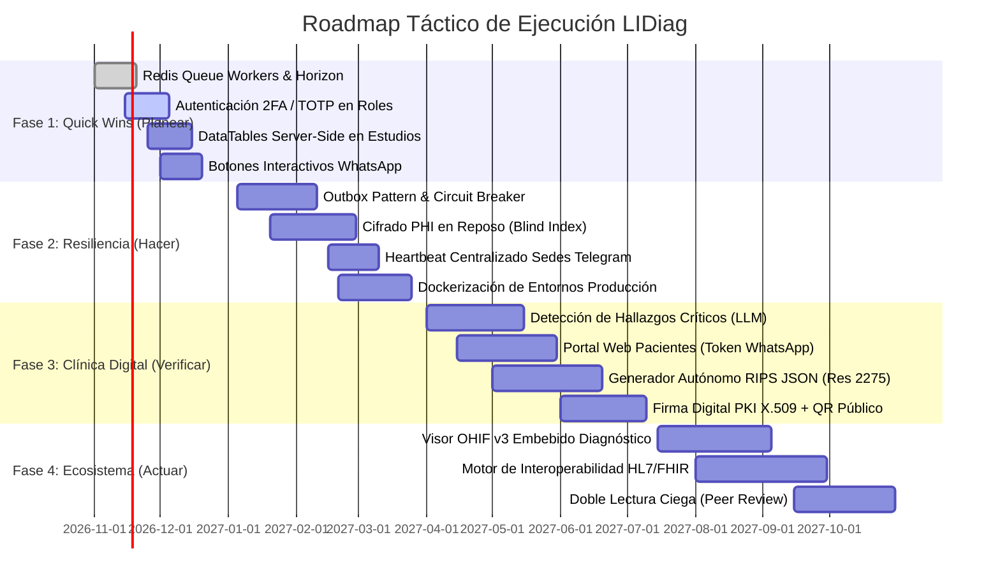

# 🗺️ ROADMAP ESTRATÉGICO Y ARQUITECTURA FUTURA — LIDiag
**De un RIS/PACS Departamental a un Ecosistema de Imagenología Diagnóstica de Alta Disponibilidad e Inteligencia Clínica**

---

## 1. Visión Ejecutiva y Contexto del Ecosistema

LIDiag es una plataforma integral de **Informática Médica (RIS / PACS / Tele-Radiología)** diseñada para la gestión clínica asistencial de imágenes diagnósticas de alta y baja complejidad (Radiología Convencional, TAC, Resonancia Magnética, Mamografía y Ecografías).

### Estado del Arte y Ecosistema Actual:
- **Core Backend:** Laravel 13 (PHP ^8.4) operando bajo arquitectura de servicios (`BaseService`), autenticación SPA stateful vía Laravel Sanctum, control de acceso basado en roles/permisos (`spatie/laravel-permission`), y persistencia relacional en MySQL.
- **Frontend Clínico:** Vue 3 (Composition API) con Vite, arquitectura orientada a componentes, bus de eventos global (`mitt`), librerías especializadas (Chart.js, Select2, DataTables) y diseño ergonómico de alta productividad con soporte para estaciones diagnósticas en penumbra (*Slate Clínico* / Dark Mode).
- **Interoperabilidad Hospitalaria Bidireccional:** Integración por consultas preparadas a base de datos externa de Historia Clínica Electrónica (**HIS - SAHI** en Microsoft SQL Server vía `sqlsrv`).
- **Orquestación DICOM Nativa (Modality Worklist - MWL):** Inserción y sincronización binaria directa en la base de datos de PACS (**Dcm4chee**) mediante codificación Little Endian Explicit VR y compresión zlib *Deflated Explicit VR Little Endian* (`1.2.840.10008.1.2.1.99`), facilitando la descarga de órdenes por las consolas de adquisición de rayos X mediante DICOM C-FIND.
- **Inteligencia Artificial y Multimedia:** Conversión forzada de audio a MP3 (64 kbps) con FFmpeg y transcripción de voz a texto especializada en CPU/GPU mediante microservicio local en **FastAPI + Whisper** (`storage/transcriptor/`).
- **Telemetría Edge de Dosimetría Radiológica:** Agente local desatendido en Python (`pydicom`) que extrae indicadores dosimétricos (`CTDIvol`, `DLP`, `DGM`, `DAP`) conforme a la **Resolución 482 de 2018 (Colombia)**, con anonimización criptográfica irreversible SHA-256 de identificadores de pacientes en cumplimiento de **ISO/IEC 27001**.
- **Canales de Notificación y Telemetría Móvil:** Webhooks interactivos de WhatsApp (Meta / Twilio) y agente bot residente en Telegram (`@salud_tolima_bot`) con soporte dual (Long-Polling / Webhook) para despacho de alertas y semáforos asistenciales.

---

## 2. Matriz Estratégica: Impacto vs. Esfuerzo

Esta matriz clasifica las iniciativas según el valor clínico y de negocio frente a la complejidad técnica y operativa requerida para su implementación:

```
 ALTO  ▲
       │  [QUICK WINS]                              [CORE UPGRADES]
       │  • Redis Queue Workers & Horizon           • Outbox Pattern & Resiliencia HIS/PACS
       │  • LLM Critical Findings Alert             • HL7 v2 / FHIR Engine (Interoperabilidad)
 I     │  • 2FA / TOTP en Roles Críticos            • Visor DICOM Zero-Footprint Embebido (OHIF)
 M     │  • DataTables Server-Side Estricto         • Firma Digital PKI X.509 + QR de Verificación
 P     │  • Botones Interactivos WhatsApp           • Cifrado en Reposo de PHI (Envelope Encryption)
 A     │─────────────────────────────────────────────────────────────────────────────────────────
 C     │  [FILL-INS / OPERACIONALES]                [MOONSHOTS / APUESTAS ESTRATÉGICAS]
 T     │  • Macros y Snippets en WYSIWYG            • Edge PACS Cache con Prefetching Predictivo
 O     │  • Heartbeat de Sedes (Telegram Bot)       • Generador Autónomo RIPS JSON (Res. 2275)
       │  • Encuesta Automatizada de NPS Clínico    • Diagnóstico Asistido por Computer Vision (CAD)
       │  • Post-procesador Fonético Whisper        • Doble Lectura Aleatoria Ciega (Peer Review)
       │
       └────────────────────────────────────────────────────────────────────────────────────────►
         BAJO                                     ESFUERZO                                   ALTO
```

### Tabla de Clasificación de Propuestas

| Cuadrante | Iniciativa | Justificación Principal | Esfuerzo Estimado | Impacto |
| :--- | :--- | :--- | :--- | :--- |
| **Quick Win** | Desacople de Colas a Redis + Horizon | Elimina latencias y timeouts bloqueantes en peticiones HTTP. | 1 Sprint | Muy Alto |
| **Quick Win** | Autenticación en 2 Pasos (2FA/TOTP) | Mitiga el vector de acceso no autorizado a información médica. | 1 Sprint | Alto |
| **Quick Win** | DataTables Server-Side en Estudios | Evita colapso de memoria del navegador en sedes con >10k registros. | 1 Sprint | Alto |
| **Quick Win** | Alerta de Hallazgos Críticos por LLM | Reduce a minutos el aviso de patologías de urgencia vital. | 2 Sprints | Crítico |
| **Core Upgrade** | Outbox Pattern + Circuit Breaker | Cero inconsistencias de órdenes ante caídas de enlace con HIS/PACS. | 3 Sprints | Crítico |
| **Core Upgrade** | Cifrado PHI en Reposo (Blind Index) | Cumplimiento regulatorio estricto ISO/IEC 27001 y Ley 1581 de 2012. | 3 Sprints | Muy Alto |
| **Core Upgrade** | Visor DICOM Zero-Footprint (OHIF/Cornerstone) | Elimina dependencia de pestañas externas y acelera lectura diagnóstica. | 4 Sprints | Muy Alto |
| **Core Upgrade** | Firma Digital PKI X.509 + QR Público | Garantiza autenticidad legal y no repudio de informes radiológicos. | 2 Sprints | Alto |
| **Core Upgrade** | Motor HL7 v2 / FHIR | Estandariza la interconexión con cualquier HIS del mercado. | 4 Sprints | Muy Alto |
| **Moonshot** | Generador RIPS JSON (Res. 2275 de 2023) | Automatiza la facturación y radicación electrónica ante EPS/Minsalud. | 3 Sprints | Muy Alto |
| **Moonshot** | Edge PACS Cache & Sincronización Local | Garantiza lectura y adquisición ininterrumpida si se corta internet. | 5 Sprints | Crítico |
| **Moonshot** | Doble Lectura y Control de Calidad | Asegura estándares de acreditación en salud y auditoría de concordancia. | 3 Sprints | Alto |

---

## 3. Bloque 1: Mejoras Arquitectónicas y Estructurales (Refactoring & SecOps)

### 3.1. Rendimiento, Concurrencia y Resiliencia en Integraciones Externas

#### A. Arquitectura Asíncrona basada en Colas Distribuidas (Redis + Laravel Horizon)
- **Problema Actual:** `QUEUE_CONNECTION=sync` ejecuta en el hilo de la petición HTTP procesos pesados como conversión de audio en FFmpeg (hasta 5-15s), inferencia de Whisper STT (10-30s), renderizado de PDF con LibreOffice/DomPDF, disparos a la API de WhatsApp/Twilio y webhooks de Telegram.
- **Solución Propuesta:** Migrar a `QUEUE_CONNECTION=redis` orquestado por **Laravel Horizon**.
  - **Colas Especializadas:**
    - `audio-processing`: Conversión FFmpeg a MP3 y consumo de microservicio Whisper con reintentos exponenciales.
    - `clinical-documents`: Generación de informes PDF y compilación de paquetes ZIP de consentimientos.
    - `external-notifications`: Despacho de WhatsApp, Telegram Bot y correos electrónicos.
    - `pacs-his-sync`: Drenaje de eventos de reconciliación MWL y SAHI.
- **Patrones de Diseño:** *Producer-Consumer Architecture*, *Compensating Transaction Pattern*.

#### B. Patrón Outbox Transaccional y Circuit Breaker para HIS/PACS
- **Problema Actual:** Si el enlace de red hacia el SQL Server de SAHI o el MySQL de Dcm4chee experimenta latencia o caída, las peticiones fallan directamente en el frontend arrojando errores 500 o dejando estudios en estados incongruentes.
- **Solución Propuesta:**
  - **Outbox Pattern:** Al asignar, cancelar o transcribir un estudio, el evento se escribe dentro de la misma transacción local MySQL en la tabla `outbox_events`. Un worker desacoplado consume y envía el cambio hacia SAHI/Dcm4chee.
  - **Circuit Breaker:** Si la conexión externa supera un umbral de 3 fallos consecutivos, el circuito pasa a estado `OPEN`, encolando los cambios sin bloquear a los usuarios en sala. Cuando el enlace se restablece, pasa a `HALF-OPEN` para verificar estabilidad y drena automáticamente los eventos acumulados (*Store-and-Forward*).
- **Tecnologías:** Middleware Guzzle / `ackintosh/ganesha` en PHP, transacciones atómicas MySQL.

#### C. Bloqueos Distribuidos Clínicos (Distributed Redlock)
- **Problema Actual:** `EstudioLockService` gestiona reservas para evitar que dos radiólogos lean o asignen el mismo estudio. En entornos balanceados o de múltiples workers, los locks basados en archivos o BD local sufren colisiones de hilos.
- **Solución Propuesta:** Implementar bloqueos distribuidos en Redis mediante el algoritmo **Redlock**:
  ```php
  Cache::lock("estudio:lectura:{$estudioProductoId}", 120)->block(3, function () {
      // Proceso de asignación o inicio de lectura
  });
  ```
  Con renovación periódica (*heartbeat*) desde la vista Vue mientras el especialista mantenga abierto el estudio.

#### D. Paginación Server-Side Estricta en Tablas Clínicas Masivas
- **Problema Actual:** En sedes de alto volumen (ej. Espinal o Ibagué), la carga de miles de registros de golpe satura el consumo de memoria del navegador y penaliza el First Contentful Paint (FCP).
- **Solución Propuesta:** Adoptar DataTables Server-Side estricto con proyecciones SQL indexadas y agregaciones optimizadas (`EXPLAIN / Covering Indexes`), reduciendo el payload de red a menos de 50 KB por página.

---

### 3.2. Endurecimiento de la Seguridad y Protección de Datos Clínicos (PHI / ISO 27001)

#### A. Cifrado en Reposo de Datos de Salud Protegidos (PHI At-Rest Encryption)
- **Problema Actual:** Nombres, documentos de identidad, diagnósticos y lecturas médicas residen en texto plano en la base de datos MySQL, exponiendo información sensible ante accesos indebidos a backups físicos.
- **Solución Propuesta:**
  - **Cifrado de Atributos:** Uso de `casts` cifrados en Eloquent (`'lectura' => 'encrypted'`, `'motivo_examen' => 'encrypted'`).
  - **Blind Indexing para Búsquedas Exactas:** Implementar `spatie/laravel-ciphersweet` con motor HMAC y salt independiente para campos que requieren búsqueda rápida (ej. `num_docu`), permitiendo consultar `WHERE num_docu_bindex = ?` sin desencriptar toda la tabla.

#### B. Auditoría Inmutable con Encadenamiento Criptográfico de Hashes (Hash Chaining)
- **Problema Actual:** La tabla `audit_logs` registra fielmente los eventos del sistema, pero si un usuario con privilegios de administrador de base de datos (`root`) altera un registro histórico, no queda evidencia de manipulación.
- **Solución Propuesta:**
  - Cada inserción en `audit_logs` calcula:
    $$\text{Hash}_n = \text{SHA256}(\text{Hash}_{n-1} + \text{id} + \text{user\_id} + \text{evento} + \text{datos\_nuevos} + \text{timestamp})$$
  - Si un solo registro es modificado o eliminado de forma retroactiva, la cadena criptográfica se invalida, disparando una alarma de integridad en el dashboard de auditoría.

#### C. Autenticación de Confianza Cero (Zero-Trust MFA & Step-Up Auth)
- **Problema Actual:** Las cuentas de radiólogos y personal administrativo dependen exclusivamente de correo y contraseña.
- **Solución Propuesta:**
  - **MFA / TOTP Obligatorio:** Integración de Google Authenticator / Microsoft Authenticator mediante `pragmarx/google2fa-laravel` para roles con acceso clínico y administrativo.
  - **Step-Up Authentication:** Exigir confirmación de contraseña o biometría web (WebAuthn / TouchID / Windows Hello) para acciones críticas (anulación de estudios, cambios en roles de seguridad o exportación masiva de datos).

---

### 3.3. Infraestructura Local, Despliegue y Alta Disponibilidad (HA)

#### A. Contenerización Homologada (Docker Compose Multicontenedor)
- **Problema Actual:** La infraestructura convive con servicios dependientes del host local (Laragon, Apache, certificados manuales, Python en entorno global, FFmpeg en PATH del sistema).
- **Solución Propuesta:** Estandarizar la arquitectura en contenedores Docker:
  - `lidiag-app`: PHP 8.4-FPM + extensiones `sqlsrv`, `pdo_mysql`, `gd`, `zip`, `bcmath`.
  - `lidiag-web`: Nginx configurado con HTTP/2, compresión Brotli y terminación SSL.
  - `lidiag-redis`: Redis 7 para colas, caché y sesiones distribuidas.
  - `lidiag-horizon`: Supervisor de colas en segundo plano.
  - `lidiag-whisper`: FastAPI + faster-whisper en contenedor aislado optimizado para CPU/GPU.
- **Beneficio:** Tiempos de despliegue en nuevas sedes reducidos de horas a minutos mediante `docker compose up -d`.

#### B. Red de Agentes Locales con Heartbeat y Alerta de Caídas (Dead Man's Snitch)
- **Solución Propuesta:**
  - Los agentes hospitalarios (`agente_dosimetria.py` y `backup_dcm_agent.py`) emitirán cada 5 minutos un pulso criptográfico a `POST /api/sedes/{id}/heartbeat` reportando métricas de salud (espacio libre en disco SSD, conectividad con MySQL `pacsdb`, carga de CPU y versión de script).
  - Si una sede hospitalaria deja de reportar por más de 15 minutos, el servicio `TelegramBotHandlerService` despacha automáticamente una alerta roja al grupo de soporte técnico en Telegram indicando el hospital afectado.

---

## 4. Bloque 2: Nuevas Funcionalidades (Product & Clinical Features)

### 4.1. Innovación Clínica para Médicos Radiólogos

#### A. Detección y Alerta Temprana de Hallazgos Críticos Asistida por IA (Red Flags Alert)
- **Propósito Clínico:** En urgencias y trauma, patologías críticas (neumotórax a tensión, hemorragia subaracnoidea, fracturas con compromiso medular, invaginación) requieren comunicación inmediata con el médico de cabecera.
- **Implementación Técnica:**
  - Microservicio NLP ligero en Python con modelo médico especializado (ej. `BiomedCLIP` o LLM cuantizado local en Ollama/vLLM).
  - Al completar la transcripción o dictado preliminar, el servicio analiza el texto mediante *Named Entity Recognition (NER)* y clasificación semántica.
  - Si clasifica un hallazgo como crítico, marca el estudio con indicador visual parpadeante (`badge-danger`) y despacha automáticamente una alerta prioritaria vía WhatsApp y Telegram al médico tratante y al jefe de turno.

#### B. Informes Radiológicos Estructurados (Structured Reporting - RSNA Templates)
- **Propósito Clínico:** Reducir la variabilidad de informes de texto libre y cumplir con estándares internacionales de reporte oncológico y seguimiento temporal.
- **Implementación Técnica:**
  - Integrar en [WysiwygEditor.vue](file:///c:/laragon/www/lidiag/resources/js/components/shared/WysiwygEditor.vue) esquemas estructurados basados en los estándares de la **RSNA (Radiological Society of North America)**:
    - *Técnica y Calidad de Imagen.*
    - *Estudios Previos de Comparación.*
    - *Hallazgos por Compartimento Anatómico.*
    - *Conclusión / Clasificación (BI-RADS, TI-RADS, LI-RADS).*
  - Exportación de informes como metadatos estructurados compatibles con HL7 FHIR `DiagnosticReport`.

#### C. Visor DICOM Web Embebido de Grado Diagnóstico (OHIF Viewer v3 + Cornerstone3D)
- **Propósito Clínico:** Eliminar la alternancia de ventanas hacia visores externos como Oviyam, unificando la lectura de imágenes y el diligenciamiento del informe en una consola diagnóstica integral.
- **Implementación Técnica:**
  - Integración de **Cornerstone3D** o **OHIF Viewer v3** embebido directamente en Vue 3 mediante WebGL / WebAssembly.
  - Soporte de Reconstrucción Multiplanar (MPR en planos Axial, Sagital y Coronal), Proyección de Máxima Intensidad (MIP), sincronización de series, medición de densidades Hounsfield (HU) en TAC y calibración milimétrica de distancias.

#### D. Doble Lectura Ciega y Control de Calidad Diagnóstica (Peer Review)
- **Propósito Clínico:** Requisito indispensable para acreditación de alta calidad hospitalaria y auditoría médica continua.
- **Implementación Técnica:**
  - Muestreo aleatorio automatizado (ej. 3% de los estudios mensuales leídos por cada radiólogo).
  - Reasignación anónima a un segundo especialista que califica la concordancia diagnóstica en escala estandarizada de 4 niveles (1: Concordante; 2: Discrepancia menor sin impacto clínico; 3: Discrepancia mayor con impacto en conducta médica; 4: Hallazgo no visualizado).
  - Generación de indicadores consolidados de calidad en el módulo de reportes.

---

### 4.2. Productividad Administrativa, Experiencia del Paciente y HelpDesk

#### A. Generador Autónomo y Validador de RIPS JSON (Resolución 2275 de 2023 de Colombia)
- **Propósito de Negocio:** Toda Institución Prestadora de Salud (IPS) en Colombia debe generar la factura electrónica acompañada del archivo RIPS en formato JSON validado ante el Ministerio de Salud para radicar cuentas ante las EPS sin glosas.
- **Implementación Técnica:**
  - Servicio dedicado `RipsJsonExportService` que cruza estudios realizados, procedimientos CUPS, diagnósticos CIE-10, datos demográficos del paciente y liquidación de tarifas.
  - Validación sintáctica y semántica previa contra el esquema oficial JSON Schema de Minsalud antes de emitir el paquete digital.

#### B. Portal Web del Paciente con Enlace Seguro Temporal vía WhatsApp
- **Propósito de Negocio:** Eliminar los costos recurrentes de impresión de placas radiológicas, quema de CDs y filas en taquillas de entrega de resultados.
- **Implementación Técnica:**
  - Al validarse la lectura y transcripción del estudio, el sistema emite automáticamente un mensaje de WhatsApp:
    `"Su informe de Rayos X está listo. Consulte su reporte e imágenes médicas aquí: https://lidiag.com/p/{token_seguro}"`.
  - **Seguridad:** El enlace cuenta con token criptográfico firmado temporal (caducidad a las 72 horas) y exige como segundo factor de validación los últimos 4 dígitos del documento de identidad del paciente.
  - Permite descargar el PDF oficial con código QR y acceder a un visor web DICOM liviano optimizado para teléfonos móviles.

#### C. Interacción Asistencial Avanzada con Botones Interactivos de WhatsApp
- **Propósito de Negocio:** Disminuir el ausentismo de pacientes en salas de diagnóstico (actualmente monitoreado en reportes).
- **Implementación Técnica:**
  - Sustituir los mensajes de texto plano por **Meta Interactive Messages** con botones de respuesta rápida:
    - `[ ✅ Confirmar Cita ]`
    - `[ ❌ Cancelar Cita ]`
    - `[ 🔄 Solicitar Reprogramación ]`
  - Las respuestas procesadas por el webhook de WhatsApp actualizan en tiempo real el estado en [AgendaCitaService.php](file:///c:/laragon/www/lidiag/app/Services/Agenda/AgendaCitaService.php) y liberan la sala de inmediato para otros pacientes.

#### D. HelpDesk Inteligente con Base de Conocimiento y Auto-Triage
- **Propósito Operativo:** Descongestionar al equipo de soporte de incidencias repetitivas de hardware o software en las sedes.
- **Implementación Técnica:**
  - Al escribir el título o detalle de la incidencia en [helpdeskCrearTicketComponent.vue](file:///c:/laragon/www/lidiag/resources/js/components/modulos/help-desk/helpdeskCrearTicketComponent.vue), un motor de autocompletado y búsqueda semántica despliega guías de solución rápida recomendadas (ej. *"Cómo reiniciar el servicio de audio"*, *"Cómo destrabar la cola del equipo de Rayos X"*).
  - Asignación inteligente automática del técnico de turno según la sede hospitalaria y prioridad del ticket.

---

## 5. Cronograma Táctico de Ejecución por Fases (Ciclo PHVA)



---

## 6. Indicadores de Éxito de la Arquitectura (KPIs Técnicos y Clínicos)

1. **Tiempo Medio de Respuesta API (P95):** Mantener el P95 por debajo de **200 ms** en todos los endpoints asistenciales mediante la descarga de tareas pesadas a workers Redis.
2. **Disponibilidad Asistencial (Uptime):** **99.9%** de tiempo en línea para la asignación y lectura de estudios, garantizado por el desacople con *Outbox Pattern*.
3. **Turn Around Time (TAT) en Estudios Urgentes:** Reducción del tiempo transcurrido desde la toma de la imagen hasta el informe firmado a menos de **60 minutos**, con alerta de hallazgos críticos en menos de **3 minutos**.
4. **Cumplimiento y Ahorro en Cuentas Médicas:** Reducción del **100%** de glosas por inconsistencias de RIPS mediante la validación previa automatizada bajo la Resolución 2275 de 2023.
5. **Ahorro en Consumibles y Logística de Resultados:** Disminución de más del **85%** en costos de impresión de placas y quema de CDs gracias a la entrega digital directa vía portal móvil con token seguro.
