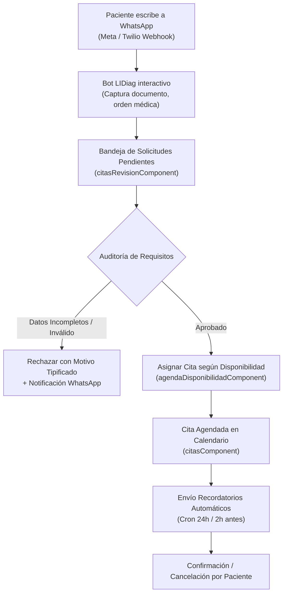

# Módulo: Agenda y Citas Médicas (WhatsApp & Portal) — LIDiag

## 1. Propósito y Alcance
El módulo de **Agenda y Citas Médicas** gestiona la programación de pacientes para procedimientos de radiología, ecografía, resonancia, tomografía y consultas especializadas. Integra capacidades de agenda médica por turnos, control de disponibilidad de salas/equipos, atención omnicanal automatizada mediante WhatsApp (Meta/Twilio) con procesamiento de solicitudes pendientes, tablero Kanban de gestión y notificaciones preventivas vía cron jobs.

- **Canales de Solicitud:**
  - *Ventanilla:* Registro directo por personal de recepción.
  - *WhatsApp Automatizado:* Bot interactivo que atiende al paciente y radica solicitudes con adjuntos.
  - *Portal Web:* Solicitudes generadas en línea.

---

## 2. Estado del Desarrollo
**Estado:** `Operativo / Estable` (en producción activa).

- **Completado e Implementado:**
  - Generador de disponibilidad médica y turnos por médico, sede y sala (`agendaDisponibilidadComponent.vue`).
  - Webhook de WhatsApp con procesamiento de menús, captura de órdenes médicas (imágenes/PDF) y radicación.
  - Bandeja de revisión de solicitudes con visor de archivos adjuntos y visualizador de conversación (`citasRevisionComponent.vue`).
  - Calendario general y tablero Kanban diario (`citasComponent.vue`, `gestionCitasComponent.vue`).
  - Transición completa de estados: `asignar`, `confirmar`, `cancelar`, `cumplir`, `no-asistio`, `rechazar`.
  - Catálogo de motivos de rechazo (`config_cita_rechazo_motivos`).
  - Preparaciones y recomendaciones clínicas por producto (`recomendacionProductoComponent.vue`).
  - Comandos cron `citas:notificar` (24h) y `citas:notificar-2h` (2h) para reducción del ausentismo.
- **En Observación / Próximos Pasos:**
  - Integración de confirmación mediante botones interactivos de WhatsApp que actualicen el estado en tiempo real sin intervención humana.

---

## 3. Funcionalidades Completas
- **Gestión de Disponibilidad (`agendaDisponibilidadComponent.vue`):**
  - Generación de bloques horarios por médico, sala y especialidad.
  - Definición de slots de tiempo en minutos y cupos simultáneos.
- **Revisión de Solicitudes Digitales (`citasRevisionComponent.vue`):**
  - Auditoría de órdenes médicas y soportes enviados por WhatsApp.
  - Lectura del historial de conversación del paciente con el bot (`verConversacion`).
  - Aprobación con asignación inmediata o rechazo justificado con notificación.
- **Calendario Multisede (`citasComponent.vue`):**
  - Filtros por sede, especialidad, médico y rango de fechas.
  - Vistas mensual, semanal y diaria de turnos.
- **Tablero Kanban Operativo (`gestionCitasComponent.vue`):**
  - Supervisión en tiempo real de pacientes del día: Pendientes, Confirmados, En Sala, Atendidos, Inasistencias.
- **Recomendaciones de Preparación (`recomendacionProductoComponent.vue`):**
  - Parametrización de indicaciones clínicas que se despachan automáticamente con la confirmación de la cita.

---

## 4. Flujos de Trabajo

---

## 5. Componentes Técnicos (Backend y Frontend)

### 5.1 Backend (Laravel)
- **Controladores (`app/Http/Controllers/Agenda/`):**
  - `AgendaCitaController.php`: CRUD de citas, webhook de WhatsApp, confirmación, descarga de medios y conversación.
  - `AgendaDisponibilidaController.php`: Bloques de disponibilidad médica y salas.
  - `AgendaDisponibilidaDetalleController.php`: Slots individuales de tiempo.
  - `ConfigCitaRechazoMotivoController.php`: Catálogo de causales de rechazo.
- **Servicios (`app/Services/Agenda/`):**
  - `AgendaCitaService.php`: Reglas de negocio de citas y notificaciones.
  - `AgendaCitaQueryService.php`: Consultas de alto rendimiento para calendario.
  - `AgendaDisponibilidaService.php`: Cálculo de slots libres según jornada.
  - `ConfigCitaRechazoMotivoService.php`: Gestión de motivos de rechazo.
- **Form Requests (`app/Http/Requests/Agenda/`):**
  - `AgendaCitaStoreRequest.php`, `AgendaCitaAsignarRequest.php`, `AgendaCitaCancelarRequest.php`, `AgendaCitaRechazarRequest.php`, `AgendaDisponibilidaRequest.php`, `AgendaDisponibilidaDetalleRequest.php`, etc.
- **Comandos:** `CitasNotificarCommand.php`, `CitasNotificar2hCommand.php`.
- **Modelos:** `AgendaCita.php`, `AgendaDisponibilidad.php`, `AgendaDisponibilidadDetalle.php`, `CitaRechazoMotivo.php`.
- **Rutas API:** `routes/api_citas.php` y `routes/api_agendamiento_dashboard.php`.

### 5.2 Frontend (Vue 3 / AdminWrap)
- `citasComponent.vue`: Calendario general y tabla de citas.
- `citasRevisionComponent.vue`: Bandeja de solicitudes pendientes con visor de adjuntos.
- `citasNotificationBadgeComponent.vue`: Indicador en tiempo real de citas pendientes en header y sidebar.
- `gestionCitasComponent.vue`: Tablero Kanban operativo diario.
- `agendaDisponibilidadComponent.vue`: Configuración de disponibilidad médica y turnos.
- `recomendacionProductoComponent.vue`: Preparaciones clínicas por examen.

---

## 6. Interoperabilidad y Reglas de Negocio
- **Webhook de WhatsApp:** En desarrollo local se expone mediante túnel Cloudflare (`http://lidiag.test`) usando el token `lidiag_whatsapp_2026`.
- **Prevención de Sobrecupos:** La asignación valida que no existan citas solapadas para el mismo paciente o sala sin autorización expresa.
- **Almacenamiento de Adjuntos:** Las órdenes médicas enviadas por WhatsApp se almacenan en el disco privado `citas_media/` y se descargan mediante `AgendaCitaController::descargarMedia`.

---

## 7. Validaciones, Permisos y Pendientes
- **Permisos Spatie:** `citas.index`, `agendamiento.agendamiento.*`, `agendamiento.solicitudes.*`, `agendamiento.disponibilidad.*`.
- **Reinicio de Túnel Cloudflare:** Cada reinicio de `cloudflared` genera una nueva URL transitoria `trycloudflare.com`, la cual debe actualizarse en el portal de Meta Developers.
