# Módulo: Configuración y Parametrización Global — LIDiag

## 1. Propósito y Alcance
El módulo de **Configuración y Parametrización Global** es el núcleo de administración de maestros, catálogos normativos de salud en Colombia, topología de sedes físicas, topología de red radiológica, parámetros de interoperabilidad (HIS/PACS), bots conversacionales y textos clínicos predefinidos de LIDiag.

Centraliza todas las definiciones requeridas por los módulos asistenciales (**Estudios**, **Ecografías**, **Oftalmología**, **Agenda y Citas**, **Tele-Radiología** y **Helpdesk**), permitiendo la adaptación ágil de la institución ante cambios normativos del Ministerio de Salud (códigos CUPS, CIE-10), convenios con EPS o aperturas de nuevas sedes asistenciales.

---

## 2. Estado del Desarrollo
**Estado:** `Operativo / Estable` (en producción activa).

- **Completado e Implementado:**
  1. **Topología de Sedes y PACS:** Configuración de sedes (`config_sedes`), credenciales encriptadas de conexión a bases de datos de PACS por sede (`ip_dcm`, `bd_dcm`, `usuario_dcm`, `password_dcm`) y definición de interfaz hospitalaria (`interface_software = 'SAHI'` o `'LOCAL'`).
  2. **Consolas y Modality Worklist (MWL):** Inventario de equipos radiológicos (`config_worklist_dispositivos`) con mapeo de AE Titles, IP, puertos DICOM, modalidad y conmutación de estado activo/inactivo (`toggle-estado`).
  3. **Catálogo de Procedimientos CUPS:** Maestro `config_productos` con códigos legales, modalidad (`CR`, `CT`, `MR`, `US`, `MG`, `OF`), tarifas base, agrupación de liquidación y comandos de sincronización (`productos:sincronizar-espinal`, `productos:relacionar-modulos`).
  4. **Diagnósticos Médicos CIE-10:** Maestro `config_diagnosticos` con búsqueda predictiva tokenizada por código o descripción y soporte para lateralidad ocular/corporal.
  5. **Directorio de Administradoras de Salud (EPS/ARL):** Catálogo `config_admin_salud` para aseguramiento médico.
  6. **Servicios Clínicos y Mapeo de Exámenes:** Parametrización de servicios de citas (`config_servicios`) y asociación relacional muchos a muchos con exámenes diagnósticos (`servicio_producto` / `ServicioProductoController`).
  7. **Tipos de Recaudo:** Maestro `config_tipos_recaudo` para clasificación de atenciones (`Particular`, `Cortesía`, `Por Atención / SAHI`).
  8. **Documentos de Identidad:** Catálogo `config_tipos_documentos` con validación estricta de formatos (`CC`, `TI`, `RC`, `CE`, `PA`, `MS`, etc.).
  9. **Prioridades Asistenciales:** Clasificación de criticidad en atención médica (`config_prioridades`).
  10. **Plantillas Radiológicas y Tipos de Plantilla:** Motor de plantillas macro (`config_plantillas`) vinculadas a tipos de plantilla (`config_plantillas_tipos`) con reemplazo de variables dinámicas (`[PACIENTE]`, `[EDAD]`, `[FECHA]`).
  11. **Plantillas Especializadas de Oftalmología:** Catálogo dedicado `config_plantillas_oftalmologia` segmentado por secciones clínicas (`ANAMNESIS`, `EXAMEN_FISICO`, `CONCEPTO_PLAN`, `MEDICAMENTOS`, `PROCEDIMIENTOS`).
  12. **Plantillas de Consentimientos Informados (WYSIWYG Multimodular):** Motor `consentimiento_plantillas` con versionado de textos legales, previsualización en PDF (`previewPdf`), activación de versión vigente (`setVigente`) y vinculación a módulos (`config_modulos`).
  13. **Consentimiento Informado General:** Catálogo `config_consentimiento_informado` para acuerdos asistenciales.
  14. **Parametrización del Bot de WhatsApp:** Estructuración en 3 dimensiones:
      - Números telefónicos por sede (`config_sede_whatsapp_numbers`).
      - Mensajes de saludo interactivos con variables dinámicas (`config_whatsapp`).
      - Preparaciones y recomendaciones clínicas por examen (`config_recomendacion_productos`).
  15. **Motivos de Rechazo y Cancelación:** Catálogo `config_cita_rechazo_motivos` para auditoría de citas no agendadas.
  16. **Parámetros de Helpdesk:** Catálogos de categorías (`helpdesk_categorias`), estados (`helpdesk_estados`) y prioridades (`helpdesk_prioridades`) para la mesa de ayuda.
  17. **Inventario de Módulos del Sistema:** Control maestro de módulos de la aplicación (`config_modulos` / `ConfigModulosController`).
- **En Observación / Próximos Pasos:**
  - Módulo de carga masiva de tarifas SOAT en archivo Excel con actualización automática de factores de conversión anual.

---

## 3. Detalle de Sub-Módulos y Catálogos Configurados

```mermaid
flowchart TD
    CONFIG["Módulo de Configuración Global<br/>(routes/api_configuracion.php)"]

    subgraph "1. Infraestructura y Red Radiológica"
        CONFIG --> S1["Sedes y Credenciales PACS<br/>(config_sedes)"]
        CONFIG --> S2["Consolas / Dispositivos MWL<br/>(config_worklist_dispositivos)"]
        CONFIG --> S3["Servicios Clínicos y Cupos<br/>(config_servicios)"]
        CONFIG --> S4["Mapeo Servicio ➔ Productos<br/>(servicio_producto)"]
    end

    subgraph "2. Catálogos Clínicos y Normativos"
        CONFIG --> C1["Procedimientos CUPS<br/>(config_productos)"]
        CONFIG --> C2["Diagnósticos CIE-10<br/>(config_diagnosticos)"]
        CONFIG --> C3["Aseguradoras / EPS<br/>(config_admin_salud)"]
        CONFIG --> C4["Tipos de Documento y Recaudo<br/>(config_tipos_documentos / recaudos)"]
        CONFIG --> C5["Prioridades Asistenciales<br/>(config_prioridades)"]
    end

    subgraph "3. Plantillas de Informes y Consentimientos"
        CONFIG --> P1["Plantillas Radiológicas<br/>(config_plantillas)"]
        CONFIG --> P2["Tipos de Plantilla<br/>(config_plantillas_tipos)"]
        CONFIG --> P3["Plantillas Oftalmología por Sección<br/>(config_plantillas_oftalmologia)"]
        CONFIG --> P4["Consentimientos WYSIWYG Multimodular<br/>(consentimiento_plantillas)"]
    end

    subgraph "4. Mensajería, Citas y Soporte"
        CONFIG --> M1["Líneas WhatsApp por Sede<br/>(config_sede_whatsapp_numbers)"]
        CONFIG --> M2["Saludos y Bot Conversacional<br/>(config_whatsapp)"]
        CONFIG --> M3["Recomendaciones y Preparación CUPS<br/>(config_recomendacion_productos)"]
        CONFIG --> M4["Motivos de Rechazo de Citas<br/>(config_cita_rechazo_motivos)"]
        CONFIG --> M5["Parámetros Helpdesk<br/>(Categorías, Estados, Prioridades)"]
        CONFIG --> M6["Maestro de Módulos Activos<br/>(config_modulos)"]
    end
```

### 3.1 Infraestructura, Sedes y Servidores PACS (`config_sedes`)
- **Propósito:** Registro de sucursales físicas (Espinal, Chaparral, Ibagué, Líbano, Honda, La Dorada).
- **Parámetros Críticos:**
  - `interface_software`: Determina si la sede interactúa con el HIS hospitalario SAHI (`'SAHI'`) o trabaja de manera local autónoma (`'LOCAL'`).
  - Parámetros de conexión a la base de datos MySQL del PACS de la sede: `ip_dcm`, `puerto_dcm`, `bd_dcm`, `usuario_dcm`, `password_dcm`.
  - Endpoint `POST /config/sedes/updateWitchPlantillas` para asociación de plantillas institucionales por sede.

### 3.2 Dispositivos de Flujo y Consolas DICOM (`config_worklist_dispositivos`)
- **Propósito:** Registro de consolas de Rayos X, Tomógrafos, Resonadores y Mamógrafos que consumen la lista de trabajo Modality Worklist (DICOM C-FIND).
- **Campos:** AE Title del equipo, dirección IP de red local, puerto DICOM (ej. 104, 11112), modalidad asociada y sede física. Conmutación rápida mediante `PATCH /api/config-worklist-dispositivos/{id}/toggle-estado`.

### 3.3 Catálogo de Procedimientos CUPS (`config_productos`)
- **Propósito:** Portafolio maestro de exámenes y consultas.
- **Campos:** `CodLegal` (código CUPS normativo en Colombia), `NomProducto` (nombre del examen), modalidad (`CR`, `CT`, `MR`, `US`, `MG`, `OF`), valor base de referencia, grupo asistencial de liquidación y estado.
- **Comandos de Soporte:**
  - `php artisan productos:sincronizar-espinal`: Sincronización automática de productos hospitalarios desde SAHI Espinal.
  - `php artisan productos:relacionar-modulos`: Mapeo automático de exámenes a sus respectivos módulos en base a su código CUPS y descripción.

### 3.4 Diagnósticos Médicos CIE-10 (`config_diagnosticos`)
- **Propósito:** Maestro internacional de enfermedades utilizado para el cierre diagnóstico de estudios, ecografías y consultas oftalmológicas.
- **Optimización:** Búsqueda indexada en base de datos para autocompletado en menos de 50 ms en los componentes de lectura médica.

### 3.5 Administradoras de Salud / EPS (`config_admin_salud`)
- **Propósito:** Directorio de pagadores, Entidades Promotoras de Salud (EPS contributivo/subsidiado), aseguradoras de riesgos laborales (ARL), SOAT y medicina prepagada.

### 3.6 Servicios Clínicos y Vinculación de Productos (`config_servicios` y `servicio_producto`)
- **Propósito:** Configuración de las agendas asistenciales (Radiología, Ecografías, Oftalmología, Tomografía, etc.).
- **Vinculación:** Mediante `ServicioProductoController`, define con precisión qué exámenes CUPS específicos pueden ser agendados dentro de cada servicio clínico, disponiendo del endpoint de consulta `GET /api/servicio-producto/productos-no-vinculados`.

### 3.7 Tipos de Recaudo (`config_tipos_recaudo`)
- **Propósito:** Clasificación operativa y contable de los pacientes:
  - `1 - PARTICULAR`: Recaudo en taquilla o transferencia sin orden de EPS.
  - `2 - CORTESÍA`: Examen médico autorizado sin costo para el usuario.
  - `3 - POR ATENCIÓN (SAHI)`: Paciente facturado mediante la interfaz hospitalaria.

### 3.8 Tipos de Documento de Identificación (`config_tipos_documentos`)
- **Propósito:** Maestro de documentos según los estándares de la Registraduría y el Ministerio de Salud de Colombia (`CC`, `TI`, `RC`, `CE`, `PA`, `MS`, `AS`, etc.) con validación de longitud y caracteres permitidos.

### 3.9 Prioridades Asistenciales (`config_prioridades`)
- **Propósito:** Clasificación de urgencia médica (`Urgente`, `Prioritario`, `Rutinario`) que gobierna el orden de lectura en las estaciones de trabajo de los radiólogos.

### 3.10 Plantillas de Informes Radiológicos y Tipos (`config_plantillas` y `config_plantillas_tipos`)
- **Propósito:** Biblioteca de textos estructurados para agilizar el dictado médico.
- **Clasificación:** Agrupadas por tipo de plantilla (`config_plantillas_tipos`) correspondiente a modalidades de imagen (RX Tórax, TAC de Cráneo simple, Resonancia de Columna, etc.).
- **Variables Dinámicas:** Reemplazo en tiempo de lectura de comodines como `[PACIENTE]`, `[EDAD]`, `[DOCUMENTO]`, `[FECHA]`, `[MEDICO]`.

### 3.11 Plantillas Clínicas de Oftalmología (`config_plantillas_oftalmologia`)
- **Propósito:** Catálogo clínico especializado segmentado por pestañas de la historia oftalmológica:
  - `ANAMNESIS`: Motivos de consulta y antecedentes oftalmológicos.
  - `EXAMEN_FISICO`: Descripciones estándar de biomicroscopía y fondo de ojo.
  - `CONCEPTO_PLAN`: Conductas médicas y recomendaciones de control.
  - `MEDICAMENTOS`: Fórmulas predefinidas de colirios, lubricantes y antibióticos con posología.
  - `PROCEDIMIENTOS`: Órdenes estandarizadas de exámenes diagnósticos oculares.

### 3.12 Plantillas de Consentimientos Informados Multimodular (`consentimiento_plantillas`)
- **Propósito:** Gestión legal avanzada con editor WYSIWYG de textos de consentimiento informado para procedimientos que conllevan riesgo (ecografías intervencionistas, medios de contraste endovenoso en TAC/RM, procedimientos oftalmológicos).
- **Capacidades Clave:**
  - Vinculación directa con módulos (`config_modulos`).
  - Historial de versionado (`/consentimientos-plantillas/producto/{id}/versions`).
  - Activación de versión vigente (`POST /consentimientos-plantillas/{id}/vigente`).
  - Previsualización en tiempo real del PDF legal (`GET /consentimientos-plantillas/{id}/preview-pdf`).

### 3.13 Bot Asistencial de WhatsApp (`config_whatsapp`, `config_sede_whatsapp_numbers`, `config_recomendacion_productos`)
- **Propósito:** Parametrización completa del bot de WhatsApp para agendamiento desatendido:
  - `config_sede_whatsapp_numbers`: Líneas telefónicas y cuentas de Meta Cloud API asignadas a cada sede física.
  - `config_whatsapp`: Mensajes interactivos de bienvenida, menús de opciones y textos de saludo.
  - `config_recomendacion_productos`: Guías clínicas de preparación de exámenes (ayuno, hidratación previa, suspensión de medicamentos, creatinina previa para contrastes) que el bot despacha automáticamente al confirmarse la cita.

### 3.14 Motivos de Rechazo de Citas (`config_cita_rechazo_motivos`)
- **Propósito:** Catálogo de causales tipificadas (orden médica vencida, falta de preparación clínica, inconsistencia de datos, falta de convenio con EPS) para auditoría de citas rechazadas.

### 3.15 Parámetros de Mesa de Ayuda Helpdesk
- **Propósito:** Tablas de parametrización para el módulo de soporte informático:
  - `helpdesk_categorias`: Clasificación del problema (Hardware, Software PACS, Red/Conectividad, HCE).
  - `helpdesk_estados`: Flujo de vida del ticket (Abierto, En Proceso, En Espera, Resuelto, Cerrado).
  - `helpdesk_prioridades`: Niveles de severidad (Baja, Media, Alta, Urgente).

### 3.16 Inventario de Módulos del Sistema (`config_modulos`)
- **Propósito:** Registro maestro de las capacidades funcionales instaladas en la plataforma (`ConfigModulosController::listarModulos`) utilizado para la vinculación transversal de plantillas, auditoría y permisos de navegación.

---

## 4. Componentes Backend y Frontend

### 4.1 Backend (Laravel)

| Tipo | Archivo / Clase | Responsabilidad |
|---|---|---|
| **Controlador** | `App\Http\Controllers\Configuracion\ConfigSedeController` | CRUD de sedes físicas, parámetros PACS y asignación de plantillas. |
| **Controlador** | `App\Http\Controllers\Configuracion\ConfigWorklistDispositivoController` | Gestión de consolas DICOM MWL y toggle de activación. |
| **Controlador** | `App\Http\Controllers\Configuracion\ConfigProductoController` | Catálogo de procedimientos CUPS, modalidades y tarifas base. |
| **Controlador** | `App\Http\Controllers\Configuracion\ConfigDiagnosticoController` | Maestro de diagnósticos médicos CIE-10 y búsqueda predictiva. |
| **Controlador** | `App\Http\Controllers\Configuracion\ConfigAdminSaludController` | Directorio de EPS, ARL y aseguradoras de salud. |
| **Controlador** | `App\Http\Controllers\Configuracion\ConfigServicioController` | Servicios clínicos de citas y disponibilidad. |
| **Controlador** | `App\Http\Controllers\Configuracion\ServicioProductoController` | Mapeo y desvinculación de exámenes CUPS a servicios de citas. |
| **Controlador** | `App\Http\Controllers\Configuracion\ConfigTipoRecaudoController` | Maestro de modalidades de recaudo (Particular, Cortesía, SAHI). |
| **Controlador** | `App\Http\Controllers\Configuracion\ConfigTipoDocumentoController` | Maestro de documentos de identidad oficiales. |
| **Controlador** | `App\Http\Controllers\Configuracion\ConfigPrioridadController` | Catálogo de prioridades clínicas. |
| **Controlador** | `App\Http\Controllers\Configuracion\ConfigPlantillaController` | CRUD de plantillas de informe radiológico. |
| **Controlador** | `App\Http\Controllers\Configuracion\ConfigPlantillaTipoController` | Maestro de tipos y categorías de plantillas médicas. |
| **Controlador** | `App\Http\Controllers\Configuracion\ConfigPlantillaOftalmologiaController` | CRUD de plantillas clínicas oftálmicas por sección. |
| **Controlador** | `App\Http\Controllers\Consentimientos\ConsentimientoPlantillasController` | Motor WYSIWYG de plantillas de consentimientos informados con versionado y preview PDF. |
| **Controlador** | `App\Http\Controllers\Configuracion\ConsentimientoInformadoController` | Catálogo de consentimientos informados generales. |
| **Controlador** | `App\Http\Controllers\Configuracion\ConfigSedeWhatsappNumberController` | Asignación de líneas telefónicas de WhatsApp por sede. |
| **Controlador** | `App\Http\Controllers\Configuracion\ConfigWhatsappController` | Mensajes de bienvenida y configuración conversacional del bot. |
| **Controlador** | `App\Http\Controllers\Configuracion\ConfigRecomendacionProductoController` | Preparaciones y recomendaciones clínicas asociadas a productos CUPS. |
| **Controlador** | `App\Http\Controllers\Agenda\ConfigCitaRechazoMotivoController` | Maestro de motivos tipificados de rechazo de citas. |
| **Controlador** | `App\Http\Controllers\HelpDesk\HelpDeskCategoriasController` | Maestro de categorías de tickets de soporte técnico. |
| **Controlador** | `App\Http\Controllers\HelpDesk\HelpDeskEstadosController` | Maestro de estados de tickets. |
| **Controlador** | `App\Http\Controllers\HelpDesk\HelpDeskPrioridadesController` | Maestro de prioridades de incidentes técnicos. |
| **Controlador** | `App\Http\Controllers\Configuracion\ConfigModulosController` | Listado y gobierno de módulos activos del sistema. |
| **Servicios** | `App\Services\Configuracion\*` | Capa de negocio transaccional (`ConfigSedeService`, `ConfigProductoService`, `ConfigPlantillaService`, `ConfigPlantillaOftalmologiaService`, `ConfigWhatsappService`, `ProductosEspinalSyncService`, etc.). |
| **Form Requests** | `App\Http\Requests\Configuracion\*` | Validación estricta de formularios (`ConfigSedeRequest`, `ConfigProductoRequest`, `StoreConfigPlantillaRequest`, `StoreConsentimientoInformadoRequest`, etc.). |
| **Rutas API** | `routes/api_configuracion.php` | 40+ endpoints RESTful protegidos por middleware `auth` (Sanctum stateful) y Spatie Permissions. |

### 4.2 Frontend (Vue 3 / AdminWrap)

| Componente Vue | Ruta SPA / Blade | Propósito |
|---|---|---|
| `configSedeComponent.vue` | `/config-sedes-listar` | Gestión de sedes, conexiones PACS multisede, parámetros SAHI y plantillas institucionales. |
| `configDispositivosComponent.vue` | `/config-dispositivos-listar` | Maestro de consolas y equipos radiológicos MWL (AE Title, IP, puerto, modalidad). |
| `configProductoComponent.vue` | `/config-productos-listar` | Catálogo de exámenes CUPS, tarifas base, modalidades y grupos de liquidación. |
| `configDiagnosticoComponent.vue` | `/config-diagnosticos-listar` | Maestro de códigos diagnósticos CIE-10. |
| `configAdminSaludComponent.vue` | `/config-adminsalud-listar` | Directorio de aseguradoras, EPS y terceros pagadores. |
| `configServicioCitaComponent.vue` | `/config-servicio-citas-listar` | Configuración de agendas de citas y asociación de exámenes CUPS autorizados. |
| `configTipoDocumentoComponent.vue` | `/config-tipos-documentos-listar` | Maestro de tipos de documentos de identidad. |
| `configPrioridadComponent.vue` | `/config-prioridades-listar` | Catálogo de niveles de prioridad asistencial. |
| `configPlantilla.vue` | `/config-plantillas-listar` | Editor de plantillas de informe radiológico con variables dinámicas. |
| `configTipoPlantilla.vue` | `/config-tipos-plantillas.listar` | Categorías y agrupaciones de plantillas médicas. |
| `configPlantillasOftalmologiaComponent.vue` | `/config-plantillas-oftalmologia` | Editor de plantillas oftálmicas segmentadas por sección clínica. |
| `plantillasConsentimientoComponent.vue` | `/config-consentimientos-plantillas` | Editor WYSIWYG de cláusulas de consentimientos con versionado y previsualización de PDF. |
| `configConsentimientoInformadoComponent.vue` | `/config-consentimiento-informado-listar` | Catálogo de consentimientos informados generales. |
| `configWhatsappComponent.vue` | `/config-whatsapp-listar` | Tablero integrado del bot de WhatsApp (pestañas: Números, Saludos, Recomendaciones). |
| `configWhatsappNumeros.vue` | Pestaña en WhatsApp Bot | Asignación de líneas telefónicas por sede. |
| `configWhatsappSaludos.vue` | Pestaña en WhatsApp Bot | Mensajes de bienvenida y reglas de respuesta interactiva. |
| `configWhatsappProductos.vue` | Pestaña en WhatsApp Bot | Mapeo de preparaciones y recomendaciones por examen CUPS. |
| `configCitaRechazoMotivoComponent.vue` | `/config-cita-rechazo-motivos` | Catálogo de causales de cancelación/rechazo de solicitudes de citas. |
| `helpdeskConfigCategoriasComponent.vue` | `/config-helpdesk-categorias-listar` | Maestro de categorías para la mesa de ayuda. |
| `helpdeskConfigEstadosComponent.vue` | `/config-helpdesk-estados-listar` | Maestro de estados de tickets técnicos. |
| `helpdeskConfigPrioridadesComponent.vue` | `/config-helpdesk-prioridades-listar` | Maestro de prioridades de incidentes de soporte. |

---

## 5. Interoperabilidad y Reglas de Negocio
- **Cifrado Robusto de Credenciales PACS:** Las contraseñas de las bases de datos remotas en `config_sedes` se protegen mediante el encriptador simétrico de Laravel (`Crypt::encryptString`) y nunca se exponen en texto plano en las respuestas JSON de la API.
- **Inactivación Lógica Defensiva:** Los procedimientos CUPS (`config_productos`) y diagnósticos (`config_diagnosticos`) que posean referencias históricas en estudios, ecografías o historias clínicas no pueden ser eliminados físicamente; el backend restringe la acción forzando el marcado de estado inactivo (`estado = false`) para garantizar la inmutabilidad de la historia clínica.
- **Matriz de Permisos Spatie Granular:** Cada catálogo cuenta con su propio set de permisos (`config.sedes.*`, `config.productos.*`, `config.diagnosticos.*`, `config.whatsapp.*`, `config.dispositivos.*`, etc.), impidiendo accesos accidentales o desautorizados desde cuentas operativas.
- **Sincronización Asistencial con SAHI:** El comando `productos:sincronizar-espinal` permite actualizar en bloque las tarifas y códigos CUPS vigentes en la base de datos SQL Server del hospital principal.

---

## 6. Pendientes y Notas Técnicas
- **Caché de Catálogos Maestros:** Dado que catálogos como tipos de documento, tipos de recaudo y prioridades cambian con muy baja frecuencia, se recomienda implementar almacenamiento en caché (`Cache::rememberForever`) invalidado únicamente mediante observadores Eloquent (`saved`/`deleted`).
- **Pérdida de Formato en Plantillas WYSIWYG:** El editor de consentimientos informados limpia automáticamente tags HTML inseguros (`<script>`, `<iframe>`), preservando únicamente estilos en línea permitidos para garantizar la correcta renderización por el motor DomPDF.
