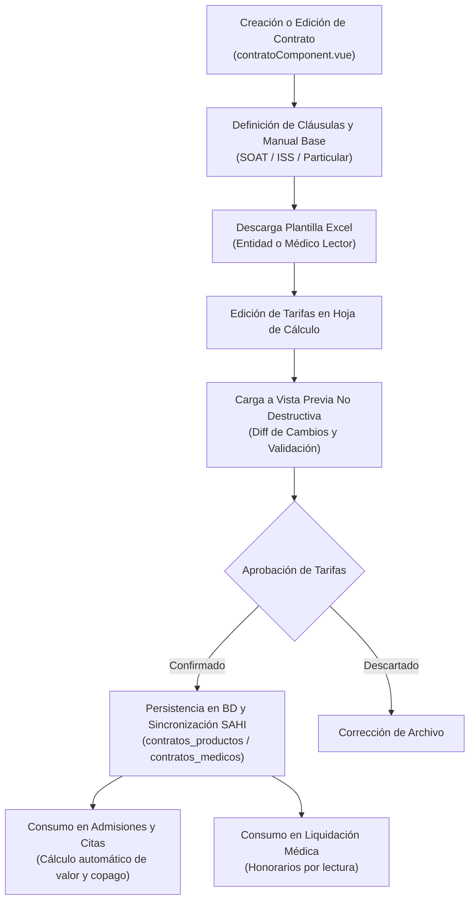

# Módulo: Contratación, Tarifarios y Convenios — LIDiag

## 1. Propósito y Alcance
El módulo de **Contratación, Tarifarios y Convenios** administra la estructura comercial, administrativa y tarifaria de LIDiag. Gestiona los acuerdos de voluntades celebrados con Entidades Promotoras de Salud (EPS), aseguradoras de riesgos laborales (ARL), compañías de medicina prepagada, planes complementarios y empresas privadas, definiendo los manuales tarifarios (SOAT, ISS 2001, convenios propios con factor de liquidación) aplicables a cada estudio de imágenes diagnósticas.

- **Manuales Tarifarios Dinámicos:**
  - `SOAT`: Liquidación basada en SMLDV o UVT con porcentaje de variación (+ / - %).
  - `ISS 2001` / `ISS 2000`: Liquidación en UVR con factores de conversión pactados.
  - `TARIFARIO PROPIO / PARTICULAR`: Tarifas fijas en moneda corriente.
  - `TARIFAS MÉDICOS LECTORES`: Configuración de honorarios diferenciados por especialista y examen dentro de cada convenio.

---

## 2. Estado del Desarrollo
**Estado:** `Operativo / Estable` (en producción activa).

- **Completado e Implementado:**
  - CRUD completo de contratos, entidades pagadoras y planes de salud asociados (`ContratoController.php`).
  - Conmutador de estado activo/inactivo (`toggleEstado`).
  - Análisis de cobertura de catálogo: reporte de exámenes sin tarifa asignada (`cobertura`).
  - Drawer interactivo de médicos vinculados y productos (`listarMedicosProductos`).
  - Importación/Exportación bidireccional en Excel de Plantillas de Entidad/Hospital y Plantillas personalizadas de Médicos Lectores.
  - Previsualización no destructiva (`previewImportarEntidad`, `previewImportarMedicos`) con detección de diferencias (diff) antes de la confirmación final.
  - Sincronización transaccional con `conContrato` y `conPlan` de SAHI.
- **En Observación / Próximos Pasos:**
  - Alertas automáticas por correo electrónico ante contratos próximos a vencer (30 y 15 días previos).

---

## 3. Funcionalidades Completas
- **Gestión Integral de Contratos (`contratoComponent.vue`):**
  - Registro de convenios con entidad, vigencia, modalidad de pago, topes y pólizas.
  - Tabla interactiva con búsqueda por entidad o número de contrato.
- **Tarifas de Entidad / Hospital:**
  - Descarga de plantilla Excel prellenada con códigos CUPS (`exportPlantillaEntidad`).
  - Carga masiva con vista previa no destructiva (`previewImportarEntidad`) y persistencia confirmada (`confirmarImportarEntidad`).
- **Tarifas de Médicos Lectores:**
  - Configuración de honorarios médicos por lectura para cada profesional (`exportPlantillaMedico`).
  - Sincronización no destructiva de asignación médico-producto (`syncMedicos`).
- **Auditoría de Cobertura de Portafolio:**
  - Reporte instantáneo de productos del portafolio que carecen de tarifa en el contrato seleccionado.

---

## 4. Flujos de Trabajo

---

## 5. Componentes Técnicos (Backend y Frontend)

### 5.1 Backend (Laravel)
- **Controlador:**
  - `app/Http/Controllers/Contratacion/ContratoController.php`: Endpoints CRUD, cobertura, exportación/importación Excel, preview y diff.
- **Servicio:**
  - `app/Services/Contratacion/ContratoService.php` (59 KB de lógica de cálculo tarifario, manuales y validación).
- **Form Requests (`app/Http/Requests/Contratacion/`):**
  - `ContratoRequest.php`, `ContratoIndexRequest.php`, `ContratoPreviewEntidadRequest.php`, `ContratoConfirmarEntidadRequest.php`, `ContratoPreviewMedicoRequest.php`, `ContratoConfirmarMedicoRequest.php`, `ContratoSyncMedicosRequest.php`, `ContratoImportarMedicosRequest.php`.
- **Modelos:** `App\Models\Contratacion\*`.
- **Rutas API:** `routes/api_contratacion.php` (protegidas por `auth` y Spatie: `contratos.*`, `contratos.detalle.*`).

### 5.2 Frontend (Vue 3 / AdminWrap)
- `contratoComponent.vue`: Componente maestro (105 KB) con tablas de contratos, drawer lateral de tarifas, modales de importación Excel con preview diff y gestión de médicos lectores.

---

## 6. Interoperabilidad y Reglas de Negocio
- **Jerarquía Tarifaria:**
  1. *Tarifa Excepcional del Contrato:* Prevalece el valor fijo acordado para el examen.
  2. *Cálculo por Manual Tarifario:* Aplica fórmula del manual base (ej. `Valor_SOAT * (1 + Porcentaje)`).
  3. *Tarifa Base del Producto:* Aplica el valor estándar de `config_productos`.
- **Integración SAHI:** Homologación con las tablas `conContrato` y `conPlan` de SQL Server en sedes con interfaz activa.

---

## 7. Validaciones, Permisos y Pendientes
- **Permisos Spatie:**
  - `contratos.index`, `contratos.create`, `contratos.show`, `contratos.edit`, `contratos.destroy`.
  - `contratos.detalle.create`, `contratos.detalle.edit`.
- **Bloqueo por Vencimiento:** El sistema restringe la admisión de pacientes bajo contratos vencidos o suspendidos, alertando al usuario de la taquilla.
