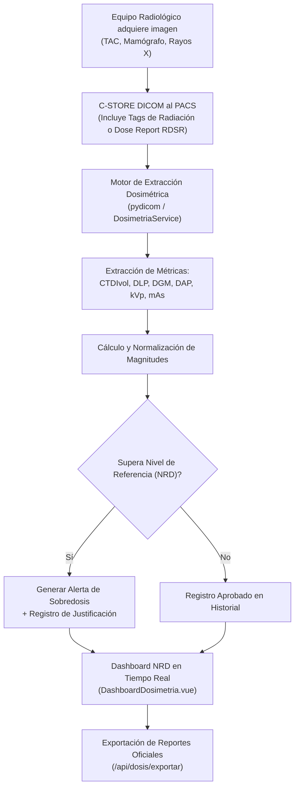

# Módulo: Control de Radiación y Dosimetría — LIDiag

## 1. Propósito y Alcance
El módulo de **Control de Radiación y Dosimetría** es el componente de vigilancia de radioprotección y aseguramiento metrológico de LIDiag. Implementa telemetría edge y extracción automatizada de dosis de radiación ionizante impartida a pacientes a partir de los metadatos de las imágenes DICOM, dando estricto cumplimiento a los **Niveles de Referencia para Diagnóstico (NRD)** conforme a la **Resolución 482 de 2018** del Ministerio de Salud y Protección Social de Colombia y lineamientos internacionales del OIEA (Organismo Internacional de Energía Atómica).

- **Modalidades Vigiladas:**
  - **Tomografía Computarizada (CT / TAC):** `CTDIvol` (mGy) y `DLP` (mGy*cm).
  - **Mamografía Digital (MG):** `DGM` / `AGD` (Dosis Glandular Media en mGy) y `ESAK`.
  - **Radiología Convencional e Intervencionismo (CR / DX / XA):** `DAP` / `KAP` (Gy*cm² o µGy*m²).

---

## 2. Estado del Desarrollo
**Estado:** `Operativo / Estable` (en producción activa).

- **Completado e Implementado:**
  - Endpoints canónicos y retrocompatibles en `routes/api_dosimetria.php` (`/dosis/dashboard`, `/dosis/registros`, `/dosis/heartbeat`, `/dosis/exportar`).
  - Motor de extracción de tags DICOM dosimétricos (`(0018,1152)`, `(0018,0060)`, `(0018,9345)`, etc.) o reportes RDSR.
  - Normalización de unidades dosimétricas discrepantes entre fabricantes.
  - Almacenamiento en base de datos de registros dosimétricos por serie y acumulado por paciente.
  - Dashboard interactivo con semáforo de NRD institucionales (`DashboardDosimetria.vue`).
  - Comandos programados: `dosimetria:sync-estudios` (TAC), `dosimetria:sync-mamografia` (Mamografía) y `dosimetria:token`.
  - Exportación de reportes de dosimetría para auditorías de física médica y habilitación sanitaria.
- **En Observación / Próximos Pasos:**
  - Integración de curvas de tendencia dosimétrica por tecnólogo y equipo radiológico para mantenimiento preventivo del tubo de rayos X.

---

## 3. Funcionalidades Completas
- **Dashboard Estadístico NRD (`DashboardDosimetria.vue`):**
  - Gráficas de dispersión de dosis, distribución por sedes y equipos, y percentil 75 normativo.
  - Alertas automáticas de estudios que superan los umbrales NRD institucionales.
  - Filtros dinámicos por rango de fechas, sede, modalidad y equipo radiológico.
- **Ingesta de Telemetría Edge:**
  - Endpoint `POST /api/dosis/registros` para recepción de dosis enviadas por agentes recolectores locales.
  - Endpoint `POST /api/dosis/heartbeat` para monitoreo de estado activo de los agentes de consolas.
- **Exportación Oficial (`/dosis/exportar`):**
  - Descarga de libros Excel con datos estructurados para presentación ante secretarías de salud y auditorías de física médica.

---

## 4. Flujos de Trabajo

---

## 5. Componentes Técnicos (Backend y Frontend)

### 5.1 Backend (Laravel)
- **Controlador:**
  - `app/Http/Controllers/Api/DosimetriaController.php`: Endpoints de dashboard, ingesta de registros, heartbeat y exportación.
- **Servicio:**
  - `app/Services/Dosimetria/DosimetriaService.php` (68 KB de motor de cálculo dosimétrico, normalizaciones y umbrales NRD).
- **Comandos:**
  - `DosimetriaSyncEstudiosCommand.php`: Sincronización recurrente de TAC desde PACS.
  - `DosimetriaSyncMamografiaCommand.php`: Sincronización y cálculo de DGM en mamografía.
  - `DosimetriaTokenCommand.php`: Generación de tokens de acceso para microservicios edge.
- **Modelos:** `App\Models\Dosimetria\*`.
- **Rutas API:** `routes/api_dosimetria.php` (protegidas por `auth:sanctum,web`).

### 5.2 Frontend (Vue 3 / AdminWrap)
- `DashboardDosimetria.vue`: Componente completo (114 KB) de visualización con Chart.js, indicadores de dispersión, semáforo NRD y exportación.

---

## 6. Interoperabilidad y Reglas de Negocio
- **Cumplimiento Res. 482 de 2018:** Permite auditar periódicamente los percentiles 75 institucionales, requisito obligatorio para la licencia de funcionamiento de equipos generadores de radiación ionizante.
- **Normalización de Unidades:** El módulo normaliza automáticamente lecturas en `cGy*cm²`, `dGy*cm²` o `µGy*m²` hacia la unidad estándar antes de persistir.
- **Tokens de Telemetría Edge:** Los scripts recolectores locales utilizan autenticación por Bearer token generado mediante `dosimetria:token`.

---

## 7. Validaciones, Permisos y Pendientes
- **Permisos Spatie:** `dosimetria.dashboard`, `dosimetria.registros`, `dosimetria.configurar`.
- **Consolas Antiguas sin RDSR:** Equipos convencionales sin soporte de RDSR requieren que el tecnólogo confirme los parámetros de kVp y mAs manualmente si la consola no inyecta los tags privados en la cabecera DICOM.
