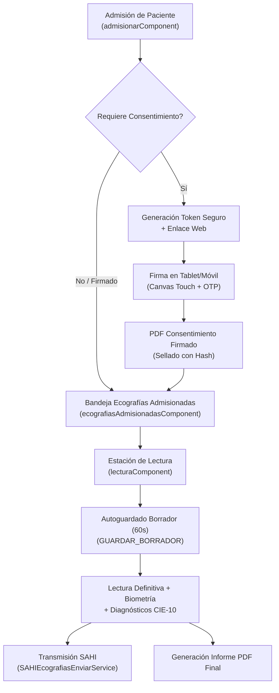

# Módulo: Ecografías y Consentimientos Informados — LIDiag

## 1. Propósito y Alcance
El módulo de **Ecografías** gestiona de manera especializada el servicio de ultrasonido diagnóstico, intervencionismo ecográfico y la firma digitalizada de consentimientos informados con validez legal. Ofrece un flujo asistencial en tiempo real donde el médico radiólogo examina presencialmente al paciente, autoguarda su borrador clínico y sincroniza los resultados directamente con el HIS hospitalario.

- **Especialidad:** Ultrasonido general, obstétrico, doppler vascular, músculo-esquelético y biopsias ecodirigidas.
- **Tipos de Recaudo Soportados:**
  - `PARTICULAR`: Cobro directo y emisión local sin dependencia obligatoria de SAHI.
  - `CORTESÍA`: Atención autorizada sin costo asistencial.
  - `POR ATENCIÓN (SAHI)`: Pacientes admitidos y facturados en el HIS hospitalario SAHI.

---

## 2. Estado del Desarrollo
**Estado:** `Operativo / Estable` (en producción activa).

- **Completado e Implementado:**
  - Admisión en sala de espera por búsqueda sargable en SAHI (rango de fechas o por documento/nombre) o registro directo particular/cortesía.
  - Motor de Consentimientos Informados con generación de tokens públicos temporales (24h) y firma manuscrita digital (canvas táctil para móviles/tablets).
  - Estación de lectura compacta (6 columnas) con autoguardado de borrador cada 60s (`GUARDAR_BORRADOR`).
  - Catálogo de plantillas preconfiguradas para informes ecográficos.
  - Transmisión transaccional a SAHI (`SAHIEcografiasEnviarService`) y generación de informe en PDF.
  - Comando `sync:dicom-ecografias` para enlazar imágenes de ecógrafos de red local hacia el PACS.
  - Generación de paquetes masivos de consentimientos en ZIP (`generarZip`).
- **En Observación / Próximos Pasos:**
  - Automatización del envío del PDF del consentimiento firmado por WhatsApp al paciente al momento de la firma.

---

## 3. Funcionalidades Completas
- **Admisión y Búsqueda de Procedimientos (`admisionarComponent.vue`):**
  - Consulta sargable en SAHI cruzando grupos de ecografía (`[44, 195, 156, 190, 204, 191]`) con tiempo de respuesta de ~140 ms.
  - Admisión particular/cortesía con selección de examen y cálculo de tarifas.
  - Fallback automático entre `CodProducto`, `CodLegal` y `cod_cups`.
- **Sala de Espera de Ecografías (`ecografiasAdmisionadasComponent.vue`):**
  - Badges distintivos de recaudo (`Particular`, `Cortesía`, `Por Atención`).
  - Indicador de estado del consentimiento informado (`Pendiente`, `Firmado`).
  - Acción directa para emitir token o abrir modal de firma presencial.
- **Firma Táctil de Consentimiento (`ecografiaFirmaConsentimientoComponent.vue` y Vista Blade):**
  - Canvas HTML5 optimizado para captura manuscrita en pantallas táctiles.
  - Almacenamiento seguro de trazo vectorial, resolución del dispositivo, IP remota, User-Agent y hash SHA-256.
- **Estación de Lectura Médica (`lecturaComponent.vue`):**
  - Tabla compacta de 6 columnas de alto impacto clínico.
  - Autoguardado silencioso cada 60 segundos (`GUARDAR_BORRADOR`).
  - Catálogo de plantillas y textos preconfigurados con variables dinámicas.
  - Diagnósticos CIE-10 y biometría ecográfica estructurada.
- **Gestión Legal de Consentimientos (`ecografiasConsentimientosComponent.vue` y `ecografiasConsentimientosPlantillasComponent.vue`):**
  - Editor WYSIWYG de plantillas con versionado histórico y preview en PDF.
  - Descarga individual o por lotes comprimidos en ZIP.

---

## 4. Flujos de Trabajo

---

## 5. Componentes Técnicos (Backend y Frontend)

### 5.1 Backend (Laravel)
- **Controladores (`app/Http/Controllers/Ecografias/`, `Consentimientos/`):**
  - `EcografiaController.php`: CRUD de ecografías, filtros dinámicos y anulación.
  - `EcografiaLecturaController.php`: Procesamiento de informes definitivos y autoguardado.
  - `EcografiaProductoController.php`: Procedimientos CUPS asociados y cantidades.
  - `EcografiaConsentimientosController.php`: Gestión de tokens, firma de médico/paciente, generación de PDF y ZIP.
  - `PlantillaEcografiaController.php`: Gestión de plantillas de lectura.
  - `ConsentimientoPlantillasController.php`: Editor y versionado de textos legales de consentimiento.
- **Servicios (`app/Services/Ecografias/`, `Interfaces/`):**
  - `EcografiaService.php`: Transacciones de admisión y anulación.
  - `EcografiaLecturaService.php`: Persistencia de borradores e informes finales.
  - `EcografiaConsentimientosService.php`: Criptografía de firmas y generación DomPDF.
  - `PlantillaEcografiaService.php`: Catálogo de textos clínicos.
  - `SAHIEcografiasService.php`: Consulta sargable en SQL Server.
  - `SAHIEcografiasEnviarService.php`: Transmisión a `hceConsulta` en SAHI.
- **Form Requests (`app/Http/Requests/Ecografias/`):**
  - `EcografiaStoreRequest.php`, `EcografiaUpdateRequest.php`, `EcografiaLeerRequest.php`, `EcografiaAnularRequest.php`, `EcografiaConsentimientoFirmarPacienteRequest.php`, `EcografiaConsentimientoFirmarMedicoRequest.php`, `EcografiaConsentimientoCrearTokenRequest.php`, `EcografiaConsentimientoGenerarZipRequest.php`, `EcografiaFiltroRequest.php`, `EcografiaGenerarReporteRequest.php`.
- **Modelos:** `Ecografia.php`, `EcografiaProducto.php`, `PlantillaEcografia.php`, `ConsentimientoFirmado.php`, `ConsentimientoPlantilla.php`.
- **Rutas API:** `routes/api_ecografias.php` (con rate limiting específico: `throttle:api-lectura`, `throttle:api-sahi`, `throttle:api-consent-create`).

### 5.2 Frontend (Vue 3 / AdminWrap)
- `admisionarComponent.vue`: Admisión desde SAHI o directa, con selección de exámenes.
- `ecografiasAdmisionadasComponent.vue`: Sala de espera con badges de recaudo y consentimientos.
- `lecturaComponent.vue`: Estación de lectura compacta (6 columnas), autoguardado a 60s y plantillas.
- `ecografiaFirmaConsentimientoComponent.vue`: Modal de captura táctil en pantalla.
- `ecografiasConsentimientosComponent.vue`: Historial de consentimientos firmados y descargas.
- `ecografiasConsentimientosPlantillasComponent.vue`: Editor WYSIWYG de cláusulas legales con versionado.
- Vista Blade Pública: `resources/views/modulos/ecografias/firma-consentimiento.blade.php`.

---

## 6. Interoperabilidad y Reglas de Negocio
- **Búsqueda Sargable en SAHI:** La consulta de órdenes de ecografía en SQL Server (`SAHIEcografiasService`) filtra por formato sargable estándar (`CONVERT(datetime, 'YYYY-MM-DD', 120)`) cruzando exclusivamente los grupos asistenciales permitidos (`IdGrupo IN (44, 195, 156, 190, 204, 191)`), logrando respuestas en ~140 ms.
- **Sedes Independientes:** Si la sede no tiene habilitada la interfaz hospitalaria en `config_sedes`, el módulo opera 100% de manera autónoma sin emitir excepciones de red.
- **Validez Legal del Consentimiento:** Toda firma digital almacena coordenadas vectoriales del trazo, resolución de pantalla, dirección IP remota y hash criptográfico SHA-256.

---

## 7. Validaciones, Permisos y Pendientes
- **Permisos Spatie:**
  - `ecografias.admision`: Acceso y creación de admisiones.
  - `ecografias.leer`: Emisión y firma de lecturas ecográficas.
  - `ecografias.anular`: Anulación de registros asistenciales.
  - `ecografias.consentimientos.capturar_firma`: Creación de tokens de firma.
  - `ecografias.consentimientos.plantillas.*`: Gestión de plantillas legales.
- **Expiración de Tokens de Firma:** Los tokens de firma digital tienen una vigencia configurada de 24 horas; si el paciente no firma en ese lapso, la secretaria debe regenerar el token desde `ecografiasAdmisionadasComponent.vue`.
