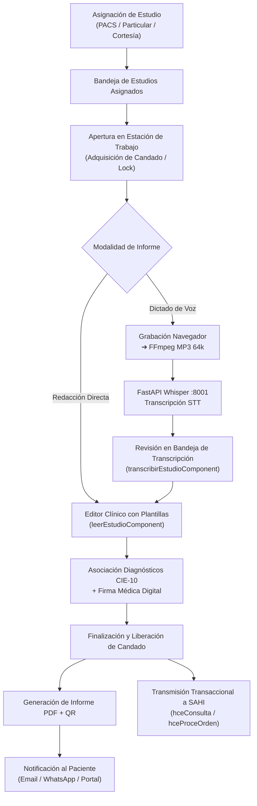

# Módulo: Estudios Radiológicos (RX, TAC, RM, Mamografía) — LIDiag

## 1. Propósito y Alcance
El módulo de **Estudios Radiológicos** constituye el núcleo operativo de diagnóstico por imágenes de alta y media complejidad en LIDiag. Gestiona de punta a punta el ciclo de vida del estudio médico: asignación a médicos radiólogos, consulta de imágenes DICOM, transcripción de informes con inteligencia artificial (Whisper STT), lectura/dictado clínico, bloqueo concurrente (optimistic locks), generación de PDF y notificación multicanal.

- **Modalidades Soportadas:** Rayos X (CR/DX), Tomografía Computarizada (CT/TAC), Resonancia Magnética (MR) y Mamografía (MG).
- **Separación de Responsabilidad:** Mantiene un flujo de trabajo asistencial y de facturación independiente del módulo de ecografías y de oftalmología, optimizado para grandes volúmenes de adquisición DICOM y turnos médicos de radiología.

---

## 2. Estado del Desarrollo
**Estado:** `Operativo / Estable` (en producción activa).

- **Completado e Implementado:**
  - Asignación manual, particular, cortesía y sincronizada desde PACS (`dcm4chee`).
  - Integración de notas de voz clínicas con compresión obligatoria FFmpeg a MP3 (64 kbps mono) en disco `audios/tmp/`.
  - Microservicio FastAPI + Whisper STT en `http://localhost:8001/transcribir`.
  - Estación de trabajo de lectura con candados concurrentes (`estudio_locks`), plantillas dinámicas y diagnósticos CIE-10.
  - Generación de informe PDF mediante DomPDF con código de verificación QR (`/validar-informe/{token}`).
  - Despacho de notificaciones y soporte para adjuntos encriptados de historia clínica (`EstudioSoporteHCController`).
  - Sincronización bidireccional con HIS SAHI (SQL Server `ESP_PRI`) en tablas `hceConsulta` y `hceProceOrden`.
  - Herramientas auxiliares de quema de medios físicos individuales y múltiples (`QuemadorCdComponent.vue`, `QuemarMultiplesComponent.vue`, `DescargarZipComponent.vue`).
- **En Observación / Próximos Pasos:**
  - Optimización en lotes de transcripción masiva para evitar picos de CPU en el modelo Whisper local.

---

## 3. Funcionalidades Completas
- **Asignación de Estudios (`AsignarEstudioComponent.vue`):**
  - Carga y distribución de estudios DICOM por radiólogo, modalidad, sede y prioridad.
  - Flujos dedicados para registros "+ Particular" y "+ Cortesía".
  - Filtros avanzados por fecha, paciente, Accession Number y estado.
- **Dictado de Voz y Transcripción STT (`audio-texto.vue`):**
  - Grabación directa en el navegador vía Web Audio API.
  - Conversión en background mediante FFmpeg a MP3 (64 kbps) y envío al servicio Whisper.
- **Bandeja de Transcripción (`transcribirEstudioComponent.vue`):**
  - Búsqueda manual controlada (evita peticiones automáticas innecesarias).
  - Reproductor de audio integrado con control de velocidad, rebobinado y atajos.
  - Editor de texto clínico enriquecido para mecanógrafos.
- **Estación de Lectura Radiológica (`leerEstudioComponent.vue`):**
  - Editor clínico con plantillas parametrizables con sustitución de variables.
  - Inserción de diagnósticos CIE-10 con lateralidad y tipo de diagnóstico.
  - Enlace directo a visores DICOM (Oviyam / OHIF) mediante Study Instance UID.
  - Firma médica digitalizada protegida por hash.
- **Control de Bloqueo Concurrente (`EstudioLockController.php`):**
  - Candados temporales con latido (heartbeat) que evitan que dos radiólogos o transcriptores abran el mismo examen simultáneamente. Expiración automática a los 2 minutos de inactividad.
- **Notificación y Portal de Pacientes (`notificarEstudioComponent.vue`):**
  - Envío de informe por correo electrónico y despacho al portal web de pacientes.
- **Quema y Exportación de Medios Físicos:**
  - Preparación de imágenes DICOM para grabación en CD/DVD o compresión en ZIP para pacientes o traslados.

---

## 4. Flujos de Trabajo

---

## 5. Componentes Técnicos (Backend y Frontend)

### 5.1 Backend (Laravel)
- **Controladores (`app/Http/Controllers/Estudios/`):**
  - `EstudioController.php`: CRUD general, listado de asignados, lectura, guardado de transcripción, envío a SAHI y anulación.
  - `EstudioAudioController.php`: Subida, validación, streaming y eliminación de notas de voz.
  - `EstudioLockController.php`: Endpoints `tomar` y `liberar` para reserva concurrente.
  - `EstudioNotificacionController.php`: Despacho de notificaciones a pacientes.
  - `EstudioProductoController.php`: Gestión de procedimientos CUPS (`config_productos`).
  - `EstudioDiagnosticoController.php`: Diagnósticos CIE-10 asociados (`config_diagnosticos`).
  - `EstudioSoporteHCController.php`: Subida y descarga de soportes externos encriptados.
  - `PlantillaEstudioController.php`: Gestión y reemplazo de variables en plantillas.
- **Servicios (`app/Services/Estudios/`):**
  - `EstudioService.php`: Orquestador principal de lecturas, estados y validaciones.
  - `EstudioQueryService.php`: Consultas optimizadas con eager loading.
  - `EstudioAudioService.php`: Compresión FFmpeg y comunicación HTTP con Whisper.
  - `EstudioLockService.php`: Control de expiración y persistencia de bloqueos.
  - `EstudioNotificacionService.php`: Envío multicanal.
  - `EstudioPortalSyncService.php`: Sincronización con portales externos.
  - `PlantillaEstudioService.php`: Procesamiento de plantillas de informe.
- **Form Requests (`app/Http/Requests/Estudios/`):**
  - `StoreEstudioRequest.php`, `LeerEstudioRequest.php`, `GuardarTranscripcionRequest.php`, `StoreAudioEstudioRequest.php`, `CargarAudioTranscribirRequest.php`, `AnularAsignacionEstudioRequest.php`, `ListarEstudiosAsignadosRequest.php`, `ListarPendientesTranscribirRequest.php`, `ListarPendientesMedicoRequest.php`, `NotificarEmailEstudioRequest.php`.
- **Modelos (`app/Models/Estudio/`):**
  - `Estudio.php`, `EstudioProducto.php`, `EstudioDiagnostico.php`, `EstudioAudio.php`, `EstudioLock.php`, `EstudioSoporteHC.php`.
- **Rutas API:** `routes/api_estudios.php` (protegidas por middleware `auth` y Spatie: `estudio.index|estudio.asignar|estudio.leer|estudio.leerEstudio|estudio.transcribir|estudio.productos`).

### 5.2 Frontend (Vue 3 / AdminWrap)
- `AsignarEstudioComponent.vue`: Bandeja de entrada para asignación médica.
- `estudioAsignadosComponent.vue`: Gestión y reasignación de carga médica.
- `leerEstudioComponent.vue`: Estación de lectura, plantillas, CIE-10 y visor PACS.
- `transcribirEstudioComponent.vue`: Estación de mecanografía con reproductor de audio.
- `notificarEstudioComponent.vue`: Envío de resultados y notificaciones.
- `audio-texto.vue`: Subcomponente de grabación y dictado de voz.
- `QuemadorCdComponent.vue`, `QuemarMultiplesComponent.vue`, `DescargarZipComponent.vue`: Utilidades de medios físicos.

---

## 6. Interoperabilidad y Reglas de Negocio
- **PACS `dcm4chee`:** La búsqueda se vincula mediante `AccessionNumber` o `StudyInstanceUID`. Si existe en PACS, prellena series y fechas de adquisición.
- **HIS SAHI (SQL Server):** Si la sede tiene `interface_software = 'SAHI'`, al finalizar la lectura se transmite a `hceConsulta` y `hceProceOrden`.
- **Whisper Timeout:** El `.env` debe incluir `TRANSCRIPTOR_TIMEOUT=300`. Si el servicio no responde, el audio queda en disco para transcripción manual.
- **Firma Médica Segura:** Las firmas se almacenan como imagen vectorizada/PNG protegida y se calcula un hash único de validación por informe.

---

## 7. Validaciones, Permisos y Pendientes
- **Permisos Spatie:**
  - `estudio.asignar`: Asignación y anulación de estudios.
  - `estudio.transcribir`: Acceso a bandeja de notas de voz y transcripción.
  - `estudio.leerEstudio`: Emisión y firma de informes médicos.
  - `estudios.notificar.index`: Envío de notificaciones a pacientes.
- **Consumo de CPU:** Whisper corre en CPU local; audios largos requieren paciencia del transcriptor o cola sincrónica.
- **Locks Huérfanos:** Existe un cron job de limpieza para candados de lectura cuya sesión haya expirado sin cierre explícito del navegador.
