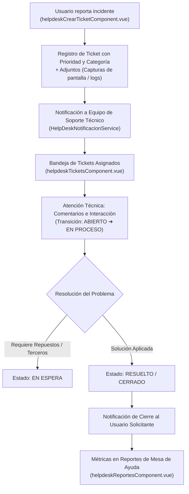

# Módulo: Helpdesk y Mesa de Ayuda Técnica — LIDiag

## 1. Propósito y Alcance
El módulo de **Helpdesk y Mesa de Ayuda Técnica** es el canal integrado de soporte informático, gestión de incidentes y mantenimiento técnico de LIDiag. Permite a los usuarios clínicos y administrativos (médicos, transcriptores, recepcionistas, tecnólogos) reportar fallas en equipos radiológicos, estaciones de trabajo, visores DICOM o sistemas de red, gestionando el ciclo de vida del ticket conforme a buenas prácticas de ITIL.

- **Categorización Específica del Sector Salud:**
  - Fallas en equipos de adquisición de imágenes (CR, CT, RM, Ecógrafos).
  - Problemas de red o conectividad con servidores PACS / SAHI.
  - Inconsistencias en historias clínicas o resultados.
  - Soporte de usuarios, permisos y estaciones de lectura.

---

## 2. Estado del Desarrollo
**Estado:** `Operativo / Estable` (en producción activa).

- **Completado e Implementado:**
  - Radicación de tickets con clasificación por categoría, severidad y sede (`helpdeskCrearTicketComponent.vue`).
  - Carga y visualización de archivos adjuntos (imágenes y documentos de error) con subida multipart (`attachments.upload`) y descarga segura.
  - Hilo de conversación y comentarios cronológicos entre usuario y técnicos (`helpdeskDetalleTicketComponent.vue`).
  - Reasignación de tickets a técnicos disponibles (`/helpdesk-usuarios-asignables`, `reassign`).
  - Cambio de estados auditado (`changeStatus`).
  - Centro de notificaciones internas de soporte (`helpdeskNotificacionesComponent.vue`).
  - Reportes de tiempo de primera respuesta y tiempos de resolución con exportación a Excel y PDF (`helpdeskReportesComponent.vue`).
- **En Observación / Próximos Pasos:**
  - Integración de notificaciones push o mensajes directos de Telegram al equipo de guardia cuando se radique un ticket con prioridad "Urgente".

---

## 3. Funcionalidades Completas
- **Creación Asistida (`helpdeskCrearTicketComponent.vue`):**
  - Formulario intuitivo con selección de categoría, prioridad y carga drag-and-drop de archivos adjuntos.
- **Bandeja de Tickets Asignados (`helpdeskTicketsComponent.vue`):**
  - Filtros por estado (Abierto, En Proceso, En Espera, Resuelto, Cerrado), categoría y prioridad.
- **Detalle y Gestión del Caso (`helpdeskDetalleTicketComponent.vue`):**
  - Conversación pública y notas técnicas internas.
  - Cambio de estado y reasignación técnica en caliente.
- **Reportes de Calidad y SLAs (`helpdeskReportesComponent.vue`):**
  - Gráficos de indicadores de cumplimiento (KPIs), tiempos de primera respuesta y tiempos totales de solución.
  - Exportación en formatos Excel y PDF.
- **Centro de Notificaciones (`helpdeskNotificacionesComponent.vue`):**
  - Alertas en tiempo real sobre actualizaciones o resolución de tickets.

---

## 4. Flujos de Trabajo

---

## 5. Componentes Técnicos (Backend y Frontend)

### 5.1 Backend (Laravel)
- **Controladores (`app/Http/Controllers/HelpDesk/`):**
  - `HelpDeskTicketsController.php`: CRUD de tickets, comentarios, reasignación y cambios de estado.
  - `HelpDeskAdjuntosController.php`: Subida, validación, streaming y eliminación de adjuntos.
  - `HelpDeskCategoriasController.php`: Catálogo operativo y administrativo de categorías.
  - `HelpDeskEstadosController.php`: Catálogo de estados de tickets.
  - `HelpDeskPrioridadesController.php`: Niveles de severidad del servicio.
  - `HelpDeskNotificacionesController.php`: Centro de notificaciones internas Laravel.
  - `HelpDeskReportesController.php`: Agregación de indicadores, detalle y exportaciones a Excel/PDF.
  - `HelpDeskUsuariosController.php`: Selector de técnicos asignables.
- **Servicios (`app/Services/HelpDesk/`):**
  - `HelpDeskTicketService.php`, `HelpDeskAdjuntoService.php`, `HelpDeskNotificacionService.php`, `HelpDeskReporteService.php`, `HelpDeskCategoriaService.php`, `HelpDeskEstadoService.php`, `HelpDeskPrioridadService.php`.
- **Form Requests (`app/Http/Requests/HelpDesk/`):**
  - `HelpDeskTicketStoreRequest.php`, `HelpDeskTicketUpdateRequest.php`, `HelpDeskCommentRequest.php`, `HelpDeskChangeStatusRequest.php`, `HelpDeskReassignRequest.php`, `HelpDeskAdjuntoUploadRequest.php`, `HelpDeskReporteRequest.php`, etc.
- **Modelos:** `HelpDeskTicket.php`, `HelpDeskAdjunto.php`, `HelpDeskCategoria.php`, `HelpDeskEstado.php`, `HelpDeskPrioridad.php`, `HelpDeskComentario.php`.
- **Rutas API:** `routes/api_helpdesk.php` (protegidas por `auth` y Spatie `permission:...,web`).

### 5.2 Frontend (Vue 3 / AdminWrap)
- `helpdeskCrearTicketComponent.vue`: Radicación de tickets con adjuntos.
- `helpdeskTicketsComponent.vue`: Bandeja general con filtros de estado y prioridad.
- `helpdeskDetalleTicketComponent.vue`: Estación de conversación y reasignación.
- `helpdeskNotificacionesComponent.vue`: Bandeja de avisos al personal técnico.
- `helpdeskReportesComponent.vue`: Gráficos de rendimiento y exportaciones.

---

## 6. Interoperabilidad y Reglas de Negocio
- **Aislamiento de Privacidad:** Los usuarios convencionales solo acceden a sus propios tickets; los agentes y administradores poseen visibilidad global de la cola técnica.
- **Validación de Adjuntos:** Se bloquean archivos ejecutables (`.exe`, `.bat`, `.sh`, `.php`), admitiendo únicamente imágenes (JPG/PNG) y documentos (PDF/TXT).
- **Prohibición de Borrado:** Se impide la eliminación física de tickets que contengan trazabilidad operativa para cumplir con auditorías de calidad en salud.

---

## 7. Validaciones, Permisos y Pendientes
- **Permisos Spatie:**
  - `helpdesk.tickets.index`, `helpdesk.tickets.create`, `helpdesk.tickets.show`, `helpdesk.tickets.edit`, `helpdesk.tickets.delete`.
  - `helpdesk.tickets.comment`, `helpdesk.tickets.change_status`, `helpdesk.tickets.reassign`.
  - `helpdesk.tickets.attachments.upload`, `helpdesk.tickets.attachments.download`.
  - `helpdesk.reportes.index`, `helpdesk.reportes.export`.
- **Adjuntos Huérfanos:** Existe un proceso periódico para depurar adjuntos temporales de tickets que hayan sido descartados antes de su radicación final.
