# Módulo: Interoperabilidad HIS (SAHI) y Tele-Radiología — LIDiag

## 1. Propósito y Alcance
El módulo de **Interoperabilidad HIS y Tele-Radiología** constituye la pasarela de integración hospitalaria entre LIDiag y el sistema de información hospitalaria **SAHI** (desplegado sobre Microsoft SQL Server), así como la red de **Tele-Radiología** para la recepción, enrutamiento, lectura a distancia y transcripción de estudios remitidos desde clínicas y hospitales externos.

- **Interoperabilidad HIS (SAHI):** Conexión bidireccional con bases de datos hospitalarias SAHI (instancia principal `ESP_PRI` en El Espinal).
  - *Lectura:* Extracción de admisiones, pacientes, facturación y órdenes médicas de radiología, ecografía y oftalmología.
  - *Escritura:* Transmisión transaccional de resultados, conceptos clínicos, diagnósticos CIE-10 y procedimientos facturados hacia la HCE de SAHI (`hceConsulta`, `hceProceOrden`, etc.).
- **Tele-Radiología:** Red segura para centros médicos remotos que no cuentan con radiólogos presenciales:
  - Carga masiva o recepción de estudios DICOM desde sedes satélites vía API autenticada por HMAC (`tele.hmac`).
  - Asignación a radiólogos de turno para tele-informe.

---

## 2. Estado del Desarrollo
**Estado:** `Operativo / Estable` (en producción activa).

- **Completado e Implementado:**
  - Sincronización de admisiones y órdenes de radiología y ecografía (`SAHIService.php`, `SAHIEcografiasService.php`).
  - Nuevo gateway de interconsultas y citas de oftalmología en SQL Server (`SAHIOftalmologiaService.php`).
  - Transmisión transaccional de informes y procedimientos leídos hacia `hceConsulta` y `hceProceOrden`.
  - Middleware de autenticación criptográfica `VerifyTeleRadiologiaHmac` (`tele.hmac`) para clientes externos de telemedicina con validación de `X-Timestamp` y `X-Signature`.
  - Bandejas operativas en Vue 3 para recepción (`teleRadiologiaEnviarEstudioComponent.vue`) y transcripción (`teleRadiologiaTranscibirComponent.vue`).
  - Comandos de prueba de conectividad (`sahi:test-connection`) y reconciliación desatendida (`estudios:sahi-reconcile`).
- **En Observación / Próximos Pasos:**
  - Implementación de colas asíncronas para transmisiones a SAHI en momentos de alta saturación del enlace WAN hospitalario.

---

## 3. Funcionalidades Completas
- **Búsqueda Asistencial en SAHI:**
  - Consulta de pacientes por documento (`buscarPacientePorDocumento`).
  - Listado de atenciones hospitalarias (`listarAtenciones`) y productos/diagnósticos ordenados (`listarProductosDiagnosticos`).
  - Diagnóstico de conectividad en tiempo real (`verificarConexion`).
- **Gestión de Tele-Radiología:**
  - Recepción de estudios desde clínicas afiliadas vía API webhook con firma HMAC (`recibirLectura`).
  - Envío de estudios y órdenes a centros de interpretación remota (`enviarEstudio`, `enviarOrdenTeleRadiologia`).
  - Bandeja de transcripción y lectura especializada para radiólogos a distancia.
  - Triaje y priorización por semáforo de urgencia clínica.

---

## 4. Flujos de Trabajo

```mermaid
flowchart TD
    subgraph "Flujo SAHI HIS"
        A["SAHI SQL Server (ESP_PRI)<br/>(facFacturaDet / facMovimientoDet)"] --> B["Servicio Sincronización<br/>(SAHIService / SAHIEcografiasService)"]
        B --> C["Admisión en LIDiag"]
        C --> D["Lectura Médica en LIDiag"]
        D --> E["Transmisión Transaccional<br/>(hceConsulta / hceProceOrden)"]
        E --> F["Marcado estado_sahi = ENVIADO"]
    end

    subgraph "Flujo Tele-Radiología"
        G["Hospital Externo / Sede Satélite"] -->|"Envío Seguro HMAC<br/>(tele.hmac / X-Signature)"| H["API Tele-Radiología<br/>(TeleRadiologiaController)"]
        H --> I["Recepción de Imágenes y Orden"]
        I --> J["Bandeja Tele-Radiología<br/>(teleRadiologiaEnviarEstudioComponent)"]
        J --> K["Lectura y Dictado por Radiólogo"]
        K --> L["Transcripción y Validación<br/>(teleRadiologiaTranscibirComponent)"]
        L --> M["Devolución Informe Firmado<br/>+ Notificación Automática"]
    end
```

---

## 5. Componentes Técnicos (Backend y Frontend)

### 5.1 Backend (Laravel)
- **Controladores (`app/Http/Controllers/Interface/`):**
  - `SAHIController.php`: Búsqueda de pacientes, atenciones, productos y test de conexión.
  - `TeleRadiologiaController.php`: Recepción webhook HMAC, envío de estudios y órdenes.
  - `SAHIEcografiasController.php`, `SAHIEcografiasEnviarController.php`, `SAHITranscibirController.php`.
- **Middleware:**
  - `app/Http/Middleware/VerifyTeleRadiologiaHmac.php` (`tele.hmac`): Valida secreto compartido, timestamp y firma sha256.
- **Servicios (`app/Services/Interfaces/`):**
  - `SAHIService.php`, `SAHIEcografiasService.php`, `SAHIEcografiasEnviarService.php`, `SAHIOftalmologiaService.php`, `SAHITranscibirService.php`, `TeleRadiologiaService.php`.
- **Comandos:** `SahiTestConnectionCommand.php`, `EstudiosSahiReconcileCommand.php`, `EstudiosSahiEnviarRangoCommand.php`.
- **Rutas API:** `routes/api_interfaces.php`.

### 5.2 Frontend (Vue 3 / AdminWrap)
- `teleRadiologiaEnviarEstudioComponent.vue`: Recepción, triaje y envío de estudios.
- `teleRadiologiaTranscibirComponent.vue`: Estación de trabajo para transcripción e informe de telemedicina.

---

## 6. Interoperabilidad y Reglas de Negocio
- **Requisitos de PHP:** Requiere extensiones nativas `sqlsrv` y `pdo_sqlsrv` activas en Laragon.
- **Condición por Sede:** Se evalúa la columna `interface_software` en `config_sedes`; solo las sedes marcadas como `'SAHI'` ejecutan llamadas a SQL Server.
- **Firma HMAC Segura:** Toda petición a `/api/tele-radiologia-recibir-lectura` exige los encabezados `X-Timestamp` (con tolerancia máxima de 5 minutos) y `X-Signature` (`hash_hmac('sha256', ...)`) calculado con el token de la sede (`config_tokens_sedes`).

---

## 7. Validaciones, Permisos y Pendientes
- **Permisos Spatie:** `tele.ragiologia.index`, `tele.ragiologia.enviar`, `tele.ragiologia.transcribir`.
- **Consultas Sargables:** Todas las consultas sobre SQL Server deben utilizar comparaciones de fechas con formato estándar 120 (`CONVERT(datetime, 'YYYY-MM-DD HH:mm:ss', 120)`) para aprovechar los índices hospitalarios y no saturar la CPU de `ESP_PRI`.
