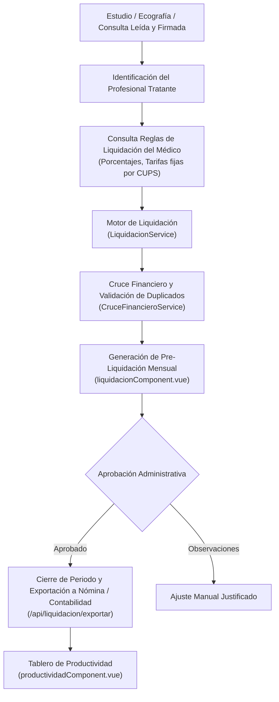

# Módulo: Liquidación Médica y Productividad — LIDiag

## 1. Propósito y Alcance
El módulo de **Liquidación Médica y Productividad** gestiona los honorarios médicos profesionales devengados por los radiólogos y especialistas a partir de los informes clínicos emitidos, así como los indicadores de rendimiento operativo y análisis de productividad individual e institucional.

- **Liquidación de Honorarios:** Cálculo de los valores a pagar a cada médico radiólogo, ecografista u oftalmólogo con base en tarifas por evento, tipo de lectura, modalidad de imagen, turnos o lecturas de urgencias.
- **Productividad Asistencial:** Métricas de carga laboral, volumen de estudios procesados por hora/día, tiempos de entrega (Turnaround Time - TAT) y análisis comparativo de producción entre sedes.

---

## 2. Estado del Desarrollo
**Estado:** `Operativo / Estable` (en producción activa).

- **Completado e Implementado:**
  - Endpoint `GET /api/liquidacion` para cálculo de liquidación por sede y rango de fechas.
  - Endpoint `GET /api/liquidacion/productividad` para corte de mes y lectura de datos congelados.
  - Cruce financiero contra SAHI (`CruceFinancieroService.php`) para validar que el estudio cuente con factura/autorización o recaudo particular confirmado.
  - Descarga de liquidación del periodo en Excel (`/api/liquidacion/exportar`).
  - Descarga de reporte de productividad médica en Excel (`/api/liquidacion/productividad/exportar`).
  - Componentes Vue dedicados (`liquidacionComponent.vue`, `productividadComponent.vue`).
- **En Observación / Próximos Pasos:**
  - Automatización de comprobantes de liquidación en PDF con desglose de retenciones en la fuente para entrega a los especialistas.

---

## 3. Funcionalidades Completas
- **Cálculo y Auditoría de Honorarios (`liquidacionComponent.vue`):**
  - Filtros por sede, especialista, modalidad y rango de fechas.
  - Desglose línea por línea de cada examen leído con paciente, fecha, CUPS, valor facturado y honorario neto.
  - Marcado y control de estudios liquidados para evitar duplicidades de cobro.
- **Tablero de Productividad Médica (`productividadComponent.vue`):**
  - Métrica de volumen total de informes emitidos por especialista y sede.
  - Tiempos promedio de respuesta diagnóstica (Turnaround Time - TAT).
  - Cumplimiento de compromisos contractuales de lectura.
- **Exportación Contable y Financiera:**
  - Libros de Excel formateados con cabeceras estándar para importación en sistemas de nómina y contabilidad.

---

## 4. Flujos de Trabajo

---

## 5. Componentes Técnicos (Backend y Frontend)

### 5.1 Backend (Laravel)
- **Controlador:**
  - `app/Http/Controllers/Liquidacion/LiquidacionController.php`: Endpoints `calcular`, `productividad`, `exportar` y `exportarProductividad`.
- **Servicios:**
  - `app/Services/Liquidacion/LiquidacionService.php`: Motor de liquidación, cálculo de honorarios y deducciones.
  - `app/Services/Liquidacion/CruceFinancieroService.php`: Cruce con facturación hospitalaria de SAHI y recaudo.
- **Form Requests (`app/Http/Requests/Liquidacion/`):**
  - `LiquidacionFiltroRequest.php`, `LiquidacionProductividadRequest.php`.
- **Modelos:** `App\Models\Liquidacion\*`.
- **Rutas API:** `routes/api_liquidacion.php` (protegidas por `auth` y Spatie: `liquidacion.index`, `liquidacion.exportar`).

### 5.2 Frontend (Vue 3 / AdminWrap)
- `liquidacionComponent.vue`: Interfaz de cálculo, auditoría y aprobación de honorarios médicos con desglose por examen.
- `productividadComponent.vue`: Tablero de control de productividad con métricas de volumen, tiempos de lectura y gráficos de desempeño.

---

## 6. Interoperabilidad y Reglas de Negocio
- **Condición Indispensable de Liquidación:** Un estudio solo es computable para liquidación médica si cuenta con informe definitivo, diagnóstico principal y firma digital médica estampada. Los borradores quedan excluidos automáticamente.
- **Trazabilidad en Auditoría:** Todo ajuste manual sobre el valor liquidado exige la captura de una observación obligatoria y se registra en `audit_logs`.

---

## 7. Validaciones, Permisos y Pendientes
- **Permisos Spatie:** `liquidacion.index`, `liquidacion.exportar`.
- **Descargas Streaming:** Las consultas de liquidación masiva utilizan cursores de base de datos para no desbordar la memoria RAM en exportaciones de más de 5.000 estudios.
