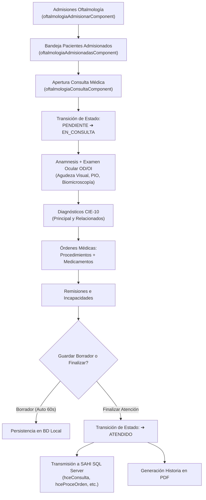

# Módulo: Oftalmología — LIDiag

## 1. Propósito y Alcance
El módulo de **Oftalmología** es una solución especializada de Historia Clínica Electrónica (HCE) y atención oftalmológica ambulatoria/quirúrgica. Ofrece un flujo clínico integral de dos etapas que abarca desde la admisión y triaje hasta la consulta médica especializada con examen ocular estructurado, formulación de medicamentos, órdenes de procedimientos, remisiones e incapacidades, con interoperabilidad directa hacia el HIS hospitalario SAHI.

- **Especialidad:** Oftalmología clínica, quirúrgica, optometría y subespecialidades visuales.
- **Ciclo de Estados Clínicos:**
  - `PENDIENTE`: Paciente admitido en sala de espera.
  - `EN_CONSULTA`: Médico abre la consulta e inicia borrador (con autoguardado a 60s).
  - `ATENDIDO`: Consulta finalizada, firmada y transmitida a SAHI.
  - `ANULADO`: Admisión cancelada.

---

## 2. Estado del Desarrollo
**Estado:** `Operativo / Estable` (Fases 1 a 6 completadas; refactorización UI de 2 etapas y búsqueda SAHI finalizadas exitosamente).

- **Completado e Implementado:**
  - Migraciones individuales dedicadas (`2026_11_19_100001` a `100008`) para atenciones, consultas, diagnósticos CIE-10, órdenes CUPS, medicamentos, remisiones, incapacidades y plantillas.
  - Gateway SAHI condicional por sede (`SAHIOftalmologiaService.php`) con búsqueda de interconsultas y citas en `facFacturaDet` y `facMovimientoDet`.
  - Flujo de dos etapas: listado de atenciones admisionadas con filtros y botón directo "Atender", seguido por la estación de historia clínica.
  - Examen físico binocular estructurado (Agudeza Visual OD/OI con y sin corrección, PIO, MOE, Reflejos, Biomicroscopía y Fondo de Ojo).
  - Buscador predictivo en vivo de CIE-10 con lateralidad y selector de plantillas preconfiguradas (`config_plantillas_oftalmologia`).
  - Autoguardado periódico cada 60 segundos del borrador clínico.
  - Sincronización explícita o automática con SAHI (`sincronizarSahi`).
  - Reportes de producción compatibles con `ReporteProduccionService.php`.
- **En Observación / Próximos Pasos:**
  - Integración de captura de imágenes de lámpara de hendidura y retinografía directamente hacia el expediente oftalmológico.

---

## 3. Funcionalidades Completas
- **Admisiones Oftalmológicas (`oftalmologiaAdmisionarComponent.vue`):**
  - Búsqueda en SAHI por número de atención directo, documento del paciente o nombres/apellidos tokenizados.
  - Admisiones particulares y de cortesía con drawer lateral (.right-sidebar).
  - Resolución automática de paciente en tabla `pacientes`.
- **Sala de Espera de Pacientes (`oftalmologiaAdmisionadasComponent.vue`):**
  - Tabla compacta con DataTable y skeleton loader.
  - Filtros plegables (`fade-collapse`) por documento, nombre, estado y fechas.
  - Acción directa "Atender / Ver" que redirige al expediente clínico.
- **Estación de Consulta Clínica (`oftalmologiaConsultaComponent.vue`):**
  - Tarjeta de identificación hospitalaria estándar con edad y EPS.
  - 6 pestañas clínicas: Anamnesis, Examen Físico (OD/OI), CIE-10, Concepto/Plan, Órdenes/Incapacidad y Anexos.
  - Grid de Agudeza Visual binocular con y sin corrección.
  - Prescripción de fármacos y órdenes de procedimientos CUPS.
  - Expedición de incapacidades laborales y remisiones médicas.
  - Autoguardado silencioso a los 60 segundos de inactividad de edición.
- **Plantillas Clínicas Especializadas:**
  - Catálogo preconfigurado en `config_plantillas_oftalmologia` por sección clínica.

---

## 4. Flujos de Trabajo

---

## 5. Componentes Técnicos (Backend y Frontend)

### 5.1 Backend (Laravel)
- **Controladores:**
  - `app/Http/Controllers/Oftalmologia/OftalmologiaAdmisionController.php`: Admisión, listado paginado y anulación.
  - `app/Http/Controllers/Oftalmologia/OftalmologiaConsultaController.php`: Guardado de borradores, cierre de atención, búsqueda predictiva y reintento de sincronización SAHI.
  - `app/Http/Controllers/Configuracion/ConfigPlantillaOftalmologiaController.php`: CRUD de plantillas de texto.
- **Servicios:**
  - `app/Services/Oftalmologia/OftalmologiaAdmisionService.php`: Transacciones de admisión y resolución de pacientes.
  - `app/Services/Oftalmologia/OftalmologiaConsultaService.php`: Persistencia clínica, diagnósticos CIE-10 y órdenes.
  - `app/Services/Interfaces/SAHIOftalmologiaService.php`: Gateway de consulta y transmisión hospitalaria en SQL Server.
  - `app/Services/Configuracion/ConfigPlantillaOftalmologiaService.php`: Gestión de catálogo de plantillas clínicas.
- **Modelos (`app/Models/Oftalmologia/`):**
  - `OftalmologiaAtencion.php`, `OftalmologiaConsulta.php`, `OftalmologiaDiagnostico.php`, `OftalmologiaProcedimiento.php`, `OftalmologiaMedicamento.php`, `OftalmologiaRemision.php`, `OftalmologiaIncapacidad.php`.
- **Rutas API:** `routes/api_oftalmologia.php` (prefijo `oftalmologia` protegido por `auth:sanctum`).

### 5.2 Frontend (Vue 3 / AdminWrap)
- `oftalmologiaAdmisionarComponent.vue`: Búsqueda de órdenes SAHI y drawer lateral.
- `oftalmologiaAdmisionadasComponent.vue`: Lista de pacientes admisionados con filtros.
- `oftalmologiaConsultaComponent.vue`: Estación clínica de 6 pestañas, autoguardado a 60s y grid binocular.
- `configPlantillasOftalmologiaComponent.vue`: Editor de plantillas por sección.
- Vistas Blade de montaje: `resources/views/modulos/oftalmologia/` (`admisiones.blade.php`, `admisionadas.blade.php`, `consulta.blade.php`).

---

## 6. Interoperabilidad y Reglas de Negocio
- **Interoperabilidad Condicional:** Solo las sedes con `interface_software = 'SAHI'` (ej. El Espinal) y con recaudo que transmita (`envia_sahi = true`) interactúan con SQL Server. Para atenciones particulares o sedes satélites, opera 100% de manera local.
- **Códigos CUPS Soportados:** Detecta automáticamente interconsultas (`890476`), consultas de primera vez (`890202`), controles (`890302`) y servicios con descripción `LIKE '%OFTALMO%'`.
- **Transmisión Atómica:** La finalización de consulta se ejecuta en transacciones (`DB::transaction`) para asegurar la consistencia entre la consulta médica y las órdenes expedidas.

---

## 7. Validaciones, Permisos y Pendientes
- **Permisos Spatie:**
  - `oftalmologia.admision`: Creación de admisiones.
  - `oftalmologia.consulta`: Apertura y edición de la historia clínica.
  - `oftalmologia.plantillas`: Configuración de textos predefinidos.
  - `oftalmologia.reportes`: Acceso a informes de producción.
- **Bloqueo tras Cierre:** Una vez pasada a estado `ATENDIDO` y transmitida a SAHI, la historia clínica queda bloqueada para edición directa; cualquier modificación posterior debe gestionarse mediante nota aclaratoria asistencial.
