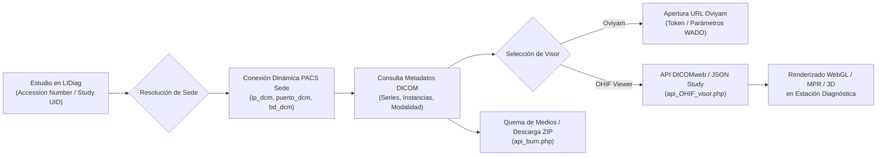

# Módulo: PACS (Dcm4chee) y Visores DICOM (Oviyam / OHIF) — LIDiag

## 1. Propósito y Alcance
El módulo de **PACS y Visores DICOM** gestiona la conexión con el Picture Archiving and Communication System (`dcm4chee`), la consulta de metadatos de imágenes diagnósticas a través de bases de datos multisede y la integración fluida con visores web médicos (Oviyam y OHIF Viewer) para la visualización diagnóstica de estudios de Tomografía, Resonancia, Mamografía y Rayos X.

- **Servidor PACS Central y Satélites:** Conexión con servidores `dcm4chee` corriendo en arquitectura multisede (Espinal, Chaparral, Ibagué, Líbano, Honda).
- **Visores Integrados:**
  - **Oviyam 2.x:** Visor DICOM web ligero para revisiones clínicas rápidas vía WADO.
  - **OHIF Viewer:** Visor DICOM de grado médico avanzado con renderizado 3D, reconstrucción multiplanar (MPR) y mediciones.

---

## 2. Estado del Desarrollo
**Estado:** `Operativo / Estable` (en producción activa).

- **Completado e Implementado:**
  - Resolución dinámica de credenciales por sede almacenadas en `config_sedes` (`ip_dcm`, `puerto_dcm`, `bd_dcm`, etc.).
  - Consultas con timeout defensivo (`PDO::ATTR_TIMEOUT => 5`) y liberación garantizada en bloques `finally`.
  - Integración mediante enlace WADO seguro con visor Oviyam preautenticado.
  - Implementación completa de endpoints DICOMweb (QIDO-RS, WADO-RS, WADO-URI) en `routes/api_OHIF_visor.php`.
  - Sistema de quema de medios y generación de paquetes ISO/ZIP (`DicomBurnerController.php` en `routes/api_burn.php`).
- **En Observación / Próximos Pasos:**
  - Implementación de pre-caching de series de Tomografía de más de 1.000 cortes para acelerar el renderizado en OHIF.

---

## 3. Funcionalidades Completas
- **Consulta de Estudios DICOM (QIDO-RS):**
  - Endpoints `/qido/studies`, `/wado/studies/{studyUID}/series` y `/instances` para búsqueda estructurada de metadatos.
- **Recuperación de Imágenes y Frames (WADO-RS / WADO-URI):**
  - Streaming de archivos DICOM (`wadoRetrieve`) y frames individuales para renderizado WebGL en el cliente.
- **Acceso a Visor Oviyam:**
  - Apertura en un clic de las imágenes del estudio desde las estaciones de lectura o transcripción.
- **Estación Diagnóstica OHIF:**
  - Navegación avanzada con herramientas de densidad Hounsfield (HU), zoom, pan y proyecciones MIP/MPR.
- **Quema y Exportación de Medios (`DicomBurnerController.php`):**
  - Detección de unidades ópticas (`listDrives`).
  - Generación de imágenes ISO (`generateIso`), grabado físico (`burn`) y empaquetado en ZIP (`generateZip`).

---

## 4. Flujos de Trabajo

---

## 5. Componentes Técnicos (Backend y Frontend)

### 5.1 Backend (Laravel)
- **Controladores:**
  - `app/Http/Controllers/Dcm4chee/StudyController.php`: Búsqueda de estudios PACS y resolución de enlaces WADO.
  - `app/Http/Controllers/OHIF_visor/OhifVisorController.php`: Endpoints DICOMweb (QIDO-RS, WADO-RS, WADO-URI) y metadatos remotos/locales.
  - `app/Http/Controllers/DicomBurnerController.php`: Grabador de CD/DVD, generación de ISO y ZIP.
- **Servicios:**
  - `app/Services/Dcm4chee/StudyService.php`: Consultas al esquema relacional de `dcm4chee` (`patient`, `study`, `series`, `instance`).
  - `app/Services/OHIF_visor/OhifVisorService.php`: Mapeo de metadatos DICOM a la especificación esperada por OHIF.
- **Modelos (`app/Models/Dcm4chee/`):**
  - `Study.php`, `Series.php`, `Instance.php`.
- **Rutas API:** `routes/api_OHIF_visor.php` y `routes/api_burn.php` (protegidas por `auth`).

### 5.2 Frontend (Vue 3 / AdminWrap)
- Visor Modal Oviyam: Integrado mediante botones "Ver Imágenes" en `leerEstudioComponent.vue` y `transcribirEstudioComponent.vue`.
- Enrutamiento a OHIF Viewer: Despacho a la estación OHIF embebida o en nueva pestaña.
- Componentes de Grabación: `QuemadorCdComponent.vue`, `QuemarMultiplesComponent.vue`, `DescargarZipComponent.vue`.

---

## 6. Interoperabilidad y Reglas de Negocio
- **Seguridad de Credenciales:** Las credenciales de acceso a las bases de datos de PACS de cada sede nunca se exponen al cliente frontend; toda consulta es procesada por el servidor backend.
- **Protección de Datos PHI:** Las rutas de QIDO/WADO requieren sesión autenticada con cookies seguras para proteger la información de salud protegida (PHI).
- **Manejo de Errores WAN:** Si una sede remota no responde (timeout o caída de enlace), la consulta captura la excepción PDO y retorna un mensaje amigable al médico sin tumbar la aplicación.
- **Formateo de Nombres DICOM:** Transforma cadenas como `LOZANO^JHON^^^^` a `JHON LOZANO` para la vista de usuario.

---

## 7. Validaciones, Permisos y Pendientes
- **Configuración de Red por Sede:** Para consultar servidores PACS de sedes remotas se requiere que los puertos MySQL (por defecto 3306 o mapeado) estén accesibles a través de la red VPN corporativa.
- **Discos Temporales de Quema:** Los archivos ISO y ZIP generados se limpian mediante `dicom.cleanup` para no saturar el almacenamiento local.
