# Módulo: Pacientes y Modality Worklist (DICOM MWL) — LIDiag

## 1. Propósito y Alcance
El módulo de **Pacientes y Modality Worklist (MWL)** es el componente de integración estándar internacional DICOM que enlaza los datos demográficos y las órdenes médicas de LIDiag directamente con las consolas físicas de adquisición radiológica (Rayos X, Tomógrafos, Resonadores y Mamógrafos), eliminando la digitación manual de datos por parte de los tecnólogos y previniendo errores de identificación en los estudios.

- **Estándar:** Cumplimiento con DICOM NEMA PS 3.4 (Modality Worklist SOP Class `1.2.840.10008.5.1.4.31` y MPPS).
- **Consolas Homologadas:** Allengers, Agfa, Carestream, Siemens, General Electric, Philips, Neusoft.

---

## 2. Estado del Desarrollo
**Estado:** `Operativo / Estable` (en producción activa).

- **Completado e Implementado:**
  - Maestro centralizado de pacientes con validación de tipo y número de documento (`PacienteController.php`).
  - Anonimización criptográfica SHA-256 de identificadores para telemedicina y auditorías (ISO/IEC 27001).
  - Generador de Accession Number sugerido (`obtenerAccessionSugerido`) y estaciones disponibles (`obtenerEstacionesWorklist`).
  - Envío, cancelación y reconciliación directa de órdenes hacia la Worklist de PACS (`enviarWorklist`, `cancelarWorklist`, `reconciliarWorklist`).
  - Codificación de tags DICOM obligatorios: Patient Name (`APELLIDO^NOMBRE`), Patient ID, Accession Number, Study Instance UID y Modality.
  - Comandos de reconciliación (`worklist:reconcile`) y despacho masivo (`lidiag:enviar-paciente`).
- **En Observación / Próximos Pasos:**
  - Soporte para recepción de eventos MPPS (Modality Performed Procedure Step) para marcar automáticamente el estudio como adquirido en tiempo real.

---

## 3. Funcionalidades Completas
- **Admisión Integral de Pacientes (`admisionComponent.vue`):**
  - Búsqueda tokenizada en vivo por documento o nombres completos.
  - Validación de duplicados demográficos antes de la creación.
  - Generación automática o manual de números de orden (Accession Number).
- **Publicación en Worklist Radiológica:**
  - Inyección inmediata en el servidor DICOM al admitir un examen seleccionando la consola destino.
- **Gestión de Consolas y Estaciones:**
  - Mapeo de consolas por AE Title, dirección IP, puerto DICOM y modalidad.
- **Cancelación y Reconciliación:**
  - Retiro de órdenes de la consola si el paciente desiste o es cancelado.

---

## 4. Flujos de Trabajo

```mermaid
flowchart LR
    A["Admisión de Paciente en LIDiag<br/>(admisionComponent.vue)"] --> B["Creación de Orden de Examen<br/>(Accession Number Sugerido)"]
    B --> C["Publicación en Worklist<br/>(enviarWorklist / WorklistService)"]
    C --> D["Servidor DICOM MWL<br/>(dcm4chee MySQL / SCP)"]
    D --> E["Consola del Equipo Radiológico<br/>(Consulta C-FIND MWL)"]
    E --> F["Tecnólogo selecciona paciente<br/>y realiza el disparo/adquisición"]
    F --> G["Envío de Imágenes al PACS (C-STORE)<br/>con UID idénticos"]
    G --> H["LIDiag asocia automáticamente<br/>imágenes al paciente"]
```

---

## 5. Componentes Técnicos (Backend y Frontend)

### 5.1 Backend (Laravel)
- **Controladores:**
  - `app/Http/Controllers/Pacientes/PacienteController.php`: CRUD de pacientes, catálogo, Accession sugerido, envío y cancelación de Worklist.
  - `app/Http/Controllers/Configuracion/ConfigWorklistDispositivoController.php`: Configuración de consolas.
- **Servicios:**
  - `app/Services/Pacientes/PacienteService.php`: Búsqueda tokenizada, prevención de duplicados y resolución demográfica.
  - `app/Services/Dcm4chee/WorklistService.php`: Generación de tags DICOM, UID y persistencia en base de datos MWL.
- **Form Requests (`app/Http/Requests/Pacientes/`):**
  - `PacienteStoreRequest.php`, `PacienteUpdateRequest.php`, `PacienteIndexRequest.php`, `WorklistEnviarRequest.php`, `WorklistCancelarRequest.php`.
- **Comandos:** `WorklistReconcileCommand.php`, `LidiagEnviarPacienteCommand.php`.
- **Modelos:** `App\Models\General\Paciente`, `App\Models\Configuracion\ConfigWorklistDispositivo`.
- **Rutas API:** `routes/api_pacientes.php` (protegidas por `auth:sanctum`).

### 5.2 Frontend (Vue 3 / AdminWrap)
- `admisionComponent.vue`: Interfaz de admisión rápida, georreferenciación, selección de consola destino y despacho a Worklist.
- `configDispositivosComponent.vue`: Maestro de consolas y equipos radiológicos.

---

## 6. Interoperabilidad y Reglas de Negocio
- **Limpieza de Caracteres DICOM:** Los nombres se depuran eliminando tildes y caracteres especiales, formateándose al estándar `APELLIDO1 APELLIDO2^NOMBRE1 NOMBRE2`.
- **Particionado Multisede:** Cada sede física cuenta con su propio servidor de PACS o partición MWL. `WorklistService` conmuta dinámicamente según la sede del paciente.
- **Tolerancia a Fallos de Red WAN:** Si un servidor MWL de sede no responde, el registro se conserva localmente y se encola para sincronización desatendida vía cron.

---

## 7. Validaciones, Permisos y Pendientes
- **Permisos Spatie:** `gestion.pacientes.index`, `gestion.pacientes.create`, `gestion.pacientes.update`, `gestion.pacientes.delete`.
- **Formato del Accession Number:** Debe ser estrictamente alfanumérico sin espacios para evitar rechazos en consolas de radiología antiguas.
