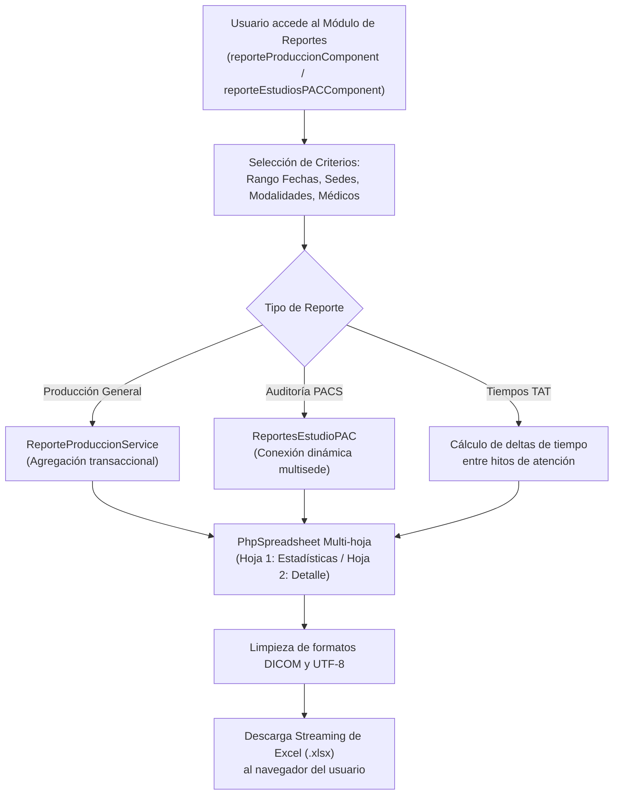

# Módulo: Reportes y Business Intelligence Clínico — LIDiag

## 1. Propósito y Alcance
El módulo de **Reportes y Business Intelligence Clínico** es el centro de analítica de datos, trazabilidad operativa y generación de informes ejecutivos de LIDiag. Ofrece exportación masiva multi-hoja en formato Excel (PhpSpreadsheet / Maatwebsite Excel) y tableros de indicadores clave de rendimiento (KPIs) sobre producción clínica, auditoría de imágenes PACS, tiempos de entrega (TAT), ausentismo en citas y utilización de infraestructura.

- **Reportes Disponibles en el Módulo:**
  1. *Reporte de Producción Detallada:* Desglose de cada estudio, ecografía y consulta con EPS, modalidad, valor y médico.
  2. *Reporte de Producción Consolidada:* Resumen agrupado por sede, modalidad y especialista.
  3. *Reporte de Estudios PACS:* Auditoría directa contra los servidores `dcm4chee` para conciliar imágenes versus informes.
  4. *Reporte de Tele-Radiología:* Volumen, sedes remitentes y tiempos de respuesta.
  5. *Reporte de Ausentismo y Cancelación de Citas:* Tasas de no-show por sede y motivo.
  6. *Reporte TAT (Turnaround Time):* Auditoría de tiempos de ciclo (Ingreso $\rightarrow$ Adquisición $\rightarrow$ Lectura $\rightarrow$ Entrega).
  7. *Reporte de Rendimiento de Agentes / Secretarias:* Actividad en admisiones y solicitudes.
  8. *Reporte Consolidado de Red:* Panorama integral multi-sede en un único libro.
  9. *Reporte de Almacenamiento DICOM:* Ocupación de discos de PACS por sede.

---

## 2. Estado del Desarrollo
**Estado:** `Operativo / Estable` (en producción activa; corrección reciente en reporte PACS multisede validada).

- **Completado e Implementado:**
  - Controlador central `ReporteProduccion.php` con endpoints dedicados para cada tipo de reporte.
  - Componente maestro `reporteProduccionComponent.vue` (197 KB) con múltiples filtros analíticos y gráficos integrados.
  - Exportador multi-hoja `ReportesEstudioPAC.php` con resolución dinámica de credenciales de sede (`ConfigSede`), timeout estricto de 5s y liberación `finally`.
  - Limpieza de formato DICOM en nombres (`APELLIDO^NOMBRE^^^^` $\rightarrow$ `APELLIDO NOMBRE`).
  - Detección inteligente de bloqueadores de popups en el frontend (`reporteEstudiosPACComponent.vue`) con prellenado automático de fechas del día.
  - Exportación de libros de cálculo con estilos institucionales y hojas separadas de "Estadísticas y Gráficas" y "Detalle de Registros".
- **En Observación / Próximos Pasos:**
  - Generación en segundo plano (vía colas) para reportes anuales que superen los 50.000 registros, con notificación por email al estar listo el archivo.

---

## 3. Funcionalidades Completas
- **Producción Clínica Integral (`reporteProduccionComponent.vue`):**
  - Filtros cruzados por sede, médico radiólogo/especialista, modalidad de imagen, EPS y rango de fechas.
  - Descarga consolidada o detallada línea por línea.
- **Auditoría de Imágenes PACS (`reporteEstudiosPACComponent.vue`):**
  - Cruce de imágenes adquiridas en servidores `dcm4chee` locales versus estudios informados en base de datos.
  - Validación de popups al abrir descarga con advertencia amigable.
- **Analítica de Citas y Ausentismo:**
  - Tasas de inasistencia (no-show) por motivo tipificado y sede.
- **Métricas de Rendimiento TAT:**
  - Tiempos de respuesta diagnóstica desde la toma hasta la entrega final al paciente.

---

## 4. Flujos de Trabajo

---

## 5. Componentes Técnicos (Backend y Frontend)

### 5.1 Backend (Laravel)
- **Controlador:** `app/Http/Controllers/Reportes/ReporteProduccion.php`.
- **Servicio:** `app/Services/Reportes/ReporteProduccionService.php` (35 KB).
- **Clases Exportadoras (`app/Exports/`):**
  - `ReportesEstudioPAC.php`, `Sheets/ReportesEstudioPACDetalleSheet.php`, `ReporteProduccionExport.php`, `ReporteTATExport.php`, `ReporteAgentesExport.php`, `ReporteAusentismoCitasExport.php`, `ReporteTeleRadiologiaExport.php`, `ReporteCitasWhatsAppExport.php`, `ReporteAlmacenamientoExport.php`, `ReporteConsolidadoRedExport.php`.
- **Rutas API y Descargas:** Endpoints en `routes/web.php` (`/descarga-reportes-*`) y `routes/api_agendamiento_dashboard.php` (`/api/reportes-*`).

### 5.2 Frontend (Vue 3 / AdminWrap)
- `reporteProduccionComponent.vue`: Interfaz analítica avanzada (197 KB) con filtros, KPIs y descarga de libros de producción.
- `reporteEstudiosPACComponent.vue`: Auditoría de estudios PACS multisede con prellenado de fechas y validación de popup blockers.

---

## 6. Interoperabilidad y Reglas de Negocio
- **Conexiones Dinámicas a PACS:** Prioriza estrictamente los parámetros de `ConfigSede` (`ip_dcm`, `puerto_dcm`, `bd_dcm`, `usuario_dcm`, `password_dcm`), dejando `config(...)` únicamente como fallback en caso de valores vacíos.
- **Normalización Temporal:** El rango de fechas abarca de forma robusta desde las `00:00:00` del primer día hasta las `23:59:59` del último día.
- **Segmentación por Permisos:** Protegido por permisos Spatie (`reportes.indicadores`, `reportes.detallados`, `reportes.produccion`).

---

## 7. Validaciones, Permisos y Pendientes
- **Límites de Memoria de PHP:** Se recomienda mantener `memory_limit = 512M` en `php.ini` de Laragon para exportaciones de alto volumen de datos.
- **Bloqueadores de Ventanas Emergentes:** El frontend detecta si el navegador del usuario bloqueó la apertura de la ventana de descarga y muestra una notificación orientativa.
