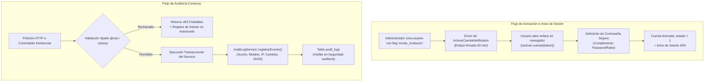

# Módulo: Seguridad, Auditoría y Control de Acceso — LIDiag

## 1. Propósito y Alcance
El módulo de **Seguridad, Auditoría y Control de Acceso** es la columna vertebral de gobierno, protección de datos y autenticación de LIDiag. Administra el modelo de control de acceso basado en roles y permisos (RBAC) con **Spatie Laravel Permission**, la gestión del ciclo de vida de usuarios con activación por correo electrónico, auditoría forense inmutable (`audit_logs`), monitoreo de copias de seguridad de bases de datos e imágenes, y autenticación para aplicaciones cliente mediante **Laravel Sanctum**.

- **Políticas de Autenticación:** Complejidad de contraseñas (`PasswordRules::nueva()`), forzado de cambio periódico (`ForcePasswordChange`) y restablecimiento por correo firmado.
- **Auditoría Forense:** Bitácora inmutable de operaciones sensibles conforme a requerimientos de la norma ISO/IEC 27001 para registros de salud.

---

## 2. Estado del Desarrollo
**Estado:** `Operativo / Estable` (en producción activa; flujo completo de activación por correo implementado recientemente).

- **Completado e Implementado:**
  - Creación de usuarios con flag `enviar_invitacion`: genera clave aleatoria interna temporal, estado inactivo (`0`) y despacha [`ActivarCuentaNotification.php`](file:///c:/laragon/www/lidiag/app/Notifications/Seguridad/ActivarCuentaNotification.php) con token firmado de 60 minutos.
  - Interfaz de activación definitiva de cuenta (`activar.blade.php`, `AccountActivationController.php`) que valida la nueva clave, marca `email_verified_at`, activa el usuario (`1`) y revoca tokens usados.
  - Botón de restablecimiento manual de contraseña desde la tabla de usuarios (`usuarioComponent.vue` $\rightarrow$ `UserController::enviarResetEmail`).
  - Matriz completa de roles y permisos Spatie con comandos `permissions:audit` y `sync:missing-permissions`.
  - Bitácora forense `audit_logs` con visor interactivo de diferencias JSON y contexto HTTP (IP, User-Agent, usuario).
  - Panel de monitoreo de copias de seguridad (`BackupMonitorController.php`) con ejecución manual de backups DB (`ejecutarBackupDb`).
  - Gestión de Tokens de Sedes para agentes edge (`TokenSedeController.php`) con descarga de configuración JSON (`descargarConfigJson`).
- **En Observación / Próximos Pasos:**
  - Habilitación opcional de Autenticación de Dos Factores (2FA / TOTP) mediante aplicaciones autenticadoras (Google Authenticator / Authy) para roles con privilegios de Administrador.

---

## 3. Funcionalidades Completas
- **Gestión Integral de Usuarios (`usuarioComponent.vue`):**
  - Asignación de roles, sedes autorizadas, estados de cuenta (activo/inactivo) y firmas digitales.
  - Creación de usuarios con invitación por correo (switch que oculta contraseñas manuales).
  - Botón de acción inline para envío de enlace de restablecimiento de contraseña.
- **Matriz de Permisos (RBAC) (`roleComponente.vue`):**
  - Configuración visual de privilegios por rol con árbol de permisos clasificados por módulo.
- **Perfil de Usuario (`usuarioPerfil.vue`):**
  - Cambio de contraseña personal y actualización de firma/foto con sincronización reactiva hacia el topbar vía bus Mitt (`usuarioPerfilActualizado`).
- **Auditoría Forense (`auditLogComponent.vue`):**
  - Registro inmutable de eventos (`index`, `eventos`) con filtros por modelo, usuario, acción y fechas.
- **Monitoreo de Backups (`backupMonitorComponent.vue`):**
  - Estado del último respaldo, tamaño, salud y descarga de agentes de respaldo DICOM.
- **Tokens de Sedes (`seguridadTokensComponent.vue`):**
  - Generación, revocación y exportación de archivos JSON de configuración para agentes edge.

---

## 4. Flujos de Trabajo

---

## 5. Componentes Técnicos (Backend y Frontend)

### 5.1 Backend (Laravel)
- **Controladores (`app/Http/Controllers/Seguridad/`, `Auth/`):**
  - `UserController.php`: CRUD de usuarios, actualización de perfil, activación y reseteo por email.
  - `RolController.php`: Roles y permisos Spatie.
  - `AuditLogController.php`: Bitácora forense y eventos de auditoría.
  - `BackupMonitorController.php`: Monitoreo y ejecución de backups.
  - `TokenSedeController.php`: Tokens para sedes y agentes edge.
  - `AccountActivationController.php`: Activación de cuenta por enlace firmado.
  - `ResetPasswordController.php`: Restablecimiento de credenciales.
- **Servicios (`app/Services/Seguridad/`):**
  - `UserService.php` (26 KB), `RolService.php`, `AuditLogService.php`, `TokenSedeService.php` (15 KB).
- **Form Requests (`app/Http/Requests/Seguridad/`):**
  - `StoreUserRequest.php`, `UpdateUserRequest.php`, `UpdateUserProfileRequest.php`, `RolAgregarRequest.php`, `RolActualizarRequest.php`, `AuditLogIndexRequest.php`, `CambiarPasswordRequest.php`, `ResetPasswordUserRequest.php`.
- **Comandos:** `AuditPermissions.php`, `SyncMissingPermissions.php`, `ResetPermissionCacheSafe.php`, `LidiagBackupCommand.php`.
- **Modelos:** `App\Models\User.php`, `App\Models\AuditLog.php`, `App\Models\Seguridad\TokenSede.php`.
- **Rutas API:** `routes/api_seguridad.php`.

### 5.2 Frontend (Vue 3 / AdminWrap)
- `usuarioComponent.vue`: Administración de usuarios con acciones inline de activación y reseteo por email.
- `roleComponente.vue`: Matriz visual de roles y permisos Spatie.
- `usuarioPerfil.vue`: Perfil del usuario autenticado con emisión de evento `usuarioPerfilActualizado` vía Mitt.
- `auditLogComponent.vue`: Visor de auditoría forense con visor de cambios JSON.
- `backupMonitorComponent.vue`: Tablero de monitoreo de respaldos.
- `seguridadTokensComponent.vue`: Administración de tokens de sedes satélites.

---

## 6. Interoperabilidad y Reglas de Negocio
- **Políticas de Complejidad:** Las contraseñas deben contener mínimo 8 caracteres, al menos una mayúscula, un número y un símbolo especial, impidiendo el uso de secuencias triviales.
- **Sincronización Reactiva de Avatar:** Al actualizar el perfil en `usuarioPerfil.vue`, se emite el evento global `usuarioPerfilActualizado` vía Mitt (`proxy.emitter`), refrescando en caliente el avatar en el topbar sin recargas de página.
- **Caché Spatie Segura:** El comando personalizado `php artisan permissions:cache-reset` mitiga los falsos negativos del comando nativo en entornos locales con `CACHE_DRIVER=file`.

---

## 7. Validaciones, Permisos y Pendientes
- **Permisos Spatie:**
  - `seguridad.usuarios.index`, `seguridad.usuarios.create`, `seguridad.usuarios.edit`, `seguridad.usuarios.destroy`, `seguridad.usuarios.show`.
  - `seguridad.roles.index`, `seguridad.roles.create`, `seguridad.roles.edit`, `seguridad.roles.destroy`, `seguridad.roles.show`.
  - `seguridad.auditoria.index`, `seguridad.backups.index`, `seguridad.backups.ejecutar`, `seguridad.tokens.index`, `seguridad.tokens.create`, `seguridad.tokens.revoke`.
- **Inmutabilidad:** La tabla `audit_logs` no cuenta con métodos de edición ni eliminación en sus controladores; los registros permanecen como prueba documental legal inalterable.
