# Módulo: Notificaciones Multicanal y Bot de Telegram — LIDiag

## 1. Propósito y Alcance
El módulo de **Notificaciones Multicanal y Bot de Telegram** gestiona los canales de comunicación asíncrona desatendida y alertas de estado crítico en LIDiag. Ofrece una pasarela bidireccional mediante la **Telegram Bot API** (con soporte para Long-Polling y Webhooks), resúmenes ejecutivos diarios (Daily Digest) dirigidos a directores médicos y coordinadores de sede, y notificaciones automáticas de contingencia operativa.

- **Canal de Alertas:** Entrega instantánea de notificaciones a través de la mensajería de Telegram para personal directivo, ingenieros de soporte y médicos de guardia.
- **Tipos de Mensajes Soportados:**
  1. *Alertas de Falla Crítica:* Caída de enlaces con PACS, fallos de conexión a SAHI o saturación de almacenamiento.
  2. *Resumen Diario de Producción (Daily Digest):* Reporte consolidado automático al inicio o fin de la jornada con estudios atendidos, pendientes y tiempos de ciclo.
  3. *Bot Interactivo de Consultas:* Comandos de Telegram para consultar el estado de sedes o volumen de pacientes.

---

## 2. Estado del Desarrollo
**Estado:** `Operativo / Estable` (en producción activa).

- **Completado e Implementado:**
  - Cliente de mensajería `TelegramService.php` (18 KB) con formateo seguro de Markdown/HTML y sanitización de caracteres especiales.
  - Procesador conversacional `TelegramBotHandlerService.php` (88 KB) con enrutamiento de comandos y validación de usuarios autorizados.
  - Endpoint receptor de webhooks (`TelegramWebhookController.php` en `/api/telegram/webhook`).
  - Modo Long-Polling desatendido para servidores locales o tras cortafuegos/NAT (`php artisan telegram:poll`).
  - Tarea programada de resumen diario de producción (`php artisan telegram:daily-digest`).
- **En Observación / Próximos Pasos:**
  - Adición de comandos interactivos para autorizar o desbloquear estudios desde el chat de Telegram mediante botones inline.

---

## 3. Funcionalidades Completas
- **Alertas de Contingencia e Infraestructura:**
  - Despacho inmediato ante excepciones de red, caídas de bases de datos o saturación de almacenamiento.
- **Resumen Ejecutivo Matutino (Daily Digest):**
  - Estadísticas consolidadas de producción entregadas directamente a los canales directivos al cierre o inicio de jornada.
- **Bot Conversacional de Consultas:**
  - Comandos interactivos para consultar volumen de pacientes en espera, estudios pendientes de lectura y estado de sedes.
- **Doble Modalidad de Escucha:**
  - Soporte tanto para webhooks públicos HTTPS como para polling continuo en redes privadas.

---

## 4. Flujos de Trabajo

```mermaid
flowchart TD
    subgraph "Generación de Alertas y Resúmenes"
        A["Hito Clínico o Evento del Sistema<br/>(Alerta / Fin de Turno / Cron)"] --> B["TelegramService::enviarMensaje()"]
        B --> C["Formateo Markdown / HTML Seguro<br/>(Normalización de caracteres especiales)"]
        C --> D["Despacho HTTP a Telegram Bot API<br/>(https://api.telegram.org/bot<TOKEN>/sendMessage)"]
        D --> E["Recepción en Canal o Grupo de Telegram Directivo"]
    end

    subgraph "Interacción del Bot (Polling o Webhook)"
        F["Usuario envía comando en Telegram<br/>(ej. /estado_sedes o /produccion_hoy)"] --> G{"Modo de Escucha"}
        G -->|"Polling Desatendido"| H["TelegramPollCommand<br/>(getUpdates loop con timeout)"]
        G -->|"Webhook"| I["TelegramWebhookController<br/>(Ruta pública segura)"]
        H --> J["TelegramBotHandlerService<br/>(Procesamiento de comandos y permisos)"]
        I --> J
        J --> K["Consulta a la BD de LIDiag"]
        K --> L["Respuesta Formateada al Chat del Usuario"]
    end
```

---

## 5. Componentes Técnicos (Backend y Frontend)

### 5.1 Backend (Laravel)
- **Controlador:**
  - `app/Http/Controllers/Telegram/TelegramWebhookController.php`: Receptor de webhooks entrantes de Telegram.
- **Servicios:**
  - `app/Services/Telegram/TelegramService.php`: Cliente HTTP y formateo de mensajes.
  - `app/Services/Telegram/TelegramBotHandlerService.php`: Procesador y enrutador de comandos conversacionales.
- **Comandos:**
  - `TelegramPollCommand.php`: Proceso daemon de consola para captura vía Long-Polling.
  - `TelegramDailyDigestCommand.php`: Compilación y despacho del informe diario de producción.
- **Rutas API:** `routes/api_telegram.php`.

### 5.2 Frontend
- Integración transversal transparente: las alertas operativas se despachan desde los controladores backend sin requerir componentes Vue dedicados.

---

## 6. Interoperabilidad y Reglas de Negocio
- **Lista Blanca de Usuarios:** El bot rechaza de forma predeterminada cualquier comando originado desde cuentas de Telegram que no figuren en la lista de identificadores autorizados.
- **Protección de Datos (Habeas Data):** Las alertas grupales en Telegram contienen únicamente métricas agregadas o identificadores anonimizados, preservando la confidencialidad médica de los pacientes.
- **Tolerancia a Caídas de Red:** Si la API de Telegram no responde, la excepción se captura en logs y el flujo clínico de LIDiag continúa sin interrupciones.

---

## 7. Validaciones, Permisos y Pendientes
- **Ejecución como Servicio en Windows:** Para mantener `telegram:poll` corriendo de forma ininterrumpida en Windows + Laragon, se recomienda configurarlo como servicio mediante NSSM o tarea programada de Windows.
