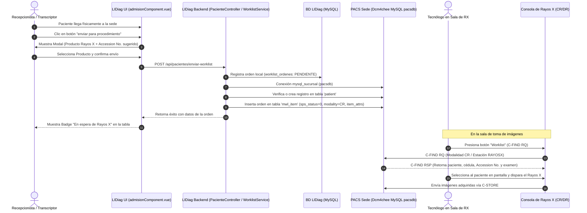

# Especificación y Flujo del Módulo Modality Worklist (LIDiag ➔ DCM / Dcm4chee)

## 1. Resumen Ejecutivo y Alcance

Este documento describe la arquitectura, flujo de datos, especificación funcional y técnica para la integración de **LIDiag (RIS)** con el servicio de **DICOM Modality Worklist (MWL - C-FIND)** de **DCM4CHEE (PACS)** en las diferentes sedes clínicas.

### Alcance de la Fase Inicial:
* **Modalidad inicial:** Rayos X Convencional (`CR` - Radiografía Computarizada / `DX` - Radiografía Digital).
* **Momento de Inserción:** Admisión física del paciente en la sede (cuando el paciente llega a la sala de espera para su examen).
* **Módulo de Gestión:** **Pacientes ➔ Admisión** (`/pacientes/admision`), accesible desde el menú principal de LIDiag.
* **Roles Autorizados:** **Administrador** y **Transcriptor**.
* **Acción Operativa:** Envío del paciente a la Worklist mediante el botón `title="enviar para procedimiento"`.

---

## 2. Diagrama de Arquitectura y Flujo de Trabajo

---

## 3. Especificación del Módulo Frontend (Pacientes ➔ Admisión)

### 3.1 Ubicación y Navegación
* **Ruta Web:** `/pacientes/admision`
* **Nombre de Ruta:** `gestion.pacientes.admision`
* **Menú Sidebar:** `resources/views/comunes/sidebar.blade.php` bajo la sección *"Pacientes ➔ Admisionar Paciente"*.
* **Permisos Spatie requeridos:** `gestion.pacientes.index`, `gestion.pacientes.create`, `gestion.pacientes.update`, `gestion.pacientes.delete`.

### 3.2 Componente Vue 3 (`admisionComponent.vue`)
Ubicación: `resources/js/components/modulos/pacientes/admisionComponent.vue`

#### Secciones del Componente:
1. **Encabezado y Acciones Principales:**
   * Título institucional: *"Admisión de Pacientes y Worklist"*.
   * Breadcrumbs de navegación.
   * Chip de Sede Activa (sincronizado con `sessionStorage` y EventBus `sedeSeleccionada`).
   * Botón *"Nuevo Paciente"* para desplegar el panel lateral de registro.
2. **Filtros de Búsqueda Colapsables (`useFilterPersistence`):**
   * Número de documento (búsqueda parcial o exacta).
   * Nombres / Apellidos.
   * Rango de fechas (Fecha Inicio - Fecha Fin).
   * Botón *"Buscar"* y Botón *"Limpiar"*.
3. **Tabla DataTable de Pacientes:**
   * Soporte para `TableSkeletonLoader.vue` durante la carga y `EmptyStateComponent.vue` cuando no hay registros.
   * Columnas:
     * **Tipo Doc:** (CC, TI, RC, CE, etc.).
     * **Documento:** Número de identificación.
     * **Nombre del Paciente:** Nombres y apellidos completos.
     * **Sexo / Edad:** Sexo clínico ('M'/'F') y cálculo determinista de edad.
     * **Contacto:** Teléfono o celular.
     * **Estado Worklist:** Badge visual dinámico:
       * `badge badge-warning`: *"En espera de Rayos X"* (si tiene orden generada en el día).
       * `badge badge-light`: *"Sin orden activa"*.
     * **Acciones:**
       * Botón **Editar** (`fa fa-pencil`): Abre el Right-Sidebar con los datos del paciente cargados.
       * Botón **"enviar para procedimiento"** (`fa fa-list-alt` / `fa fa-play-circle`, `title="enviar para procedimiento"`): Abre el modal de generación de Worklist.
       * Botón **"Retirar de Worklist"** (`fa fa-times text-danger`, condicional si tiene orden activa): Permite anular la orden y borrarla de la consola del equipo si el paciente no se realiza el examen.
4. **Modal "Enviar para procedimiento":**
   * Encabezado con datos del paciente seleccionado (Nombre completo, Documento, Sede).
   * **Producto de Rayos X:** Selector interactivo (`<select>`) cargado dinámicamente con los productos CUPS pertenecientes al servicio de Rayos X de la sede activa.
   * **Accession Number (Mixto):** Campo de texto pre-cargado automáticamente con un consecutivo sugerido único (formato `RX-YYYYMMDD-XXXX`), con posibilidad de ser editado por el operador en caso de requerir un número de orden física específico.
   * Botones: *"Cancelar"* y *"Confirmar Envío a Worklist"* con feedback visual de guardado (`fa fa-spinner fa-spin`).
5. **Right-Sidebar "Registrar / Editar Paciente":**
   * Formulario reactivo validado para creación/actualización:
     * Tipo de documento (`config_tipos_documentos`).
     * Número de documento (con verificación de duplicados).
     * Primer Nombre, Segundo Nombre, Primer Apellido, Segundo Apellido.
     * Sexo (`M` / `F`).
     * Fecha de Nacimiento (con normalización UTC-5).
     * Teléfono, Celular, Correo Electrónico y Dirección.
6. **Diseño Visual:**
   * Soporte 100% nativo para Modo Claro y Modo Oscuro radiológico (`body.theme-dark`).

---

## 4. Especificación del Backend y Conexión DICOM

### 4.1 Base de Datos LIDiag (Trazabilidad Local)
Tabla: `worklist_ordenes`
* `id`: BIGINT UNSIGNED AUTO_INCREMENT PRIMARY KEY.
* `paciente_id`: BIGINT UNSIGNED (FK a `pacientes.id`).
* `sede_id`: BIGINT UNSIGNED (FK a `config_sedes.id`).
* `producto_id`: BIGINT UNSIGNED (FK a `config_productos.id`).
* `accession_no`: VARCHAR(50) NOT NULL.
* `study_iuid`: VARCHAR(128) NOT NULL (Study Instance UID estándar DICOM).
* `modality`: VARCHAR(10) DEFAULT 'CR'.
* `station_aet`: VARCHAR(50) DEFAULT 'RAYOSX'.
* `mwl_item_pk`: BIGINT NULLABLE (PK del registro en `pacsdb.mwl_item` de Dcm4chee).
* `estado`: ENUM('PENDIENTE', 'CANCELADO', 'COMPLETADO') DEFAULT 'PENDIENTE'.
* `usuario_id`: BIGINT UNSIGNED (FK a `users.id` - usuario que admitió al paciente).
* `observaciones`: TEXT NULLABLE.
* `created_at` / `updated_at`: TIMESTAMPS.

### 4.2 Servicio DICOM Worklist (`WorklistService.php`)
Ubicación: `app/Services/Dcm4chee/WorklistService.php`

#### Flujo del Proceso de Inserción en Dcm4chee:
1. **Conexión a la Sede:** Configura dinámicamente la conexión `mysql_sucursal` usando los datos de `ConfigSede` (`ip_dcm`, `bd_dcm`, `puerto_dcm`, `usuario_dcm`, `password_dcm`).
2. **Generación de UIDs:**
   * **Accession Number:** `RX-` + Fecha actual (`YYYYMMDD`) + Consecutivo del día formateado a 4 dígitos.
   * **Study Instance UID:** Raíz estándar DICOM basada en prefijo ISO clínico + timestamp microsegundos + sufijo aleatorio seguro.
3. **Sincronización en tabla `patient` de Dcm4chee:**
   * Consulta si el paciente ya existe en `pacsdb.patient` mediante `pat_id = $paciente->num_docu`.
   * Si existe, reutiliza su `patient.pk`.
   * Si no existe, inserta en `patient`:
     * `pat_id`: `$paciente->num_docu`.
     * `pat_name`: Formato DICOM estándar `APELLIDO1 APELLIDO2^NOMBRE1 NOMBRE2`.
     * `pat_birthdate`: Formato DICOM `YYYYMMDD`.
     * `pat_sex`: `'M'` o `'F'`.
     * `created_time`: `NOW()`.
4. **Inserción en tabla `mwl_item` de Dcm4chee:**
   * `patient_fk`: PK del paciente en Dcm4chee.
   * `sps_status`: `0` (SCHEDULED).
   * `sps_id`: `$accession_no`.
   * `start_datetime`: Fecha y hora actual (`YYYY-MM-DD HH:MM:SS`).
   * `station_aet`: `'RAYOSX'` (o el configurado para la sala).
   * `station_name`: `'SALA RAYOS X'`.
   * `modality`: `'CR'` (con soporte para `'DX'`).
   * `req_proc_id`: Código CUPS del producto o ID interno.
   * `accession_no`: `$accession_no`.
   * `study_iuid`: `$study_iuid`.
   * `item_attrs`: Dataset DICOM binario codificado en Little Endian Explicit VR conteniendo los atributos estándar requeridos por la norma DICOM PS 3.4 (Worklist Information Model).
5. **Persistencia en LIDiag:**
   * Guarda el registro en `worklist_ordenes` en la BD de LIDiag vinculando el `mwl_item_pk` retornado.
6. **Cancelación / Retiro de Worklist:**
   * Al invocar la cancelación, localiza el registro en `pacsdb.mwl_item` de la sede y lo elimina o marca con estado discontinuado, actualizando la orden local a `CANCELADO`.

### 4.3 Servicio de Pacientes (`PacienteService.php`)
Ubicación: `app/Services/Pacientes/PacienteService.php`
* Centraliza las operaciones CRUD de pacientes con validaciones de unicidad de documento.
* Agrega a cada paciente de la consulta el estado de sus órdenes de trabajo del día actual.

### 4.4 Controlador Delgado (`PacienteController.php`)
Ubicación: `app/Http/Controllers/Pacientes/PacienteController.php`
* Inyecta `PacienteService` y `WorklistService`.
* Métodos:
  * `listar(PacienteIndexRequest $request)`
  * `store(PacienteStoreRequest $request)`
  * `show($id)`
  * `update(PacienteUpdateRequest $request, $id)`
  * `destroy($id)`
  * `obtenerAccessionSugerido(Request $request)`
  * `enviarWorklist(WorklistEnviarRequest $request)`
  * `cancelarWorklist(WorklistCancelarRequest $request)`

---

## 5. Configuración en la Consola del Equipo de Rayos X (Sedes)

Para que el equipo de Rayos X de la sede consulte con éxito las órdenes creadas en LIDiag, el personal técnico debe parametrizar en el software de adquisición de Rayos X los siguientes datos:

| Parámetro en Consola RX | Valor a Configurar | Observaciones |
| :--- | :--- | :--- |
| **Service / Rol** | DICOM Modality Worklist (MWL / C-FIND SCU) | Servicio de lista de trabajo. |
| **Called AE Title** | `DCM4CHEE` | AE Title del PACS local de la sede. |
| **Server IP Address** | `ip_dcm` de la sede (ej. `10.35.47.3`) | Dirección IP del servidor PACS local en la LAN. |
| **Port** | `11112` (o `104`) | Puerto DICOM configurado en Dcm4chee. |
| **Modality Filter** | `CR` (o `DX` / `Cualquiera`) | Coincide con la modalidad enviada por LIDiag. |
| **Station AE Title Filter** | `RAYOSX` (o dejar vacío / `*`) | Identificador de estación. |

---

## 6. Lista de Verificación y Aseguramiento de Calidad (DoD)

- [ ] **Estilo de Código PHP:** Validación obligatoria con `vendor\bin\pint.bat --test` (0 errores de formato y LF).
- [ ] **Estilo de Código JS/Vue:** Validación con `npx eslint` sobre los componentes creados.
- [ ] **Compilación Vite:** `npm run build` exitoso sin advertencias de dependencias.
- [ ] **Tolerancia a Fallos:** Si la conexión a la base de datos Dcm4chee de la sede experimenta timeout o caída, LIDiag responde con mensaje controlado mediante `BaseService::error()` sin excepciones 500 no capturadas.
- [ ] **Persistencia de Documentación:** Actualización de `MEMORY.md` y `docs/CONTROLLERS.md` tras completar la implementación.
