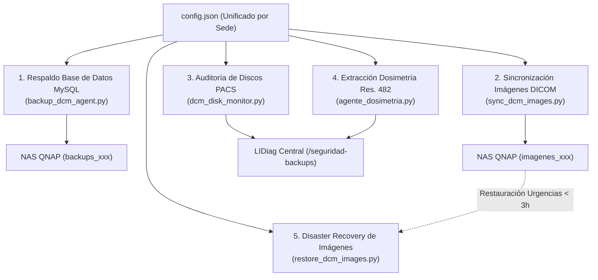

# LIDiag — Paquete Unificado de Agentes PACS DCM y Dosimetría por Sede

Solución integral y autónoma de grado clínico para servidores hospitalarios de PACS / DCM (dcm4chee) en la red asistencial de **LIDiag**.  
Este paquete agrupa bajo un único entorno (`venv`) y un único archivo de configuración (`config.json`) los servicios esenciales de resiliencia, monitoreo y radioprotección hospitalaria:



---

## 📚 Documentación Técnica por Agente

Cada agente cuenta con su propio manual técnico especializado con tablas de argumentos CLI, parámetros y comandos de diagnóstico:

| Agente / Servicio | Guía Específica | Script Principal | Lanzador `.bat` | Frecuencia / Modo |
| :--- | :--- | :--- | :--- | :--- |
| **1. Respaldo BD MySQL (`pacsdb`)** | 📖 [README_BACKUP_DB.md](README_BACKUP_DB.md) | `backup_dcm_agent.py` | `ejecutar_backup_db.bat` | Diaria (02:00 AM) |
| **2. Sincronización Imágenes DICOM** | 📖 [README_SYNC_IMAGENES.md](README_SYNC_IMAGENES.md) | `sync_dcm_images.py` | `ejecutar_sync_imagenes.bat` | Continua en 2º plano (cada 3 min) |
| **3. Monitoreo de Discos PACS** | 📖 [README_DISK_MONITOR.md](README_DISK_MONITOR.md) | `dcm_disk_monitor.py` | `ejecutar_disk_monitor.bat` | Periódica (cada 30 min) |
| **4. Extracción Dosimetría (Res. 482)** | 📖 [README_DOSIMETRIA.md](README_DOSIMETRIA.md) | `agente_dosimetria.py` | `ejecutar_dosimetria.bat` | Horaria (cada 1 hora) |
| **5. Recuperación ante Desastres** | 📖 [README_RESTORE_IMAGENES.md](README_RESTORE_IMAGENES.md) | `restore_dcm_images.py` | `ejecutar_restore_imagenes.bat` | Manual interactivo (Emergencias) |

---

## 📁 Estructura del Directorio del Paquete

```text
C:\agente_backups_dcm\
│
├── config.json                     # Configuración activa de la sede hospitalaria
├── config.json.example             # Plantilla de referencia para configuración
├── install.bat                     # Instalador en 1 clic del entorno virtual (venv)
├── requirements.txt                # Dependencias Python requeridas (pydicom, requests, etc.)
├── instalar_tareas_sede.bat        # Registra las 4 tareas en el Programador de Tareas (SYSTEM)
│
├── backup_dcm_agent.py             # Script: Respaldo MySQL + ZIP + CRC32 + SHA256 + QNAP
├── ejecutar_backup_db.bat          # Lanzador por lotes de respaldo MySQL
│
├── sync_dcm_images.py              # Script: Replicación continua de imágenes Robocopy
├── ejecutar_sync_imagenes.bat       # Lanzador por lotes de sincronización de imágenes
│
├── dcm_disk_monitor.py             # Script: Monitoreo de espacio en discos y telemetría Central
├── ejecutar_disk_monitor.bat       # Lanzador por lotes de auditoría de discos
│
├── agente_dosimetria.py            # Script: Extracción dosimétrica + HMAC-SHA256 + Cola SQLite
├── ejecutar_dosimetria.bat         # Lanzador por lotes de dosimetría
│
├── restore_dcm_images.py           # Script: Disaster Recovery cronológico inverso
├── ejecutar_restore_imagenes.bat   # Asistente interactivo guiado de restauración
│
├── README.md                       # Índice maestro y guía de despliegue institucional
├── README_BACKUP_DB.md             # Manual detallado del agente de respaldo de base de datos
├── README_SYNC_IMAGENES.md         # Manual detallado del agente de sincronización de imágenes
├── README_DISK_MONITOR.md          # Manual detallado del agente de monitoreo de discos
├── README_DOSIMETRIA.md            # Manual detallado del agente de dosimetría radiológica
├── README_RESTORE_IMAGENES.md      # Manual detallado del agente de recuperación de desastres
│
└── logs\                           # Bitácoras operativas y colas transaccionales
    ├── backup_db.log
    ├── sync_imagenes.log
    ├── robocopy_scan.log
    ├── dcm_monitor.log
    ├── dosimetria_agent.log
    └── cola_dosimetria.db          # Cola persistente SQLite con tolerancia a desconexión
```

---

## 🚀 Guía Rápida de Despliegue en el Servidor PACS (1 Clic)

### Paso 1: Preparar el Entorno Aislado
1. Asegúrate de tener Python 3.10+ instalado en el servidor Windows.
2. Ejecuta **`install.bat`**: Detectará Python, creará el entorno virtual aislado (`venv`) e instalará automáticamente todas las dependencias requeridas desde `requirements.txt`.

### Paso 2: Generar y Descargar `config.json` desde LIDiag Central

Para garantizar la seguridad de la red y evitar tokens desactualizados, genera la credencial desde la plataforma web:

1. Inicia sesión en LIDiag con un usuario administrador.
2. Dirígete a **Administración → Seguridad → Tokens de Sedes** (o `https://<servidor_central>/seguridad-tokens`).
   > *Nota de Seguridad:* La vista lista exclusivamente las sedes hospitalarias activas. Los tokens M2M emitidos para los agentes Edge son de duración permanente (`SANCTUM_EXPIRATION=null`), evitando desconexiones involuntarias en tareas de fondo y rotándose únicamente bajo demanda administrativa.
3. Ubica la sede correspondiente y haz clic en **`Generar`** (o **`Rotar`**).
4. En el modal resultante, haz clic en **`Descargar config.json`**.
5. Transfiere el archivo a la carpeta del servidor (`C:\agente_backups_dcm\config.json`) y complementa las contraseñas locales de MySQL y la NAS QNAP.

### Paso 3: Registrar Tareas Programadas de Windows
Ejecuta el asistente de automatización con privilegios de Administrador:
```powershell
.\instalar_tareas_sede.bat
```
Este script registrará automáticamente las 4 tareas operativas bajo la cuenta de sistema `NT AUTHORITY\SYSTEM`:
* `LIDiag_Backup_DB_DCM` (Diaria a las 02:00 AM)
* `LIDiag_Sync_Imagenes_DCM` (Al inicio del sistema, persistente)
* `LIDiag_Disk_Monitor_DCM` (Cada 30 minutos)
* `LIDiag_Dosimetria_Edge` (Cada 1 hora)

---

## 🏥 Catálogo Oficial de Sedes Hospitalarias (`sede_id`)

| `sede_id` | Código | Municipio / Sede | Institución Hospitalaria | `sede_nombre` | Recurso QNAP Backups | Recurso QNAP Imágenes |
| :---: | :---: | :--- | :--- | :--- | :--- | :--- |
| **`1`** | `ESP` | Espinal | Hospital San Rafael E.S.E. | `"Espinal"` | `backups-db-espinal` | `img-dicom-espinal` |
| **`2`** | `LAD` | La Dorada | Hospital San Félix E.S.E. | `"La Dorada"` | `backups-db-ladorada` | `img-dicom-ladorada` |
| **`3`** | `CHA` | Chaparral | Hospital San Juan Bautista E.S.E. | `"Chaparral"` | `backups-db-chaparral` | `img-dicom-chaparral` |
| **`4`** | `IBA` | Ibagué | Hospital Federico Lleras Acosta E.S.E. | `"Ibague"` | `backups-db-ibague` | `img-dicom-ibague` |
| **`5`** | `LIB` | Líbano | Hospital Regional Alfonso Jaramillo Salazar E.S.E. | `"Libano"` | `backups-db-libano` | `img-dicom-libano` |
| **`6`** | `HON` | Honda | Hospital San Juan de Dios de Honda E.S.E. | `"Honda"` | `backups-db-honda` | `img-dicom-honda` |
| **`7`** | `ROV` | Rovira | Hospital San Vicente E.S.E. | `"Rovira"` | `backups-db-rovira` | `img-dicom-rovira` |

---

## 🔍 Inspección y Monitoreo Unificado de Salud

El agente escribe periódicamente archivos JSON de telemetría local y remota que alimentan los paneles de control de LIDiag (`/seguridad-backups` y `/seguridad-tokens`):

```powershell
# 1. Manifiesto consolidado en tiempo real con el estado de salud de los agentes:
Get-Content .\healthcheck_agente.json | ConvertFrom-Json | Format-List

# 2. Monitorear las bitácoras operativas en simultáneo desde PowerShell:
Get-Content .\logs\backup_db.log -Tail 10
Get-Content .\logs\sync_imagenes.log -Tail 10
Get-Content .\logs\dcm_monitor.log -Tail 10
Get-Content .\logs\dosimetria_agent.log -Tail 10

# 3. Consultar el estado de las 4 tareas programadas de Windows:
schtasks /query /tn "LIDiag_Backup_DB_DCM" /fo TABLE
schtasks /query /tn "LIDiag_Sync_Imagenes_DCM" /fo TABLE
schtasks /query /tn "LIDiag_Disk_Monitor_DCM" /fo TABLE
schtasks /query /tn "LIDiag_Dosimetria_Edge" /fo TABLE
```
