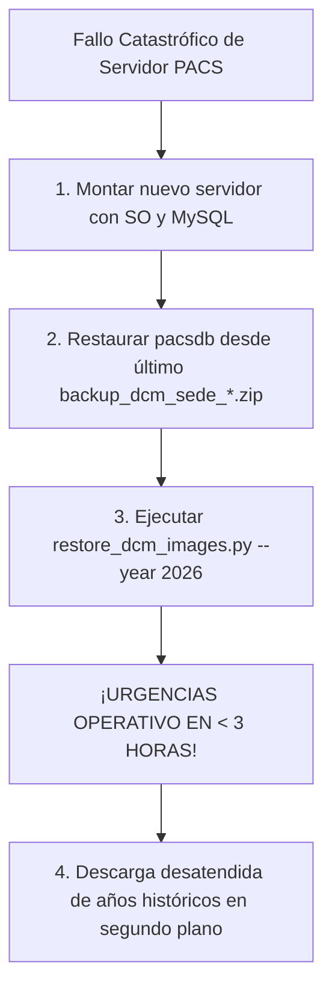

# LIDiag — Agente de Recuperación ante Desastres de Imágenes DICOM (Disaster Recovery)

Script principal: **`restore_dcm_images.py`**  
Lanzador por lotes: **`ejecutar_restore_imagenes.bat`**  
Uso: **Manual interactivo o por comando ante emergencias técnicas**  
Objetivo RTO: **Reanudación del servicio de urgencias en < 3 horas**  

---

## 1. Descripción y Propósito Clínico

El Agente de Recuperación ante Desastres es la herramienta diseñada para responder ante fallos catastróficos de hardware, corrupción irreparable de disco o reinstalación del sistema operativo en el servidor PACS local de la sede hospitalaria.

### Capacidades Principales:
* **Estrategia Cronológica Descendente (Prioridad Clínica Inversa):**
  A diferencia de las restauraciones convencionales (que copian en orden alfabético o de los años más viejos a los más nuevos), este agente restaura las imágenes desde la NAS QNAP hacia el servidor PACS en **orden cronológico descendente**:
  $$\mathbf{2026} \longrightarrow \mathbf{2025} \longrightarrow \mathbf{2024} \longrightarrow \mathbf{2023} \dots$$
* **Continuidad Asistencial en Menos de 3 Horas:**
  En cuanto finaliza la restauración del año en curso (`2026`), los médicos de urgencias, hospitalización y UCI pueden abrir inmediatamente los estudios recientes en el visor DICOM (Oviyam/OHIF), mientras los datos históricos continúan descargándose en segundo plano sin interrumpir la atención.
* **100% Reanudable (Resilient Sync):**
  Si la conexión de red se interrumpe, se reinicia el equipo o se cancela el proceso, al relanzarlo Robocopy detecta los archivos ya transferidos e inmediatamente continúa desde el punto exacto donde quedó, sin duplicar transferencias.
* **Descarga Multi-hilo de Alto Rendimiento:**
  Soporta de 8 a 32 subprocesos concurrentes (`/MT:16` a `/MT:32`) para aprovechar al máximo las tarjetas de red de 1 GbE o 10 GbE.
* **Asistente Guiado por Lotes (`ejecutar_restore_imagenes.bat`):**
  Menú interactivo en consola para administradores de guardia sin necesidad de recordar parámetros complejos.

---

## 2. Flujo Completo de Recuperación ante Desastres

Ante un cambio o reemplazo completo de servidor, sigue estos dos pasos:



### Paso 1: Restaurar la Base de Datos MySQL (`pacsdb`)
1. Localiza el último archivo `backup_dcm_sede_{id}_{slug}_{timestamp}.zip` en la carpeta `backups_xxx` de la NAS QNAP.
2. Descomprímelo para obtener el volcado `.sql`.
3. Impórtalo en MySQL:
   ```powershell
   mysql -u root -p pacsdb < backup_pacsdb_20261104.sql
   ```

### Paso 2: Restaurar las Imágenes DICOM
1. Ejecuta el asistente interactivo o el comando de restauración del año actual:
   ```powershell
   python restore_dcm_images.py --year 2026
   ```
2. Inicia el servicio dcm4chee. Los médicos ya pueden diagnosticar los estudios del año actual.
3. Lanza la restauración completa de los años anteriores en segundo plano:
   ```powershell
   python restore_dcm_images.py --from-year 2020
   ```

---

## 3. Configuración en `config.json`

El script utiliza las rutas de la NAS y del disco local definidas en el archivo unificado `config.json`:

```json
{
  "sede_id": 1,
  "sede_nombre": "Espinal",
  "qnap_ip": "10.35.47.21",
  "qnap_user": "sede_espinal",
  "qnap_password": "PASSWORD_QNAP_AQUI",
  "qnap_share_imagenes": "img-dicom-espinal",
  "local_images_dir": "D:\\img_dcm"
}
```

### Sedes Activas y Configuración de Shares:
* **Sede 1 — Espinal:** `img-dicom-espinal`
* **Sede 2 — Purificación:** `img-dicom-purificacion`
* **Sede 3 — Líbano:** `img-dicom-libano`
* **Sede 4 — Honda:** `img-dicom-honda`
* **Sede 5 — Chaparral:** `img-dicom-chaparral`
* **Sede 6 — Lérida:** `img-dicom-lerida`
* **Sede 7 — Ibagué:** `img-dicom-ibague`

---

## 4. Tabla de Argumentos de Línea de Comandos

| Argumento | Tipo | Valor por Defecto | Descripción |
| :--- | :---: | :---: | :--- |
| `--config`, `-c` | `str` | `config.json` | Ruta al archivo de configuración JSON. |
| `--year`, `-y` | `str` | `None` | Restaura **exclusivamente** el año indicado (ej. `--year=2026`). |
| `--from-year` | `str` | `None` | Restaura en orden descendente desde el año actual hasta el año límite indicado (ej. `--from-year=2024` restaura 2026, 2025 y 2024). |
| `--threads`, `-t` | `int` | `16` | Hilos concurrentes de Robocopy para descarga masiva (`/MT:16` a `/MT:32`). |
| `--dry-run` | `flag` | `False` | **Modo Simulación:** Escanea el QNAP y calcula el volumen a restaurar sin copiar ningún archivo. |

---

## 5. Comandos de Ejecución y Pruebas

```powershell
# 1. Asistente interactivo guiado por menú
.\ejecutar_restore_imagenes.bat

# 2. Restauración completa de todos los años disponibles en la NAS en orden descendente
python restore_dcm_images.py

# 3. Restaurar con máxima prioridad únicamente el año actual (para abrir urgencias de inmediato)
python restore_dcm_images.py --year 2026

# 4. Restaurar desde el año actual hasta un año límite histórico (ej: 2026 a 2024)
python restore_dcm_images.py --from-year 2024

# 5. Acelerar la descarga en enlaces de alta velocidad forzando 32 hilos
python restore_dcm_images.py --year 2026 --threads 32

# 6. Modo simulación (audita qué carpetas y volúmenes existen en la NAS sin descargar nada)
python restore_dcm_images.py --dry-run
```

---

## 6. Diagnóstico y Monitoreo durante la Restauración

```powershell
# 1. Monitorear el progreso en tiempo real de la copia de Robocopy:
Get-Process -Name robocopy | Format-Table Id, ProcessName, CPU, WorkingSet

# 2. Verificar el log de la restauración:
Get-Content .\logs\restore_imagenes.log -Wait -Tail 30

# 3. Verificar el espacio disponible en el disco local destino (D:):
Get-PSDrive D | Select-Object Used, Free, @{Name="FreeGB";Expression={[math]::round($_.Free/1GB,2)}}

# 4. Probar conectividad con la NAS QNAP antes de iniciar:
Test-NetConnection -ComputerName 10.35.47.21 -Port 445
```
